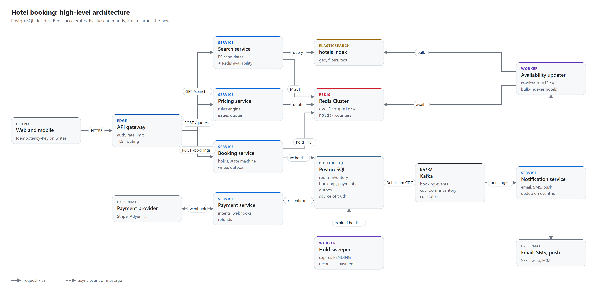

# System design practice

Worked system designs for large systems, grouped by category. Each one is written the way you would
present it in a 45-minute interview: requirements with real numbers, a capacity estimate with the
arithmetic shown, the API, real table definitions, cache keys and topics, an architecture diagram, the
request flows, deep dives into the hard parts, a failure table, trade-offs and the follow-up questions you
are likely to get.

The designs share one vocabulary and one default toolbox, so after reading two of them the rest go faster:

| Store | Role |
|---|---|
| PostgreSQL | Source of truth: anything involving money or a promise to a customer, inside a transaction |
| Redis | Speed and short-lived state: caches, holds, quotes, counters, dedup markers, rate limits |
| Elasticsearch | Search: geo, filters, full text, ranking; an eventually consistent copy |
| Kafka | Events between services, retries, change data capture; partitioned by entity id |

Where a design uses something else (a wide-column store for chat messages, an OLAP store for click
analytics), it says why.

<picture>
  <source media="(prefers-color-scheme: dark)" srcset="designs/booking-and-commerce/hotel-booking/diagrams/architecture-dark.png">
  
</picture>

## Start here

1. Read [the interview framework](guides/interview-framework.md): the six steps and how long each takes.
2. Keep [the estimation cheat sheet](guides/estimation-cheat-sheet.md) open while you practise.
3. Skim [the building blocks](guides/building-blocks.md): outbox, sagas, idempotency keys, conditional
   updates, cache patterns. The designs reference them by name.
4. Pick a design. Try it yourself first with a timer, using only its requirements section. Then read the
   rest and compare.

## Designs

| Category | Design | Difficulty | Core problems |
|---|---|---|---|
| Foundations | [URL shortener](designs/foundations/url-shortener/README.md) | Easy | ID generation, read-heavy caching, click analytics |
| Infrastructure | [Distributed rate limiter](designs/infrastructure/rate-limiter/README.md) | Medium | Algorithms, atomic counters at 1M rps, fail-open vs fail-closed |
| Booking and commerce | [Hotel booking platform](designs/booking-and-commerce/hotel-booking/README.md) | Medium to hard | No double booking, idempotent payments, stale search, suppliers, campaigns |
| Social and feeds | [News feed](designs/social-and-feeds/news-feed/README.md) | Hard | Fan-out on write vs read, celebrities, timeline caches |
| Messaging and real-time | [Chat system](designs/messaging-and-realtime/chat/README.md) | Hard | WebSocket fleets, ordering, multi-device delivery, presence |
| Location-based | [Ride-hailing](designs/location-based/ride-hailing/README.md) | Hard | Geo index at 1M updates/s, matching without double assignment, surge |

### Coming next

Each category grows over time. Planned, in rough order:

- **Booking and commerce:** flash sale and ticketing, payment system, shopping cart and checkout
- **Foundations:** unique ID generator, key-value store, distributed cache
- **Infrastructure:** distributed job scheduler, notification system, metrics and monitoring
- **Social and feeds:** search autocomplete, video streaming, comments and reactions
- **Messaging and real-time:** live comments, collaborative editing, webhook delivery
- **Location-based:** proximity search (nearby places), food delivery

## How each design is laid out

Every chapter follows [the same template](template/DESIGN_TEMPLATE.md):

1. A three-sentence answer at the top. If the interviewer stopped you there, they would know your design.
2. Requirements: functional, non-functional, out of scope, scale.
3. Capacity estimate with the arithmetic and what it means for the design.
4. API, then the data model: SQL tables, Redis keys with TTLs, Kafka topics with partition keys.
5. Architecture diagram and request flows, with sequence diagrams where order matters.
6. Deep dives on the parts an interviewer will push on.
7. Failure cases, trade-offs, likely follow-up questions, and a few phrases worth using.

## Repository layout

```text
designs/<category>/<system>/README.md        one design
designs/<category>/<system>/diagrams/        diagram specs (*.diagram.json) and rendered PNGs
guides/                                      framework, estimation numbers, building blocks
template/DESIGN_TEMPLATE.md                  skeleton for a new design
tools/render-diagrams.mjs                    JSON spec -> light and dark PNG via headless Chrome
tools/check-docs.mjs                         link and diagram checks, run in CI
```

## Diagrams

Diagrams are small JSON files rendered to PNG, one light and one dark version, so they stay editable in a
pull request and look the same everywhere. The format is in [tools/DIAGRAMS.md](tools/DIAGRAMS.md).

```sh
node tools/render-diagrams.mjs                # needs Node 20+ and Chrome or Edge
node tools/check-docs.mjs
```

## Contributing

Corrections, better numbers and new designs are welcome. See [CONTRIBUTING.md](CONTRIBUTING.md).

## License

[MIT](LICENSE). Use the designs for your own preparation, teaching or team training.
