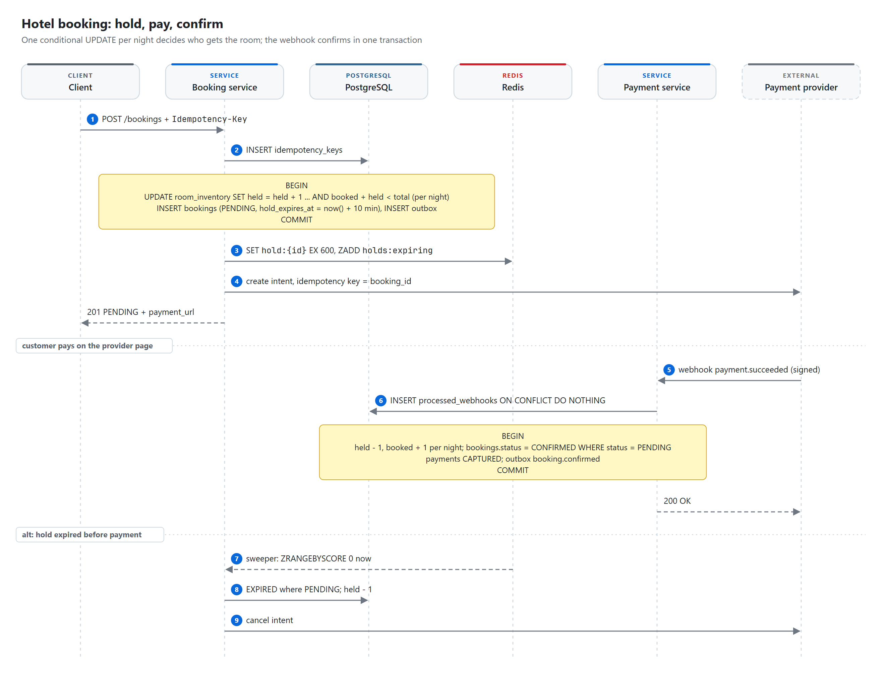
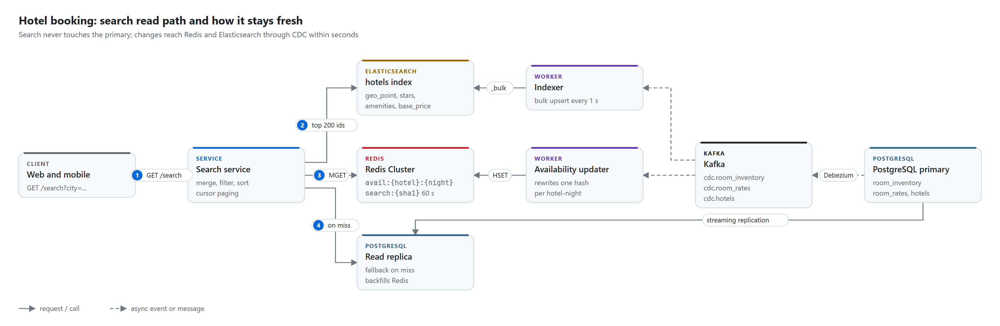
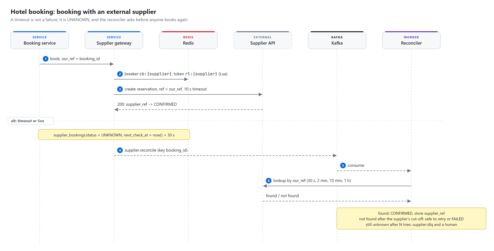
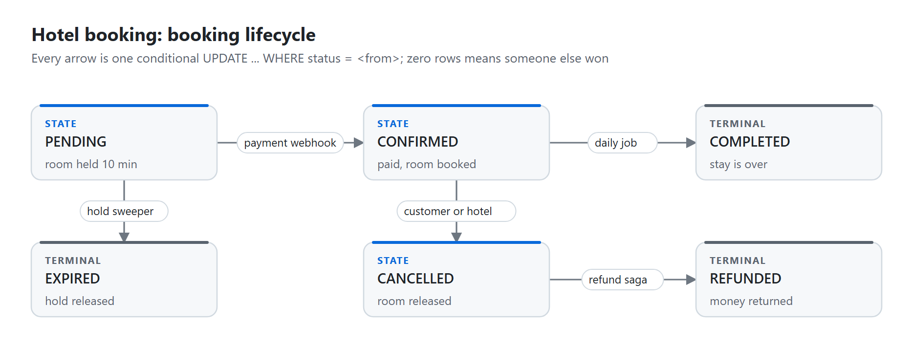

# Hotel booking platform

> **A room-night is held for 10 minutes by one conditional `UPDATE` in PostgreSQL, then confirmed in the
> same transaction that records the payment result, so the database (not a cache, not a lock service)
> decides who gets the last room.** Search runs on Elasticsearch plus a Redis copy of availability that CDC
> keeps a few seconds behind, which is fine because the booking step re-checks PostgreSQL. Every external
> call (payment provider, hotel supplier) carries our own booking id, so a retry or a timeout never creates
> a second booking, and a reconciler settles anything left unknown.

| Category | Difficulty | Interview length | Core problems |
|---|---|---|---|
| Booking and commerce | Medium to hard | 45 to 60 min | contention on the last room, idempotent payments, stale search, external suppliers |

**Contents:** [Requirements](#1-requirements) · [Capacity](#2-capacity-estimate) · [API](#3-api) ·
[Data model](#4-data-model) · [Architecture](#5-high-level-architecture) · [Flows](#6-request-flows) ·
[Deep dives](#7-deep-dives) · [Failures](#8-failure-cases) · [Trade-offs](#9-trade-offs) ·
[Follow-ups](#10-likely-follow-ups)

This chapter is the long one in the repo on purpose: a booking platform touches most of the patterns the
other chapters use (conditional writes, idempotency keys, outbox, CDC, sagas, quotas), so it doubles as a
reference for them.

## 1. Requirements

**Functional**

- Search hotels by city or map area, dates, guests, price, stars, amenities, free cancellation.
- See a price for a room type and dates, and keep that price for 15 minutes.
- Book a room type for a date range, pay through an external provider, get a confirmation.
- Cancel within the hotel's policy and get a refund.
- Receive email, SMS or push for every state change; the hotel is notified too.
- Some inventory belongs to external suppliers (chains, wholesalers) and must be booked through their APIs.

**Non-functional**

- Never sell the same room type on the same night more times than its count. This is the one hard rule.
- Search p99 under 300 ms. Availability in search results may be a few seconds stale.
- Booking is strongly consistent. Payment is external and can take seconds, or never answer.
- A client retry, a webhook redelivery or a supplier timeout never produces a second booking or charge.
- 99.95% availability for search; booking may degrade to "try again" but must never be wrong.

**Out of scope**

- Hotel-side management UI (rate loading, photos), loyalty programs, reviews, fraud scoring. Mention them,
  do not design them.

**Scale**

- 1M hotels, about 5 room types each.
- 5M searches per day, 500K bookings per day, a 10x peak during campaigns and holidays.
- Inventory and prices kept for the next 365 nights.

## 2. Capacity estimate

| Quantity | Arithmetic | Result | So what |
|---|---|---|---|
| Booking writes | 500K / 86,400 s | ~6/s avg, ~60/s peak | One PostgreSQL primary handles this easily |
| Search reads | 5M / 86,400 s | ~60/s avg, ~600/s peak | Must not reach PostgreSQL; ES + Redis |
| Availability lookups | 600 searches/s x 200 hotels x 3 nights | ~360K keys/s at peak | Pipelined `MGET`, Redis Cluster with a few shards |
| `room_inventory` rows | 1M hotels x 5 types x 365 nights | ~1.8B rows, ~150 GB | Shard or partition by `hotel_id`; drop past nights |
| Redis availability | 1M hotels x 180 nights x ~200 B | ~36 GB | Keep only the next 180 nights hot |
| Booking rows | 500K/day x ~1 KB | 0.5 GB/day, ~180 GB/year | Partition `bookings` by month for archiving |
| Hot row contention | flash sale, 5,000 people, 1 hotel | thousands of updates on one row | See [deep dive 7.1](#71-reservation-core-no-double-booking) |

The write volume is small. The design problem is correctness under contention and under unreliable
external systems, not throughput.

## 3. API

```http
GET  /search?city=istanbul&check_in=2026-11-12&check_out=2026-11-15&guests=2
            &min_price=50&max_price=200&stars=4,5&amenities=pool&sort=price&cursor=...
-> 200 { "hotels": [ { "hotel_id": 42, "name": "...", "min_price": 89.00, "rooms_left": 3 } ],
         "next_cursor": "..." }

POST /quotes
{ "hotel_id": 42, "room_type_id": 7, "check_in": "2026-11-12", "check_out": "2026-11-15", "coupon": "WINTER30" }
-> 201 { "quote_id": "q_9f3", "total": 267.00, "currency": "EUR", "breakdown": [...], "expires_at": "..." }

POST /bookings                       Idempotency-Key: <uuid>
{ "hotel_id": 42, "room_type_id": 7, "check_in": "2026-11-12", "check_out": "2026-11-15",
  "guests": 2, "quote_id": "q_9f3" }
-> 201 { "booking_id": 1001, "status": "PENDING", "payment_url": "...", "hold_expires_at": "..." }

GET  /bookings/{id}
POST /bookings/{id}/cancel           Idempotency-Key: <uuid>
POST /payments/webhook               (signed by the provider)
```

- `POST /bookings` is idempotent on `(user_id, Idempotency-Key)`. The same key with a different body
  returns `422`, because it means the client reused a key for a different request.
- The client never sends a price. It sends a `quote_id`; the price lives on the server.
- The webhook is idempotent on the provider's event id.

## 4. Data model

### PostgreSQL: source of truth

```sql
CREATE TABLE room_inventory (
  hotel_id      BIGINT,
  room_type_id  BIGINT,
  night         DATE,
  total         INT NOT NULL,
  booked        INT NOT NULL DEFAULT 0,
  held          INT NOT NULL DEFAULT 0,
  version       BIGINT NOT NULL DEFAULT 0,
  PRIMARY KEY (hotel_id, room_type_id, night),
  CHECK (booked + held <= total)
);

CREATE TABLE bookings (
  id               BIGSERIAL PRIMARY KEY,
  user_id          BIGINT NOT NULL,
  hotel_id         BIGINT NOT NULL,
  room_type_id     BIGINT NOT NULL,
  check_in         DATE NOT NULL,
  check_out        DATE NOT NULL,
  status           TEXT NOT NULL,   -- PENDING | CONFIRMED | EXPIRED | CANCELLED | COMPLETED | REFUNDED
  total_price      NUMERIC(12,2) NOT NULL,
  currency         CHAR(3) NOT NULL,
  quote_id         TEXT,
  price_snapshot   JSONB,           -- rules and versions actually applied
  hold_expires_at  TIMESTAMPTZ,
  created_at       TIMESTAMPTZ DEFAULT now(),
  updated_at       TIMESTAMPTZ DEFAULT now()
);
CREATE INDEX ON bookings (status, hold_expires_at) WHERE status = 'PENDING';
CREATE INDEX ON bookings (user_id, created_at DESC);

CREATE TABLE idempotency_keys (
  user_id        BIGINT,
  key            TEXT,
  request_hash   TEXT NOT NULL,
  status         TEXT NOT NULL,     -- PROCESSING | COMPLETED
  response_code  INT,
  response_body  JSONB,
  created_at     TIMESTAMPTZ DEFAULT now(),
  PRIMARY KEY (user_id, key)
);

CREATE TABLE payments (
  id                 BIGSERIAL PRIMARY KEY,
  booking_id         BIGINT NOT NULL REFERENCES bookings(id),
  provider           TEXT NOT NULL,
  provider_intent_id TEXT UNIQUE,
  status             TEXT NOT NULL,  -- CREATED | CAPTURED | FAILED | REFUNDED
  amount             NUMERIC(12,2) NOT NULL
);

CREATE TABLE processed_webhooks (
  provider_event_id  TEXT PRIMARY KEY,
  received_at        TIMESTAMPTZ DEFAULT now()
);

CREATE TABLE outbox (
  id             UUID PRIMARY KEY,          -- becomes event_id downstream
  aggregate_id   BIGINT NOT NULL,           -- booking_id, used as the Kafka key
  event_type     TEXT NOT NULL,             -- booking.pending, booking.confirmed, ...
  payload        JSONB NOT NULL,
  created_at     TIMESTAMPTZ DEFAULT now()
);
```

Search, pricing and supplier tables (`hotels`, `room_rates`, `pricing_rules`, `campaigns`,
`supplier_bookings`, ...) are shown in the deep dive that uses them.

### Redis: speed and short-lived state

| Key | Value | TTL | Purpose |
|---|---|---|---|
| `hold:{booking_id}` | hotel_id, room_type_id, nights | 600 s | Fast expiry signal for the sweeper |
| `holds:expiring` (sorted set) | member booking_id, score = expiry epoch | none | Sweeper reads `ZRANGEBYSCORE 0 now` every few seconds |
| `avail:{hotel_id}:{night}` | hash: room_type_id -> `rooms_left\|price` | 24 h, rewritten by CDC | Search availability |
| `search:{sha1(query)}` | serialized first page | 60 s | Popular identical searches |
| `quote:{quote_id}` | user, hotel, room, dates, total, applied rule ids and versions | 900 s | Price lock |
| `campaign:{id}:remaining` | integer | campaign end | Atomic campaign quota |
| `ratelimit:user:{user_id}` | counter | 60 s | Booking attempts per user per minute |

If Redis is lost, nothing becomes wrong, only slower. The sweeper falls back to the partial index on
`bookings`, availability is rebuilt from `room_inventory` by replaying CDC or a bulk job, quotes are
re-priced (the user may see "price changed"), and campaign counters are rebuilt from
`quota - count(campaign_redemptions)` before the campaign reopens.

### Kafka topics

| Topic | Key | Producer | Consumers |
|---|---|---|---|
| `booking.events` | booking_id | Debezium outbox connector | Notifications, hotel sync, refund saga, search cache invalidation, analytics |
| `cdc.room_inventory`, `cdc.room_rates` | hotel_id | Debezium | Availability updater |
| `cdc.hotels` | hotel_id | Debezium | Elasticsearch indexer |
| `supplier.reconcile`, `supplier.dlq` | booking_id | Supplier gateway | Reconciler, alerting |
| `pricing.rules.changed` | rule_id | Pricing admin | Pricing engines reload their rule cache |

Keying by `booking_id` (or `hotel_id`) keeps all events for one entity in one partition, so they arrive
in order.

## 5. High-level architecture

<picture>
  <source media="(prefers-color-scheme: dark)" srcset="diagrams/architecture-dark.png">
  
</picture>

Each store has one job. Say this out loud early in the interview: it shows you place every piece of data
deliberately.

| Store | Role | Rule of thumb |
|---|---|---|
| PostgreSQL | Inventory, bookings, payments, rules | Anything involving money or a promise to a customer lives here, inside a transaction |
| Redis | Holds, quotes, availability copy, counters, dedup, rate limits | Every key needs an answer to "what if Redis loses it?" |
| Elasticsearch | Geo, filters, full text, ranking | An eventually consistent copy, never written by the booking path |
| Kafka | Events, retries, CDC | Partition by entity id so events for one booking stay ordered |

- **Booking service** owns `room_inventory` holds and the booking state machine.
- **Payment service** talks to the provider and turns webhooks into the confirm transaction. Booking and
  payment are separate modules in one deployable over one database, so confirm can update inventory,
  booking and payment rows atomically. If they ever need different deploy cadences, split them: payment
  then emits `payment.captured` and booking confirms on its own side.
- **Search service** is read-only. It never touches the primary.
- **Hold sweeper** expires unpaid holds and asks the provider about payments that never reported back.

## 6. Request flows

### 6.1 Hold, pay, confirm

<picture>
  <source media="(prefers-color-scheme: dark)" srcset="diagrams/booking-flow-dark.png">
  
</picture>

1. The client sends `POST /bookings` with an `Idempotency-Key`. The gateway authenticates and rate-limits.
2. The booking service inserts into `idempotency_keys`. If the key exists, it returns the stored response
   (or `409` while the first request is still `PROCESSING`).
3. In one transaction: for each night, conditionally increment `held` in `room_inventory`; insert the
   booking as `PENDING` with `hold_expires_at = now() + 10 min`; insert an outbox row.
4. It sets `hold:{booking_id}` in Redis with a 600 s TTL, adds it to `holds:expiring`, and creates a
   payment intent with the provider using `booking_id` as the provider's idempotency key.
5. The provider calls the webhook. The payment service verifies the signature and dedups on
   `provider_event_id`.
6. In one transaction: `held - 1`, `booked + 1` per night, booking `CONFIRMED` (only if still `PENDING`),
   payment `CAPTURED`, outbox row `booking.confirmed`.
7. If the hold expires first, the sweeper sets `EXPIRED`, releases `held`, and cancels the payment intent.

### 6.2 Search

<picture>
  <source media="(prefers-color-scheme: dark)" srcset="diagrams/search-path-dark.png">
  
</picture>

1. Elasticsearch: geo filter plus static filters (stars, amenities), top 200 hotel ids.
2. Build Redis keys for every hotel x night and fetch them in one pipelined `MGET`.
3. Drop hotels with no room type free on every night; price = sum of nightly prices.
4. Sort, page with a cursor, cache the first page under the query hash for 60 s.
5. On a Redis miss for a hotel, read a PostgreSQL read replica and backfill Redis.

## 7. Deep dives

### 7.1 Reservation core: no double booking

The hold is one conditional `UPDATE` per night. Zero rows updated means sold out, and the transaction
rolls back, so a three-night stay is all or nothing.

```sql
UPDATE room_inventory
SET held = held + 1, version = version + 1
WHERE hotel_id = $1 AND room_type_id = $2 AND night = $3
  AND booked + held < total;
```

Why this works: two transactions racing for the last room both try to update the same row. PostgreSQL
serialises them on the row lock. The second one re-evaluates `booked + held < total` after the first
commits, finds it false, and updates zero rows. The `CHECK (booked + held <= total)` constraint is a
backstop: even a bug elsewhere cannot oversell.

Options considered:

| Option | Verdict |
|---|---|
| `SELECT ... FOR UPDATE`, check in code, then `UPDATE` | Correct, but two round trips while holding the lock |
| Conditional `UPDATE` (chosen) | One round trip, the database does the check |
| Optimistic `version` check with retry | Fine at low contention, retry storms on hot rows |
| Redis lock or Redis counter as the authority | Fast, but now Redis decides who gets the room, and Redis can lose writes on failover |
| One row per physical room | Needed only when guests choose a specific room; counts are enough for room types |

**Hot hotel (flash sale).** 5,000 people want the same room type on the same night. Every transaction
queues on one row lock, and p99 climbs. Options, in the order I would reach for them:

1. Keep transactions tiny (no network calls inside them), so each holds the lock for about a millisecond.
2. Put a per-hotel queue in front: booking requests for one hotel go through one Kafka partition or a
   per-hotel semaphore, and the client gets `202` plus a polling URL.
3. Split inventory into buckets: 100 rooms as 10 rows of 10, pick a bucket at random, try another on
   zero rows. More throughput, slightly more complex availability math.

**Sharding.** Shard `room_inventory` and `bookings` by `hotel_id`. Every booking touches exactly one
hotel, so the transaction never crosses shards. A user's booking list then needs a secondary index (a
small `user_bookings` table keyed by user, or the search side).

### 7.2 Idempotency and payments

Three layers of dedup, each enforced by a unique constraint rather than a "check then insert" in code:

| Duplicate source | Key | Enforced by |
|---|---|---|
| Client retry, double click | `(user_id, Idempotency-Key)` | `idempotency_keys` primary key |
| Our retry to the provider | `booking_id` as the provider's idempotency key | The provider |
| Provider redelivering a webhook | `provider_event_id` | `processed_webhooks` primary key |

The confirm transaction is also a conditional update: `UPDATE bookings SET status = 'CONFIRMED' WHERE id =
$1 AND status = 'PENDING'`. If the sweeper expired the booking a second earlier, this updates zero rows
and the webhook handler takes the "paid after expiry" branch: try to re-hold the same nights; if the room
is gone, refund automatically and tell the customer.

If the webhook never arrives, the reconciler polls the provider for every `PENDING` booking older than 15
minutes. The provider is the authority on whether money moved; we never guess.

### 7.3 Search and availability under 300 ms

Nightly availability is deliberately not in Elasticsearch. It changes thousands of times a minute, and
per-night nested documents would explode the index and force constant reindexing. Elasticsearch holds what
changes rarely (location, stars, amenities, base price); Redis holds what changes constantly.

```json
{
  "mappings": {
    "properties": {
      "hotel_id":   { "type": "long" },
      "name":       { "type": "text", "fields": { "raw": { "type": "keyword" } } },
      "city":       { "type": "keyword" },
      "location":   { "type": "geo_point" },
      "stars":      { "type": "byte" },
      "amenities":  { "type": "keyword" },
      "base_price": { "type": "scaled_float", "scaling_factor": 100 },
      "rating":     { "type": "half_float" },
      "free_cancellation": { "type": "boolean" },
      "updated_at": { "type": "date" }
    }
  }
}
```

```sql
CREATE TABLE room_rates (
  hotel_id      BIGINT,
  room_type_id  BIGINT,
  night         DATE,
  price         NUMERIC(10,2) NOT NULL,
  currency      CHAR(3) NOT NULL,
  PRIMARY KEY (hotel_id, room_type_id, night)
);
```

Latency budget at p99: Elasticsearch 80 ms, Redis `MGET` of 600 keys 15 ms, merge and sort 10 ms, network
and serialisation 50 ms. That leaves room under 300 ms without heroics.

Consistency, stated precisely: search may be a few seconds behind. It is safe to show a room that has just
sold out (the booking step says "sorry, just sold out") and never safe to sell one. To shrink the window,
re-check hotels with fewer than 2 rooms left against the replica before showing them.

Cache stampede on a hot key: a short lock (`SET lock:{key} NX PX 2000`) so one request rebuilds and the
rest wait briefly or serve the stale copy.

### 7.4 Dynamic pricing and limited campaigns

The price is computed once, stored as a quote for 15 minutes, and checkout only accepts that quote, so the
customer pays exactly what they saw.

Calculation order: base nightly rate, season and occupancy multipliers, segment discount (member, mobile),
campaign (only if quota remains), coupon (per-user limit), taxes and fees, rounding. Rules apply in
priority order; a `stackable = false` rule stops the chain for its type. Rules live in a table so they
change without a deploy.

```sql
CREATE TABLE pricing_rules (
  id          BIGSERIAL PRIMARY KEY,
  type        TEXT NOT NULL,        -- SEASON | OCCUPANCY | SEGMENT | CAMPAIGN | COUPON
  scope       JSONB NOT NULL,       -- {"hotel_ids":[42], "city":"istanbul", "segment":"member"}
  adjustment  JSONB NOT NULL,       -- {"kind":"percent","value":-30} or {"kind":"multiplier","value":1.2}
  priority    INT NOT NULL,
  stackable   BOOLEAN NOT NULL DEFAULT true,
  valid_from  TIMESTAMPTZ NOT NULL,
  valid_to    TIMESTAMPTZ NOT NULL,
  version     BIGINT NOT NULL DEFAULT 1,
  active      BOOLEAN NOT NULL DEFAULT true
);

CREATE TABLE campaigns (
  id          BIGSERIAL PRIMARY KEY,
  rule_id     BIGINT NOT NULL REFERENCES pricing_rules(id),
  quota       INT NOT NULL,         -- "first 1,000 bookings get 30% off"
  per_user    INT NOT NULL DEFAULT 1
);

CREATE TABLE campaign_redemptions (
  campaign_id BIGINT NOT NULL REFERENCES campaigns(id),
  booking_id  BIGINT NOT NULL REFERENCES bookings(id),
  user_id     BIGINT NOT NULL,
  created_at  TIMESTAMPTZ DEFAULT now(),
  PRIMARY KEY (campaign_id, booking_id)
);
```

"First 1,000 bookings" must never redeem 1,001 times. The fast path is an atomic decrement in Redis; the
durable record is `campaign_redemptions`, written inside the booking transaction.

```lua
local left = tonumber(redis.call('GET', KEYS[1]) or '0')
if left <= 0 then return -1 end
return redis.call('DECR', KEYS[1])
```

If payment fails or the hold expires, `INCR` the counter back and delete the redemption row. For a very hot
campaign (100K users at 10:00), shard the counter into 10 keys of 100 each and pick one at random; a few
shards empty early, which is acceptable. A PostgreSQL-only version (`UPDATE campaigns SET used = used + 1
WHERE used < quota`) is correct too, but one hot row becomes the bottleneck.

Store `price_snapshot` on the booking. Rules change; refunds and accounting need what was actually applied.

### 7.5 External suppliers

Part of the inventory belongs to 200 suppliers, each with its own API, rate limit and error rate. Some
answer in 5 seconds, some fail 5% of the time.

<picture>
  <source media="(prefers-color-scheme: dark)" srcset="diagrams/supplier-booking-dark.png">
  
</picture>

Two paths, never mixed:

| Path | When | How |
|---|---|---|
| Content and rates (read) | Search | Pre-fetched on a schedule into Redis; no live supplier call during search |
| Booking (write) | Checkout | Live call through the supplier gateway, async to the client: `PENDING`, then a pushed update |

```sql
CREATE TABLE supplier_bookings (
  booking_id     BIGINT PRIMARY KEY REFERENCES bookings(id),
  supplier_id    BIGINT NOT NULL,
  our_ref        TEXT UNIQUE NOT NULL,   -- sent to the supplier
  supplier_ref   TEXT,
  status         TEXT NOT NULL,          -- PENDING | CONFIRMED | UNKNOWN | FAILED | CANCELLED
  attempts       INT NOT NULL DEFAULT 0,
  last_error     TEXT,
  next_check_at  TIMESTAMPTZ,
  updated_at     TIMESTAMPTZ DEFAULT now()
);
CREATE INDEX ON supplier_bookings (status, next_check_at) WHERE status IN ('PENDING', 'UNKNOWN');
```

The rule that matters: **a timeout is not a failure.** The supplier may have booked the room and the
answer got lost. Booking again could create two reservations. So a timeout or 5xx sets `UNKNOWN`, and the
reconciler asks the supplier "do you have a booking with reference X?" with backoff (30 s, 2 min, 10 min,
1 h). Found: `CONFIRMED`. Not found after the supplier's cut-off: safe to retry or mark `FAILED`. Still
unknown after N tries: dead letter and a human. If a supplier has no lookup endpoint, cancel by our
reference (idempotent on their side) and then rebook.

The gateway keeps rate-limit tokens (`rl:{supplier_id}`, a Lua token bucket) and circuit-breaker state
(`cb:{supplier_id}`) in Redis, so all gateway replicas agree. When a breaker opens (50% errors over 30 s),
that supplier's hotels are hidden from search or shown as "on request". Adding supplier 201 is a new
adapter class plus a `suppliers` row; nothing else changes.

### 7.6 Lifecycle, notifications and refunds

<picture>
  <source media="(prefers-color-scheme: dark)" srcset="diagrams/lifecycle-dark.png">
  
</picture>

Every transition is a conditional update, so two concurrent cancels cannot both win:

```sql
UPDATE bookings SET status = 'CANCELLED', updated_at = now()
WHERE id = $1 AND status = 'CONFIRMED';
-- 0 rows = someone else already changed it
```

**Outbox.** The status change and its event are written in the same transaction (an `outbox` row).
Debezium moves outbox rows to `booking.events`. Writing to the database and then publishing to Kafka is
the dual-write problem: a crash between the two loses the event. Delivery is at least once, so every
consumer dedups on `event_id`.

**Notifications.** The notification service consumes `booking.events`, reads preferences, and sends per
channel. Dedup is two-layered: `SET sent:{event_id}:{channel} NX EX 604800` in Redis as the fast check,
and a `notifications` table with `PRIMARY KEY (event_id, channel)` as the durable one. Failures go to
`notification.retry` with backoff, then `notification.dlq` with an alert on the oldest message age.

**Refund saga (orchestrated).** Cancel writes `CANCELLED` plus `booking.cancelled`. The orchestrator
creates a `refund_sagas` row and walks the steps: release inventory (`booked - 1` per night), call the
provider's refund with `booking_id` as the idempotency key and wait for the refund webhook, mark
`REFUNDED`, notify. Any step retries from the stored step; after N attempts the saga is `FAILED` and a
support ticket is opened. Released inventory is not taken back. Orchestration beats choreography here
because support needs one place that shows where each refund is stuck.

## 8. Failure cases

| Failure | Effect | Recovery |
|---|---|---|
| Two users race for the last room | Both run the conditional `UPDATE` | Row lock serialises them; one gets zero rows and "sold out" |
| Payment succeeds after the hold expired | Webhook finds `EXPIRED` | Re-hold if possible, else automatic refund and notification |
| Webhook never arrives | Booking stuck `PENDING` | Reconciler polls the provider after 15 min |
| Supplier times out | Unknown whether a room was booked | `UNKNOWN`, reconcile by our reference, never blind rebook |
| Supplier down | Calls fail | Breaker opens, hotels hidden or "on request", search uses cached rates |
| Redis node lost | Slower search, holds tracked by DB | Sweeper uses the partial index; rebuild keys from PostgreSQL and CDC |
| Kafka down | Events pile up in the outbox | Nothing lost; Debezium drains the outbox when Kafka returns |
| Elasticsearch down | Search degraded | Fallback: city-only query on a read replica with fewer filters |
| PostgreSQL primary down | No new bookings for seconds | Automatic failover to a synchronous replica |
| Payment provider down | Bookings stay `PENDING` | Holds expire normally; route new intents to a second provider |
| Debezium lag grows | Search shows staler availability | Alert on replication slot lag; booking stays correct regardless |

## 9. Trade-offs

| Decision | Chosen | Rejected | Why |
|---|---|---|---|
| Who decides availability | PostgreSQL conditional update | Redis counter or lock | The authority must survive failover without losing writes |
| Hold duration | 10 minutes | No hold, charge first | Without a hold, the customer pays and then learns the room is gone |
| Availability in search | Redis via CDC | Elasticsearch nested per night | Update rate would force constant reindexing |
| Events | Outbox + Debezium | Publish after commit | Crash between commit and publish loses the event |
| Price at checkout | Server-side quote | Recompute at checkout | Customer must pay what they saw |
| Supplier timeouts | `UNKNOWN` + reconcile | Retry the booking | A retry can double-book at the supplier |
| Refunds | Orchestrated saga | Choreography | One place to see where each refund is stuck |

## 10. Likely follow-ups

- **Why not `SELECT ... FOR UPDATE`?** It works, but it holds the lock across a second round trip. The
  conditional update does the check and the write in one statement.
- **What if the user changes dates and retries with the same idempotency key?** The request hash differs,
  so we return `422`. Same key must mean same request.
- **How do you shard?** By `hotel_id`. Every booking touches one hotel, so no transaction crosses shards.
- **How do you page stable results when prices change between pages?** The cursor carries a snapshot id;
  page 2 comes from the cached result set, not a fresh query.
- **How do you rank?** Start with a weighted score of price, rating and distance. Later, a learned model
  served from a feature store, with the weighted score as the fallback.
- **Polling relay or CDC for the outbox?** Polling is simpler to run. CDC has lower latency and no
  `SELECT` loop load. Either is fine; say which and why.
- **How do you roll out a new pricing rule safely?** Shadow mode: compute both prices, log the difference,
  then activate.
- **Sync or async to the client for supplier bookings?** Async. Return `PENDING` and push the result;
  never hold an HTTP request open for 10 seconds.

## Phrases worth using

- "PostgreSQL decides, Redis accelerates."
- "Search is eventually consistent; booking is strongly consistent."
- "Every external call is idempotent on our own id."
- "Every Redis key can be rebuilt from the source of truth."
- "A timeout is not a failure, it is an unknown."
