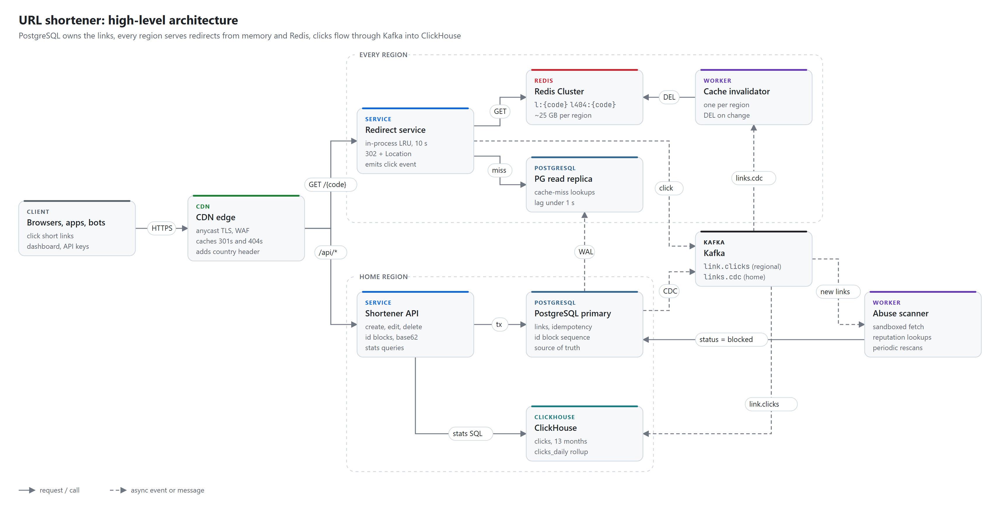
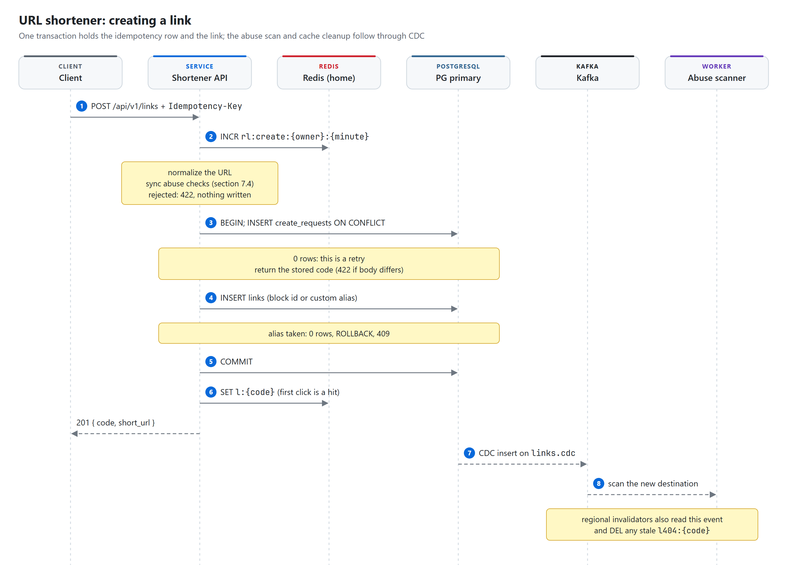
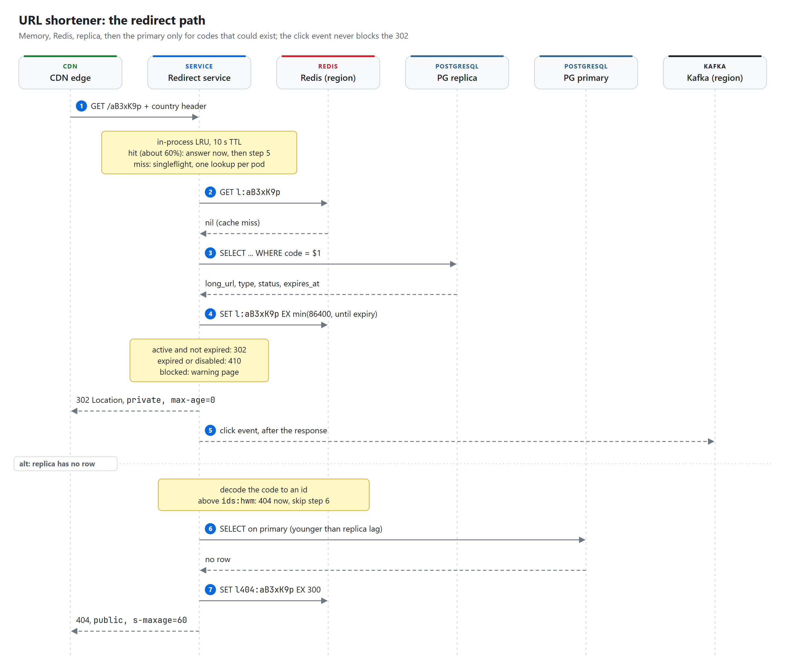
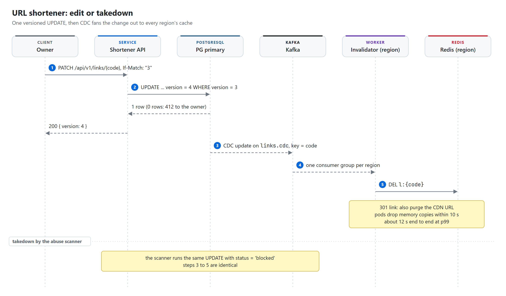
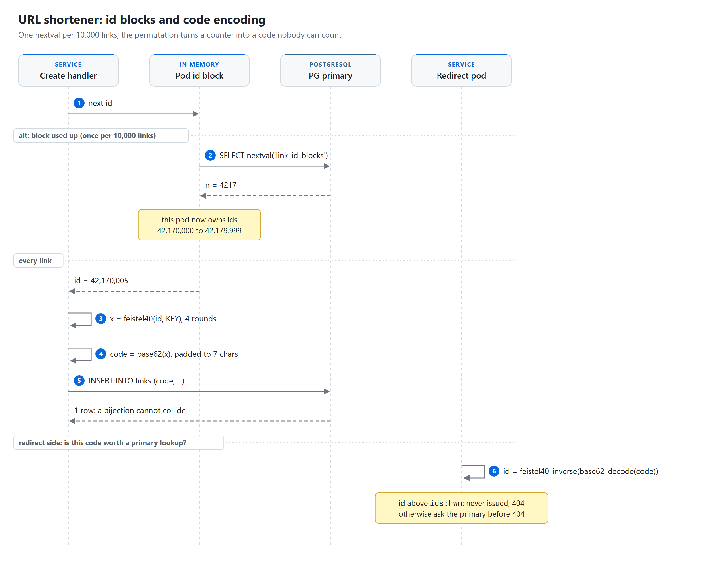
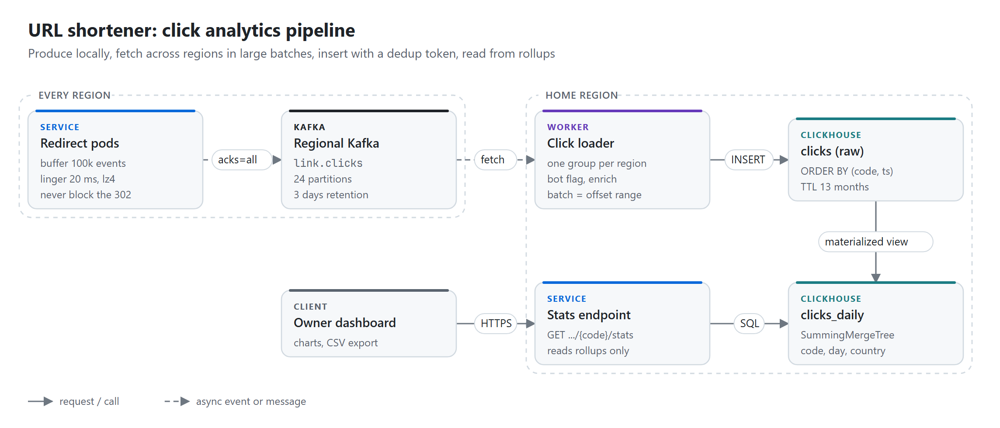
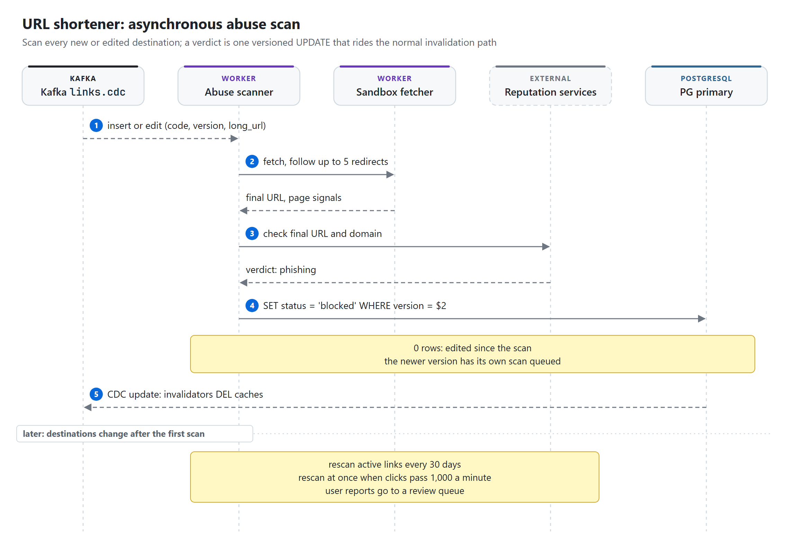

# URL shortener

> **Each app server takes a block of 10,000 ids from a PostgreSQL sequence, scrambles every id with a keyed
> 40-bit permutation and writes it as a 7-character base62 code, so codes never collide and never need a
> retry. Redirects are served from a 10-second in-process cache and Redis in every region, with a read
> replica behind them and the primary asked only about codes that could exist. The 302 goes out without
> waiting for anything; the click event follows through Kafka, and ClickHouse turns 10 billion clicks a
> month into per-link rollups.**

| Category | Difficulty | Interview length | Core problems |
|---|---|---|---|
| Foundations | Easy to medium | 45 min | ID generation, read-heavy caching, 301 vs 302, event analytics, abuse |

**Contents:** [Requirements](#1-requirements) · [Capacity](#2-capacity-estimate) · [API](#3-api) ·
[Data model](#4-data-model) · [Architecture](#5-high-level-architecture) · [Flows](#6-request-flows) ·
[Deep dives](#7-deep-dives) · [Failures](#8-failure-cases) · [Trade-offs](#9-trade-offs) ·
[Follow-ups](#10-likely-follow-ups)

## 1. Requirements

**Functional**

- Create a short link for a long URL, with a generated code or a custom alias the owner picks.
- Redirect `GET /{code}` to the long URL.
- Set an expiry, edit the destination, disable or delete a link.
- Show the owner click counts per day, country, referrer and device.
- Block malware and phishing links at creation and after the fact; accept abuse reports.

**Non-functional**

- Redirect: server time p99 under 5 ms, user-perceived p99 under 100 ms for users near one of the
  regions, 99.99% availability. A redirect never waits on analytics.
- Create: p99 under 300 ms, 99.9% availability. A link works from every region within 1 second of
  the 201.
- A code is never reused. A short link printed on a poster in 2026 must not point somewhere else in 2030.
- Stats are fresh within 1 minute and counted at least once; the counting error stays under 0.1%.
- A takedown is effective in every region within about 15 seconds.

**Out of scope**

- Billing, sign-up and SSO. Every link has an owner; the free web form creates a guest account.
- Branded custom domains, QR codes, link-in-bio pages (see follow-ups for custom domains).

**Scale**

- 100M new links a month, 10B redirects a month: a 100:1 read to write ratio.
- Long URLs average about 100 bytes, capped at 2,048.
- Three regions (us-east as home, eu-west, ap-southeast). Links kept forever, raw clicks for 13 months.

## 2. Capacity estimate

All numbers are estimates, rounded so the arithmetic is easy to say out loud. A month is ~2.6M seconds.

| Quantity | Arithmetic | Result | So what |
|---|---|---|---|
| Create QPS | 100M / 2.6M s | ~40/s avg, ~400/s peak (10x bursts from bulk API users) | One PostgreSQL primary, nowhere near busy |
| Redirect QPS | 10B / 2.6M s | ~3,850/s avg, ~20,000/s peak (5x) | Small for a cache-served path; the hard part is one viral link |
| Hottest single link | estimate for a link in a viral post | ~50,000/s for minutes | In-process cache per pod, not Redis, absorbs it |
| Link storage | 100M x 500 B (row + indexes + overhead) | ~50 GB/month, ~600 GB/year, ~3 TB in 5 years | Fits one primary; no sharding on day one |
| Code space | 2^40 permuted ids vs 1.2B links/year | 1.1T ids, ~900 years of headroom | 7 base62 chars (62^7 = 3.5T) always fit 40 bits |
| Redis per region | 100M hot links x ~250 B | ~25 GB | 4 shards of 8 GB plus replicas per region |
| Pods per region | survive one region down: 60% of 20k/s = 12k/s, ~5k/s per pod | 3 needed, run 6 | Headroom for a viral spike on top of a failover |
| DB reads | ~2% of redirects reach a replica | ~400/s peak, all regions | Primary-key lookups; a replica does not notice |
| Click events | 10B x 300 B | ~3 TB/month raw, 6 MB/s at peak | Kafka barely notices; partitions are not the limit |
| ClickHouse | 10B rows x ~30 B compressed | ~300 GB/month, ~4 TB for 13 months, x2 replicas | A 3-node cluster, not a data platform project |

## 3. API

```http
POST /api/v1/links
Authorization: Bearer <token>
Idempotency-Key: 7c1e4d1a-9f0b-4b7e-8a51-2f7d2c9e0a11
{ "long_url": "https://example.com/spring-sale?utm_source=mail",
  "custom_alias": "spring-sale",            // optional
  "expires_at": "2027-03-01T00:00:00Z",     // optional
  "redirect_type": 302 }                    // optional, 301 or 302
-> 201 { "code": "spring-sale", "short_url": "https://s.example/spring-sale",
         "long_url": "...", "expires_at": "...", "version": 1 }
-> 409 { "error": "alias_taken" }
-> 422 { "error": "url_rejected", "reason": "malware" }

GET /{code}
-> 302 Location: <long_url>      Cache-Control: private, max-age=0
-> 301 Location: <long_url>      Cache-Control: public, max-age=86400   (owner chose 301)
-> 404 not found, 410 expired or disabled, warning page if blocked

GET    /api/v1/links?limit=50&cursor=<created_at,code>       -> 200 { items, next_cursor }
PATCH  /api/v1/links/{code}      If-Match: "3"
{ "long_url": "...", "expires_at": null, "status": "disabled" }
-> 200 { ..., "version": 4 }  |  412 version changed
DELETE /api/v1/links/{code}                                   -> 204
GET    /api/v1/links/{code}/stats?from=2026-10-01&to=2026-10-26&group_by=day,country
POST   /api/v1/reports   { "code": "aB3xK9p", "reason": "phishing" }   -> 202
```

- `POST /links` is idempotent on `(owner_id, Idempotency-Key)`. A retry returns the same code; the same
  key with a different body returns 422 `idempotency_key_reused`.
- `PATCH` is guarded by `If-Match` on `version`, so two editors cannot silently overwrite each other.
- `DELETE` is idempotent by nature. It sets `status = 'deleted'`; the row stays as a tombstone so the
  code can never be handed out again.
- The list endpoint uses keyset pagination on `(created_at, code)`, never `OFFSET`.

## 4. Data model

PostgreSQL is the source of truth for links. Everything in Redis, the CDN and ClickHouse is derived.

```sql
-- Each value n owns the id range [n * 10000, n * 10000 + 9999].
CREATE SEQUENCE link_id_blocks;

CREATE TABLE links (
    code          varchar(32)  NOT NULL,
    long_url      text         NOT NULL CHECK (length(long_url) <= 2048 AND long_url ~ '^https?://'),
    owner_id      bigint       NOT NULL REFERENCES users (id),
    is_custom     boolean      NOT NULL,
    redirect_type smallint     NOT NULL DEFAULT 302 CHECK (redirect_type IN (301, 302)),
    status        text         NOT NULL DEFAULT 'active'
                  CHECK (status IN ('active', 'disabled', 'blocked', 'deleted')),
    expires_at    timestamptz,
    version       integer      NOT NULL DEFAULT 1,
    created_at    timestamptz  NOT NULL DEFAULT now(),
    updated_at    timestamptz  NOT NULL DEFAULT now(),
    PRIMARY KEY (code),
    CHECK (code ~ '^[0-9A-Za-z_-]{3,32}$'),
    -- generated codes are exactly 7 base62 characters; a custom alias can never take that shape
    CHECK (is_custom = (code !~ '^[0-9A-Za-z]{7}$'))
) PARTITION BY HASH (code);
-- 16 partitions keep each index and each VACUUM small:
-- CREATE TABLE links_p0 PARTITION OF links FOR VALUES WITH (MODULUS 16, REMAINDER 0); ... p15

CREATE INDEX links_owner_created ON links (owner_id, created_at DESC, code);

CREATE TABLE create_requests (
    owner_id     bigint      NOT NULL,
    idem_key     uuid        NOT NULL,
    request_hash bytea       NOT NULL,        -- sha256 of the normalized request body
    code         varchar(32) NOT NULL,
    created_at   timestamptz NOT NULL DEFAULT now(),
    PRIMARY KEY (owner_id, idem_key)
);                                            -- rows older than 7 days are deleted nightly

CREATE TABLE blocked_domains (
    domain     text        PRIMARY KEY,       -- registrable domain, lower case, punycode
    reason     text        NOT NULL,
    created_at timestamptz NOT NULL DEFAULT now()
);
```

Reserved words (`api`, `admin`, `login`, `help`) are seeded as `links` rows owned by a system account
with `status = 'disabled'`. The primary key does the reserving; there is no second list to keep in sync.

The custom alias shape rule is the whole collision story between the two namespaces. A generated code is
always exactly 7 alphanumeric characters, a custom alias never is, so `spring-sale`, `sale` and `Sale2026x`
are fine and `Sale202` is rejected. The two can never collide, and the 404 shortcut in section 7.2 works.

**Redis keys** (one cluster per region)

| Key | Value | TTL | Purpose |
|---|---|---|---|
| `l:{code}` | packed string `302\|active\|1803945600\|https://...` (type, status, expires epoch, URL) | 24 h, capped at `expires_at` | The redirect lookup |
| `l404:{code}` | `1` | 5 min | Negative cache so scanners do not reach PostgreSQL |
| `ids:hwm` | highest allocated id, refreshed every 5 s from the sequence | 30 s | Lets the redirect skip the primary for codes that cannot exist |
| `rl:create:{owner_id}:{minute}` | counter, `INCR` + `EXPIRE` | 120 s | Creation rate limit, for example 100/min per owner |
| `rl:404:{ip}:{minute}` | counter | 120 s | Slows code scanners after 30 misses a minute |

If Redis loses everything: `l:*` rebuilds itself from the replica on the next miss, one lookup per code
per pod thanks to singleflight. With the in-process cache still warm, the replicas see a few thousand
primary-key reads a second for a few minutes, which three replicas absorb. `l404:*` loss lets scanner
traffic reach the replicas until the 404 rate limit kicks back in. `ids:hwm` is re-read from
`SELECT last_value FROM link_id_blocks` on the replica. Losing the rate-limit counters resets one
window, which is acceptable.

**Kafka topics**

| Topic | Key | Producer | Consumers |
|---|---|---|---|
| `links.cdc` (home cluster, 12 partitions) | `code` | Debezium on `links` | Cache invalidator (one consumer group per region), abuse scanner |
| `link.clicks` (each regional cluster, 24 partitions) | none, sticky round-robin | Redirect service in that region | Click loader in the home region |

`links.cdc` is keyed by `code` because order matters per link: create, edit, block must apply in that
order. `link.clicks` breaks the house rule of keying by entity id on purpose. No consumer needs clicks of
one link in order, and keying by `code` would put a 50,000/s viral link on a single partition.

## 5. High-level architecture

<picture>
  <source media="(prefers-color-scheme: dark)" srcset="diagrams/architecture-dark.png">
  
</picture>

- **CDN edge**: terminates TLS close to the user, runs the WAF, adds a country header, and routes
  `/api/*` to the home region and `/{code}` to the nearest region. It caches only 301 responses and 404s
  for 7-character codes; 302s pass straight through.
- **Redirect service** (every region): stateless pods with a 10-second in-process LRU of about 1M
  entries. It answers from memory, Redis or the replica, and hands the click event to a background
  Kafka producer after the response is written.
- **Shortener API** (home region only): creation, edits, listing and stats. Writes are 40/s, so paying
  a cross-region hop for users in Asia is cheaper than running multi-primary.
- **PostgreSQL primary and replicas**: the primary holds the truth; each region has a streaming replica
  for cache misses. One primary is enough for 3 TB and 400 writes/s.
- **Cache invalidator** (every region): reads `links.cdc` across regions and deletes `l:{code}` and
  `l404:{code}` in its region's Redis. For 301 links it also asks the CDN to purge the URL.
- **Abuse scanner**: scans every new or edited destination within about 30 seconds and writes
  `status = 'blocked'` back through the same table, so takedowns use the same invalidation path as edits.
- **ClickHouse**: raw clicks plus rollups. The API reads rollups only.

There is no Elasticsearch here. Owners list their links by owner and date, which one B-tree index
covers. Full-text search over a user's own links is a later feature, and when it comes it is a CDC
consumer away.

## 6. Request flows

**Create a link**

<picture>
  <source media="(prefers-color-scheme: dark)" srcset="diagrams/create-flow-dark.png">
  
</picture>

1. The CDN routes `POST /api/v1/links` to the home region API.
2. Rate limit per owner in Redis, then URL normalization and the synchronous checks from section 7.4.
3. Insert the idempotency row. Zero rows means a retry: return the stored code. A concurrent duplicate
   waits on the primary key and then sees the stored row.
4. Insert the link: a generated code from the pod's id block (section 7.1) or the custom alias. A taken
   alias rolls back with 409.
5. Commit. Both rows exist or neither does.
6. Warm `l:{code}` in the home region's Redis, then return 201.
7. Debezium publishes the insert to `links.cdc`.
8. The abuse scanner queues a scan; the invalidators clear any stale `l404:{code}`.

**Redirect**

<picture>
  <source media="(prefers-color-scheme: dark)" srcset="diagrams/redirect-flow-dark.png">
  
</picture>

1. The edge nearest the user forwards `GET /aB3xK9p` to the nearest region with a country header. The pod
   checks its in-process LRU first; about 60% of redirects end there.
2. On a miss, Redis (about 38% of traffic, ~0.5 ms).
3. On a Redis miss, the replica by primary key. Concurrent misses for one code share one query.
4. Fill Redis with a TTL of 24 hours or the time left until `expires_at`, whichever is shorter, then
   answer 302, 301, 410 or the warning page.
5. After the response is flushed, the click event goes to the producer buffer. The request never waits
   for Kafka.
6. If the replica has no row and the code could exist (section 7.2), ask the primary.
7. Still nothing: write `l404:{code}` and return 404.

**Edit or takedown**

<picture>
  <source media="(prefers-color-scheme: dark)" srcset="diagrams/edit-flow-dark.png">
  
</picture>

1. The owner sends `PATCH` with `If-Match` on the current version.
2. One versioned `UPDATE`. Zero rows means someone else edited first: 412.
3. Debezium publishes the change to `links.cdc`, keyed by `code`.
4. Each region's invalidator receives it.
5. The invalidator deletes `l:{code}` (and purges the CDN URL for a 301 link). Pods drop their memory copy
   within 10 seconds, so the change is live everywhere in about 12 seconds at p99.

A takedown by the abuse scanner is the same `UPDATE` with `status = 'blocked'`; steps 3 to 5 do not change.

## 7. Deep dives

### 7.1 ID generation

The problem: 40 codes a second, unique forever, short, and not guessable enough that someone can crawl
every link by counting.

| Option | How | Problem |
|---|---|---|
| Hash the URL | first 7 chars of base62(sha256(url + salt)) | Collisions grow with the table (birthday bound), every insert needs a check-and-retry, and the same URL from two owners needs a salt anyway |
| Random base62 | 7 random chars, insert, retry on conflict | Works. Collision rate after 12B links is 12B / 3.5T, about 0.3% per insert, so retries are rare but never zero |
| Counter blocks | each pod takes 10,000 ids from a sequence, encodes them | Sequential codes leak volume and let anyone enumerate links, unless scrambled |
| Snowflake-style 64-bit | time + machine + sequence | 11 base62 characters, too long for a short link |

**Choice: counter blocks plus a keyed permutation.**

<picture>
  <source media="(prefers-color-scheme: dark)" srcset="diagrams/id-generation-dark.png">
  
</picture>

1. The create handler asks the pod's in-memory block for the next id.
2. Once per 10,000 links the block is empty and takes a new range with one `nextval`.
3. The id goes through a 4-round, 40-bit Feistel permutation keyed with `KEY`.
4. The result is written as base62 and left-padded to 7 characters.
5. The insert cannot hit a conflict, because a permutation never maps two ids to one code.
6. On the redirect side, any 7-character code decodes back to an id, which section 7.2 uses to skip the
   primary for codes that were never issued.

The encode path in code:

```python
def code_for(id_: int) -> str:
    return base62(feistel40(id_, KEY)).rjust(7, "0")   # 62^7 > 2^40, always 7 chars

def feistel40(x: int, key: bytes) -> int:
    left, right = x >> 20, x & 0xFFFFF                  # two 20-bit halves
    for round_key in derive_round_keys(key, rounds=4):
        f = int.from_bytes(hmac_sha256(round_key, right.to_bytes(3, "big"))[:3], "big") & 0xFFFFF
        left, right = right, left ^ f
    return (left << 20) | right                         # a bijection on [0, 2^40)
```

A Feistel network is a permutation for any round function, so distinct ids give distinct codes. No
collision check, no retry, and consecutive ids land far apart. Decoding runs the rounds backwards, which
gives the redirect path a cheap way to turn a code back into an id.

What it costs:

- `KEY` can never change for already-issued ids. It lives in the secret store like any signing key. If it
  leaked, codes become predictable, which is an enumeration risk, not a correctness bug.
- A pod that dies loses the rest of its block. At 1.1T ids that waste is irrelevant.
- The sequence lives on the primary. One `nextval` per 10,000 links is 0.004 calls a second.

Random 7-character codes would also be a fine answer. I take blocks because the insert path has no retry
loop, and that keeps creation latency flat and the code obvious.

### 7.2 Redirect latency and caching

The redirect is the product. Every layer exists to keep the replica and the primary out of it.

| Layer | Share of redirects (estimate) | Server time | Notes |
|---|---|---|---|
| In-process LRU, 10 s TTL | ~60% | < 0.1 ms | Hot links live here; this is the hot-link answer |
| Redis in the same region | ~38% | ~0.5 ms | 25 GB covers ~100M recently clicked links |
| PostgreSQL replica | ~2% | 2 to 5 ms | Primary-key lookup, singleflight per code |
| PostgreSQL primary | fresh links only | 80 to 150 ms from a far region | Only for codes that could exist |

**Hot links.** A viral link at 50,000/s spread over 18 pods is ~2,800/s per pod, served from memory.
Redis sees one request per pod every 10 seconds for that code. Without the local cache, every request
would land on the one Redis shard that owns the key, and a hot key on one shard is the classic way this
design falls over.

**301 vs 302.** A 301 says "permanent". Browsers cache it, often with no expiry, so repeat clicks from
that browser never reach us: we lose the count, and an edit, an expiry or an abuse takedown never reaches
that user. A 302 sends every click to us. The default is 302 with `Cache-Control: private, max-age=0`, so
neither the browser nor the CDN caches it. Owners who want a permanent redirect (SEO, no stats) can pick
301; we send it with `max-age=86400` rather than forever, the CDN caches it, and the dashboard marks those
counts as partial. 307 and 308 behave like 302 and 301 but keep the HTTP method, which does not matter for
links people click.

**Why not cache 302s at the CDN.** It would cut origin traffic to almost nothing, but then the origin
never sees most clicks, and analytics would depend on the CDN's log stream instead. At 20,000/s peak the
origin path is cheap enough that keeping the click event in our own code is the better trade. If a single
link ever outgrows the pods, the lever is to give that one link `s-maxage=10` and count it from CDN logs.

**Negative caching and scanners.** Bots try random codes. A 404 for a 7-character code is cached in Redis
for 5 minutes and at the edge for 60 seconds. A 404 for a custom-alias-shaped code is cached in Redis only
(`no-store` at the edge), because the owner might create that alias a minute later; the invalidator
deletes `l404:{code}` on insert, which the CDN could not do cheaply.

**Read-your-writes across regions.** A user in Singapore creates a link (written in us-east) and clicks
it 300 ms later. The ap-southeast replica may not have it yet. So before returning 404 the pod asks the
primary, but only if the code could exist:

- A 7-character code is decoded back to its id. If the id is above `ids:hwm`, nobody has been given that
  code yet: 404 without touching the primary. Random scanner codes almost always fail this test, because
  only about 1% of the 2^40 space will ever be allocated.
- A custom-alias-shaped code goes to the primary, protected by `l404:*` and the per-IP 404 limit.

**Expiry** is enforced on every hit from the cached `expires_at`, not by deleting keys, so a link expires
on time even if its Redis entry is still alive. Expired rows stay in the table: the code is never reused.

**Multi-region.** Each region has its own pods, Redis and replica, so a region serves redirects with no
cross-region call except the rare primary fallback. Writes stay single-region on purpose: 40/s does not
justify conflict resolution.

### 7.3 Analytics pipeline

<picture>
  <source media="(prefers-color-scheme: dark)" srcset="diagrams/analytics-pipeline-dark.png">
  
</picture>

The problem: 10B events a month, written from three regions, counted once, queried per link by date and
country in under a second.

**Producing.** The pod builds the event after the response: `event_id`, `code`, `ts`, `region`, country
from the edge header, referrer host, device class from the user agent, and a visitor hash. It goes into a
bounded in-memory buffer (100,000 events, ~30 MB) and a producer with `acks=all`, `linger.ms=20` and lz4.
If the buffer is full the event is dropped and a counter goes up; the redirect never blocks. Events go to
the Kafka cluster in the same region, so producing never crosses an ocean.

**Moving and loading.** A loader in the home region runs one consumer group per regional cluster and
fetches across regions in large batches; 6 MB/s at peak is nothing for a long-haul fetch. It flags bots
(link-preview fetchers like Slackbot and facebookexternalhit, HEAD requests, known crawler user agents),
then inserts one batch per partition offset range, up to 200,000 rows or 5 seconds. It commits Kafka
offsets only after ClickHouse acknowledges.

**Counting once.** A crash between the insert and the offset commit replays the same batch. Each insert
carries `insert_deduplication_token = '{region}-{partition}-{first_offset}-{last_offset}'`, so ClickHouse
drops the replayed block, and `deduplicate_blocks_in_dependent_materialized_views = 1` keeps the rollup
from counting it twice. Events lost in a pod crash (at most the unflushed buffer) are the accepted error.

```sql
CREATE TABLE clicks (
    event_id      UUID,
    code          String,
    ts            DateTime64(3, 'UTC'),
    region        LowCardinality(String),
    country       LowCardinality(String),
    referrer_host String,
    device        LowCardinality(String),          -- mobile, desktop, tablet, bot
    is_bot        UInt8,
    visitor_hash  UInt64                           -- keyed hash of (ip /24, user agent), key rotates daily
)
ENGINE = ReplicatedMergeTree('/clickhouse/tables/{shard}/clicks', '{replica}')
PARTITION BY toYYYYMM(ts)
ORDER BY (code, ts)
TTL toDateTime(ts) + INTERVAL 13 MONTH;

CREATE TABLE clicks_daily (
    code    String,
    day     Date,
    country LowCardinality(String),
    is_bot  UInt8,
    clicks  UInt64
)
ENGINE = ReplicatedSummingMergeTree('/clickhouse/tables/{shard}/clicks_daily', '{replica}')
ORDER BY (code, day, country, is_bot);

CREATE MATERIALIZED VIEW clicks_daily_mv TO clicks_daily AS
SELECT code, toDate(ts) AS day, country, is_bot, count() AS clicks
FROM clicks
GROUP BY code, day, country, is_bot;

-- the stats endpoint always sums, because SummingMergeTree merges in the background
SELECT day, sum(clicks) FROM clicks_daily
WHERE code = 'aB3xK9p' AND day BETWEEN '2026-10-01' AND '2026-10-26' AND is_bot = 0
GROUP BY day ORDER BY day;
```

`ORDER BY (code, ts)` puts every click of one link next to each other on disk, so a per-link query reads
a few granules, not the month. The raw table answers ad-hoc questions (referrers for one link, one hour);
the dashboard reads only rollups.

**Why ClickHouse and not PostgreSQL.** A `clicks` counter column in PostgreSQL turns every redirect into a
write on a hot row; a click table in PostgreSQL is 10B rows a month of row-store and B-tree. ClickHouse
stores the same data at ~30 bytes a row and aggregates it by scanning compressed columns. Elasticsearch
could do the aggregations, but at several times the disk for the same data.

**Freshness.** 20 ms linger, up to 5 s of batching, a second of cross-region fetch: a click shows up in
the dashboard within about 10 seconds, comfortably inside the one-minute target.

**Privacy.** The raw IP is never stored. Country comes from the edge; the visitor hash uses a key that
rotates daily, so unique-visitor counts work within a day and cannot be joined across days.

### 7.4 Abuse and malware

A shortener is a free disguise for phishing links, so abuse handling is part of the design, not a moderation
add-on.

- **At creation, synchronously, under 5 ms:** only `http` and `https`; normalized host checked against
  `blocked_domains` (held in memory, refreshed every minute); our own domain and other shorteners rejected,
  because redirect chains hide the destination; a Safe Browsing-style hash-prefix list held in memory.
  New and guest accounts get tighter rate limits.
- **After creation, asynchronously:** the scan below. Scans are idempotent on `(code, version)`; an edit
  bumps the version and triggers a new scan.
- **Later:** destinations change after the scan (bait and switch), so active links are rescanned every
  30 days, and any link whose clicks jump past 1,000 a minute gets an immediate rescan. User reports go to
  a review queue.
- **Serving a blocked link:** the redirect returns a warning page with no `Location` header. The row stays,
  so the code cannot be recycled for a new victim.

<picture>
  <source media="(prefers-color-scheme: dark)" srcset="diagrams/abuse-scan-dark.png">
  
</picture>

1. The scanner reads an insert or edit from `links.cdc`, with `code`, `version` and `long_url`.
2. A sandboxed fetcher loads the destination, following up to 5 redirects.
3. The final URL and domain go to reputation services.
4. A bad verdict becomes `UPDATE links SET status = 'blocked' WHERE code = $1 AND version = $2`. Zero rows
   means the link was edited meanwhile, and that newer version already has its own scan queued.
5. The update flows out through CDC like any edit, and every region drops the link within about
   15 seconds.

## 8. Failure cases

| Failure | Effect | Recovery |
|---|---|---|
| Redis cluster in a region down | Hot links still served from memory; the rest falls to the replica, p99 rises to ~10 ms | Circuit breaker on Redis; replicas sized for it; Redis refills from misses after restart |
| PostgreSQL primary down | Creates and edits fail with 503; redirects unaffected (cache plus replicas) | Patroni promotes a standby in ~30 s; Debezium resumes from a failover-enabled replication slot (PostgreSQL 17) |
| Replica lag spikes to minutes | Fresh links 404 in that region | The high-water-mark fallback to the primary covers it; alert on lag over 5 s |
| Regional Kafka down | Click events buffer in pods, then drop | Dropped-event counter and alert; redirects keep working; dashboard shows a gap note |
| ClickHouse down | Stats stale | Kafka keeps 3 days; the loader resumes from committed offsets |
| Loader crashes mid-batch | Batch replayed | `insert_deduplication_token` drops the duplicate block |
| A whole region down | Its users are routed to the next region by the CDN | Remaining regions sized for 60% of global peak; caches warm in minutes |
| Malicious link clicked before the async scan | A few minutes of exposure | Sync checks stop most; takedown reaches every region in ~15 s via CDC; 301s purged at the CDN |
| CDN outage | No edge, no WAF | DNS failover to the regional load balancers directly, with origin rate limits tightened |
| Pod dies holding an id block | Up to 9,999 ids never used | Nothing to do; the space is 1.1T |

## 9. Trade-offs

| Decision | Chosen | Rejected | Why |
|---|---|---|---|
| Code generation | Sequence blocks + Feistel permutation | URL hash, random + retry, Snowflake | No collision path, short codes, not enumerable |
| Default redirect | 302, not cacheable | 301 | Every click is counted, edits and takedowns take effect |
| Link store | One PostgreSQL primary, hash partitions, replicas per region | Cassandra or DynamoDB | 3 TB and 400 writes/s fit one node; we keep constraints and transactions |
| Hot-link handling | In-process 10 s cache per pod | CDN caching of 302s | Keeps clicks in our own pipeline; one hot key never hammers one Redis shard |
| Writes across regions | Single home region | Multi-primary | 40 writes/s does not pay for conflict resolution |
| Cache invalidation | CDC to a per-region invalidator | API deletes keys in every region | One path for edits, takedowns and inserts; no cross-region calls in the request |
| Click partitioning | Round-robin | Keyed by `code` | No per-link ordering needed; a viral link would pin one partition |
| Analytics store | ClickHouse with rollups | PostgreSQL counters, Elasticsearch | Columnar compression and aggregation at 10B rows a month |
| Dashboard search | B-tree index on `(owner_id, created_at)` | Elasticsearch | Listing by owner is all the product needs today |

## 10. Likely follow-ups

- **Two users shorten the same URL. Same code?** No. Each owner wants separate stats and control. If one
  owner shortens the same URL twice, we can return the existing code with a unique index on
  `(owner_id, sha256(long_url))`, as an opt-in.
- **Why not 6 characters?** 62^6 is 56.8B, enough for decades with a 35-bit permutation. I keep 7 for a
  bigger space, which also makes the high-water-mark check reject almost every random guess.
- **When do you shard PostgreSQL?** Around 5 to 10 TB, or when VACUUM on the big partitions hurts. Every
  redirect lookup is by `code`, so sharding by hash of `code` is mechanical; the owner listing then needs a
  small by-owner table or a CDC-fed index.
- **How do you count unique visitors?** `uniqCombined(visitor_hash)` per link per day in an
  AggregatingMergeTree rollup. It is approximate, within about 1%, and that is the right answer for a
  dashboard.
- **What about custom domains like `go.brand.com`?** Add `domain` to the primary key (`domain, code`) and
  to the Redis key. The CDN needs a certificate per domain, which is the real work.
- **Someone enumerates codes. What stops them?** The permutation makes codes non-sequential, 99% of random
  codes are rejected by the high-water mark without a database read, and the per-IP 404 limit plus the WAF
  slow the rest.
- **Can an owner change the destination?** Yes, with `If-Match`. The change reaches every region in about
  12 seconds. Browsers that cached a 301 keep the old destination for up to a day, which is why 302 is the
  default.
- **Does a link-preview bot count as a click?** It is stored with `is_bot = 1` and left out of the
  numbers by default; owners can toggle it on.
- **What if the analytics pipeline is down for an hour?** Redirects do not notice. Kafka holds 3 days, the
  loader catches up at many times real-time speed, and the dashboard fills in.

## Phrases worth using

- "The redirect returns before the analytics start."
- "The primary key decides uniqueness; the permutation decides what the code looks like."
- "301 is a promise you cannot take back, so it is opt-in."
- "Hot links live in process memory; Redis is for the long tail."
- "Every cache is a copy of a PostgreSQL row and can be thrown away."
