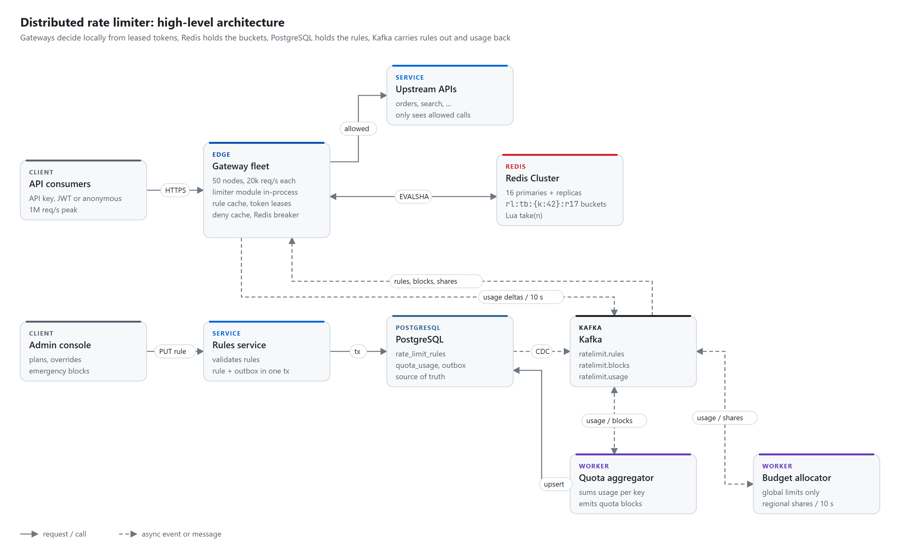
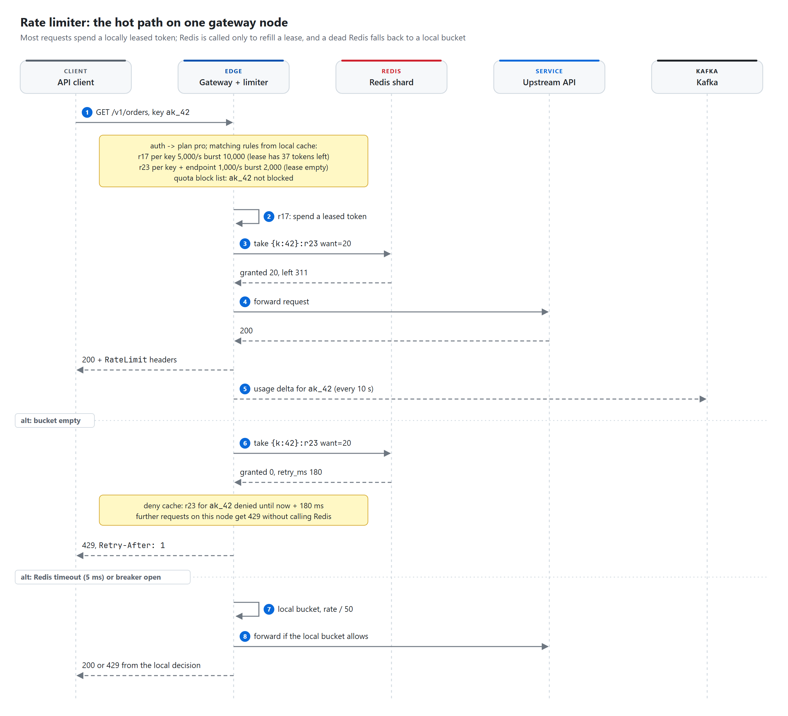
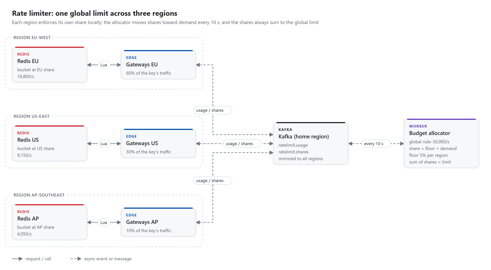

# Distributed rate limiter

> **Every gateway node decides locally, spending tokens it has leased in batches from a token bucket that
> lives in Redis and is changed only by one atomic Lua script, so Redis sees a fraction of the 1M req/s and
> a single clock decides each bucket. Rules live in PostgreSQL and reach the gateways through a compacted
> Kafka topic, while monthly quotas are counted asynchronously from usage events and enforced with a
> pushed block list. When Redis is slow or down, each rule says what to do: fall back to a local bucket
> (the default), let traffic through, or refuse it.**

| Category | Difficulty | Interview length | Core problems |
|---|---|---|---|
| Infrastructure | Hard | 45-60 min | hot keys, atomic counters, failure policy, global vs regional limits |

**Contents:** [Requirements](#1-requirements) · [Capacity](#2-capacity-estimate) · [API](#3-api) ·
[Data model](#4-data-model) · [Architecture](#5-high-level-architecture) · [Flows](#6-request-flows) ·
[Deep dives](#7-deep-dives) · [Failures](#8-failure-cases) · [Trade-offs](#9-trade-offs) ·
[Follow-ups](#10-likely-follow-ups)

## 1. Requirements

**Functional**

- Limit requests per API key, per user, per IP and per endpoint, alone or combined (per key on one route).
- Tiered plans: free, pro and enterprise get different rates, bursts and monthly quotas; one key can get an
  override.
- Reject over-limit calls with `429`, `Retry-After` and rate limit headers; tell callers their remaining
  budget on every response.
- Operators change rules and add emergency blocks without a deploy; changes reach every gateway in seconds.
- Run a new rule in shadow mode (count would-be rejections, enforce nothing) before switching it on.

**Non-functional**

- Added latency at the gateway: p99 under 1 ms when the decision is local, under 3 ms when Redis is called,
  hard timeout 5 ms.
- The limiter must never be the reason the API is down. Losing Redis degrades accuracy, not availability.
- Accuracy: with Redis healthy, never admit more than the rate plus one burst per subject. Small limits
  (login attempts, SMS sends) are exact. Large limits may under-admit by a few percent.
- Rule changes visible on every gateway within 5 s (p99). Monthly quotas enforced within about 30 s of
  being used up.

**Out of scope**

- Volumetric DDoS. That belongs at the CDN or WAF in front of us; by the time a packet reaches a gateway it
  already costs a TLS handshake.
- Authentication itself (the auth step hands us `api_key_id`, `user_id` and `plan_id`), billing and
  invoices, and limits on concurrent in-flight requests (a different tool: a semaphore, not a rate).

**Scale**

- 50 gateway nodes per region, 1M req/s peak per region (about 400k/s average), 3 regions.
- 2M API keys, about 200k active in any minute; 20M distinct client IPs per day on anonymous routes.
- About 2.5 rate rules apply to an average request (per key, per key and route, sometimes per IP).
- Rules: 20 plans with about 10 rules each, plus 50k per-key overrides. Rules change a few hundred times a
  day.

## 2. Capacity estimate

All numbers are estimates per region; the point is which part of the system they stress.

| Quantity | Arithmetic | Result | So what |
|---|---|---|---|
| Requests per gateway node | 1M/s / 50 nodes | 20k/s per node | Per-request work must be in-process, microseconds |
| Rule checks | 1M/s x 2.5 rules | 2.5M checks/s | Cannot be 2.5M Redis calls |
| Naive Redis load | 2.5M/s / ~50k Lua calls/s per shard (at 50% CPU) | ~50 primaries | Too many, and one hot key still melts one shard |
| With token leases | 80% of checks on subjects leasing ~20 tokens: 2.5M x 0.8 / 20 = 100k; long tail at 1 token: 2.5M x 0.2 = 500k | ~600k calls/s | 16 primaries at ~37k/s each, room for a shard to fail |
| Bucket memory | (2M keys x 3 rules + ~2M live IP buckets) x ~120 B | ~1 GB | Memory is not the constraint, ops/s are |
| Redis network | 600k/s x ~200 B per round trip | ~120 MB/s cluster-wide | ~8 MB/s per shard, fine |
| Usage events | 50 nodes x ~20k distinct keys per 10 s flush / 10 s | ~100k msg/s, ~10 MB/s | 24 partitions on `ratelimit.usage` |
| Quota writes to PostgreSQL | 200k active keys, one upsert per key per minute | ~3.3k upserts/s | One primary with batched upserts |
| Rule cache on each node | 50k rules x ~500 B | ~25 MB | Every gateway holds every rule in memory |
| Lease table on each node | ~200k live (rule, subject) pairs x ~64 B | ~13 MB | Fine |

The skew assumption (80% of checks on subjects big enough to lease 20 tokens) is the number that sets the
shard count. Measure it from production traffic before sizing the cluster; API traffic is usually far more
skewed than this.

## 3. API

The limiter has no public endpoint of its own. Callers see it through response headers. Header names follow
the IETF httpapi `RateLimit` header draft, which is still a draft; earlier versions used the
`RateLimit-Limit` / `RateLimit-Remaining` / `RateLimit-Reset` trio, and many APIs still send `X-RateLimit-*`.
We report the most restrictive rule that applied.

```http
GET /v1/orders
Authorization: Bearer ak_live_...

-> 200 OK
RateLimit-Policy: "per-route";q=1000;w=1
RateLimit: "per-route";r=311;t=1
```

```http
-> 429 Too Many Requests
Retry-After: 1
RateLimit-Policy: "per-route";q=1000;w=1
RateLimit: "per-route";r=0;t=1
Content-Type: application/problem+json

{ "type": "https://api.example.com/problems/rate-limited", "title": "Rate limit exceeded",
  "status": 429, "rule": "per-route", "retry_after_ms": 180 }
```

`Retry-After` is in whole seconds, rounded up, and always relative, so the client's clock does not matter.
A used-up monthly quota is also `429`, with `"type": ".../quota-exhausted"` and `Retry-After` set to the
seconds until the period resets. When a fail-closed rule cannot be evaluated because Redis is down, the
answer is `503` with `Retry-After`, because the fault is ours, not the caller's.

Customer-facing usage, served from PostgreSQL, honest about its lag:

```http
GET /v1/usage
-> 200 { "period_start": "2026-10-01", "used": 7412331, "quota": 10000000, "as_of": "2026-10-26T09:14:20Z" }
```

Admin API, used by the console and by on-call:

```http
PUT /admin/v1/rules/{rule_id}
If-Match: "7"
{ "plan": "pro", "route": "POST /v1/sms", "dimension": "api_key",
  "rate_per_sec": 10, "burst": 20, "on_failure": "closed", "shadow": true }
-> 200 { "rule_id": 913, "version": 8, ... }
-> 412 Precondition Failed      (someone else changed the rule; re-read and retry)

PUT /admin/v1/blocks/ip:203.0.113.7
{ "until": "2026-10-26T12:00:00Z", "reason": "credential stuffing" }
-> 200

DELETE /admin/v1/blocks/ip:203.0.113.7
-> 204
```

Both writes are `PUT` on a natural id, so a retry is harmless. `If-Match` on the rule version stops two
operators from silently overwriting each other.

## 4. Data model

PostgreSQL holds rules and quota usage. Redis holds only token buckets, which can be rebuilt from nothing.

```sql
CREATE TYPE limit_dimension AS ENUM ('api_key', 'user', 'ip', 'api_key_route', 'route');
CREATE TYPE failure_mode    AS ENUM ('local', 'open', 'closed');

CREATE TABLE plans (
  plan_id        smallint PRIMARY KEY,
  name           text NOT NULL UNIQUE,
  monthly_quota  bigint CHECK (monthly_quota > 0)        -- NULL means unlimited
);

CREATE TABLE rate_limit_rules (
  rule_id        bigserial PRIMARY KEY,
  name           text NOT NULL,
  plan_id        smallint REFERENCES plans,              -- NULL: every plan
  api_key_id     bigint,                                 -- set: override for one key
  route          text,                                   -- 'POST /v1/sms'; NULL: every route
  dimension      limit_dimension NOT NULL,
  rate_per_sec   numeric(12,4) NOT NULL CHECK (rate_per_sec > 0),
  burst          integer NOT NULL CHECK (burst >= 1),
  scope          text NOT NULL DEFAULT 'regional' CHECK (scope IN ('regional', 'global')),
  on_failure     failure_mode NOT NULL DEFAULT 'local',
  shadow         boolean NOT NULL DEFAULT false,
  enabled        boolean NOT NULL DEFAULT true,
  version        bigint NOT NULL DEFAULT 1,
  updated_by     text NOT NULL,
  updated_at     timestamptz NOT NULL DEFAULT now(),
  CHECK (plan_id IS NULL OR api_key_id IS NULL),         -- a rule targets a plan or a key, not both
  UNIQUE NULLS NOT DISTINCT (plan_id, api_key_id, route, dimension)
);

CREATE TABLE rules_outbox (                              -- Debezium reads this into ratelimit.rules
  id             bigserial PRIMARY KEY,
  rule_id        bigint NOT NULL,
  payload        jsonb NOT NULL,                         -- full rule row, or {"deleted": true}
  created_at     timestamptz NOT NULL DEFAULT now()
);
CREATE INDEX rules_outbox_rule ON rules_outbox (rule_id, id);   -- version history per rule, kept 90 days

CREATE TABLE quota_usage (
  api_key_id     bigint NOT NULL,
  period_start   date NOT NULL,                          -- first day of the billing month, UTC
  used           bigint NOT NULL DEFAULT 0 CHECK (used >= 0),
  blocked_at     timestamptz,
  updated_at     timestamptz NOT NULL DEFAULT now(),
  PRIMARY KEY (api_key_id, period_start)
);

CREATE TABLE usage_consumer_offsets (                    -- written in the same tx as quota_usage
  partition_id   int PRIMARY KEY,
  next_offset    bigint NOT NULL
);
```

One rule per (target, route, dimension) is deliberate: a token bucket already expresses "1,000/s with bursts
up to 2,000", so there is no need for a per-second and a per-minute rule on the same thing. `api_keys` lives
in the auth service; the gateway gets `plan_id` from the auth step, not from this database.

**Redis keys** (Redis Cluster, 16 primaries with one replica each)

| Key | Value | TTL | Purpose |
|---|---|---|---|
| `rl:tb:{k:<api_key_id>}:<rule_id>` | hash `tk` (tokens, float), `ts` (ms) | time to refill to full, +1 s | Token bucket per API key, or per key and route |
| `rl:tb:{u:<user_id>}:<rule_id>` | same | same | Per user, across all of the user's keys and devices |
| `rl:tb:{ip:<addr>}:<rule_id>` | same | same | Per IP on anonymous routes; IPv6 grouped by /64 |
| `rl:tb:{r:<rule_id>}` | same | same | One bucket for a whole route, e.g. all callers of `POST /v1/sms` |
| `rl:tb:{k:<api_key_id>#<n>}:<rule_id>` | same | same | Hot key split into n sub-buckets, each at rate / n |

The hash tag (the part in braces) puts every bucket of one subject in one slot, so the two or three calls a
request needs for one key go to one shard in one pipelined round trip.

If Redis loses a key, the next call finds no hash and starts the bucket full. That is exactly what the
bucket would hold after it had been idle long enough, which is also why the TTL is "time to refill" and not
an arbitrary number: an expired key and a full bucket are the same state. The cost of losing a whole shard
is one extra burst per subject on that shard, about 2 s of traffic for a bucket with burst = 2 x rate.
Nothing durable lives in Redis; quotas are deliberately kept out of it so a lost node cannot hand out a free
month.

**Kafka topics**

| Topic | Key | Producer | Consumers |
|---|---|---|---|
| `ratelimit.rules` (compacted) | `rule_id` | Debezium on `rules_outbox` | Every gateway, all partitions, no consumer group, from offset 0 on boot |
| `ratelimit.blocks` (compacted) | subject, e.g. `k:42`, `ip:203.0.113.7` | Quota aggregator, rules service | Every gateway; a tombstone lifts the block |
| `ratelimit.usage` | `api_key_id` | Gateways, one record per key per 10 s flush | Quota aggregator (group), budget allocator, analytics |
| `ratelimit.shares` (compacted) | `rule_id` + subject | Budget allocator | Gateways in every region (mirrored) |

Keying usage by `api_key_id` means one aggregator instance owns all usage for a key, so it can sum in memory
without coordination.

## 5. High-level architecture

<picture>
  <source media="(prefers-color-scheme: dark)" srcset="diagrams/architecture-dark.png">
  
</picture>

- **Gateway fleet.** The limiter is a module inside the gateway process, not a separate service. It holds
  every rule in memory, a lease table (tokens already taken from Redis), a deny cache (subjects known to be
  empty until a given time) and one circuit breaker per Redis shard.
- **Redis Cluster** holds the token buckets and nothing else. All changes go through one Lua script, so
  read-refill-take is atomic per bucket.
- **Rules service** validates rules and writes the rule plus an outbox row in one transaction. PostgreSQL is
  the only place a rule is ever edited.
- **Kafka** carries rules, blocks and shares out to every gateway and usage back. Compacted topics double as
  the snapshot: a new gateway reads `ratelimit.rules` from the start and has every live rule.
- **Quota aggregator** sums usage per key per month in PostgreSQL and publishes a block when a key runs out.
- **Budget allocator** exists only for the few rules marked `global`; it splits one limit across regions.

## 6. Request flows

<picture>
  <source media="(prefers-color-scheme: dark)" srcset="diagrams/check-flow-dark.png">
  
</picture>

**Allowed request**

1. The gateway authenticates the key and gets `plan_id`. It looks up the rules for (plan, route) in its
   local index, then applies key overrides on top. Order of precedence: key override, plan rule, default.
2. It checks the block list (quota or emergency blocks) and the deny cache. Both are in-memory lookups.
3. For each rule, it spends one token from the local lease if the lease has one and has not expired (leases
   live 1 s on the gateway's monotonic clock).
4. For a rule with an empty lease, it calls `take` on Redis asking for a batch (section 7.2). Concurrent
   requests for the same bucket on the same node wait on that one in-flight call instead of sending their
   own.
5. If every rule allowed, forward upstream and add the `RateLimit` headers from the most restrictive rule.
6. Increment the local usage counter for the key. Every 10 s the node flushes one record per key to
   `ratelimit.usage`.

**Rejected request**

1. `take` returns `granted 0` and `retry_ms`.
2. The gateway records "rule r23 for key 42 is empty until now + retry_ms" in its deny cache, so the next
   thousand requests for that key on this node are rejected without a network call.
3. Respond `429` with `Retry-After` rounded up to whole seconds. Tokens already spent on other rules for this
   request are not refunded; a refund call costs more than the token.

**Rule change**

1. An operator sends `PUT /admin/v1/rules/913` with `shadow: true`. The rules service checks the version,
   validates (no rule may cut a plan limit by more than 10x without a second approver) and commits the rule
   and an outbox row in one transaction.
2. Debezium publishes the outbox row to `ratelimit.rules` keyed by `rule_id`, typically within a second.
3. Every gateway applies it and rebuilds its index; it also writes the rule set to local disk so a restart
   with Kafka down still has rules.
4. In shadow mode the gateway evaluates the rule and counts would-be rejections in the usage records. After
   a day of looking at those numbers, the operator flips `shadow` to false.

**Quota runs out**

1. The aggregator consumes usage records, adds them to an in-memory total per (key, month), and every minute
   upserts `quota_usage` and its partition offsets in one transaction.
2. The threshold check runs on the in-memory total for every record, not on the minute flush. When the total
   crosses the plan's quota, it publishes `k:42 -> blocked until 2026-11-01T00:00Z` on `ratelimit.blocks`
   and sets `blocked_at` in the next flush. After a restart it reloads totals from `quota_usage` and replays
   from the stored offsets, so nothing is counted twice.
3. Gateways reject the key locally with `429 quota-exhausted`. At the period boundary, or on a plan upgrade,
   the aggregator publishes a tombstone.

Overshoot is bounded by pipeline lag (10 s flush + ~2 s Kafka + ~1 s to process and push the block, so about
15 s) times the key's rate limit. A free key limited to 10/s can overshoot by at most ~150 calls on a 100k
quota. The rate limit caps the quota error, which is why the quota path can afford to be asynchronous.

## 7. Deep dives

### 7.1 Algorithm choice

| Algorithm | State per key | Burst behaviour | Accuracy | Redis cost | Good for |
|---|---|---|---|---|---|
| Fixed window | 1 counter | Up to 2x the limit across a window boundary | Exact count, bad shape | `INCR` + `EXPIRE` | Calendar quotas (per day, per month) |
| Sliding window log | Every timestamp in the window | None beyond the limit | Exact | `ZADD`, `ZREMRANGEBYSCORE`, `ZCARD`; O(limit) memory | Tiny limits where exactness matters (5 logins per 15 min) |
| Sliding window counter | 2 counters | Smooth | Approximate: assumes the previous window was uniform | 2 `GET`s + `INCR` | General per-minute limits, cheap |
| Token bucket | Tokens + last refill time | Explicit burst parameter | Exact with one clock | One hash, one Lua call | Per-second rate limits with bursts |
| Leaky bucket (queue) | Queue + drain rate | None, output is constant | Exact | A queue per key | Shaping calls to a fragile downstream, not admission |

**Choice: token bucket for rate limits, fixed calendar window for monthly quotas.**

- Rate and burst are two numbers a plan page can print: "1,000 requests per second, bursts up to 2,000".
  A window algorithm cannot express "short bursts are fine" without a second rule.
- State is O(1) per key and the math is a few lines, so it fits in a Lua script.
- Tokens are fungible, which is what makes leases work: a gateway can take 20 tokens now and spend them over
  the next 50 ms. A sliding log cannot be batched that way.
- `Retry-After` is exact: the time until one token refills, `(1 - tokens) / rate`.
- Quotas are billing objects, and billing thinks in calendar months, so a fixed window aligned to the period
  is the correct shape there, not a compromise.

GCRA (the meter form of the leaky bucket) stores a single timestamp instead of two numbers and gives the same
policy. I would use it if bucket memory mattered; at ~1 GB it does not, and explicit tokens are easier to
lease and to explain.

### 7.2 The Redis hot path at 1M req/s

The script, loaded once with `SCRIPT LOAD` and called with `EVALSHA` (on `NOSCRIPT` after a failover, the
client sends `EVAL` once and goes back to `EVALSHA`; Redis 7 functions are an equal choice):

```lua
-- take: token bucket with batched grants (leases)
-- KEYS[1]  bucket hash, e.g. rl:tb:{k:42}:r23
-- ARGV[1]  rate, tokens per second
-- ARGV[2]  burst, bucket capacity
-- ARGV[3]  want, tokens the gateway asks for (1 for small limits)
-- returns  {granted, floor(tokens_left), retry_after_ms}
local rate  = tonumber(ARGV[1])
local burst = tonumber(ARGV[2])
local want  = tonumber(ARGV[3])

local t   = redis.call('TIME')                        -- the shard's clock, never the gateway's
local now = tonumber(t[1]) * 1000 + math.floor(tonumber(t[2]) / 1000)

local b      = redis.call('HMGET', KEYS[1], 'tk', 'ts')
local tokens = tonumber(b[1]) or burst                -- missing key: bucket is full
local ts     = tonumber(b[2]) or now

if now > ts then                                      -- a clock that stepped back refills nothing
  tokens = math.min(burst, tokens + (now - ts) * rate / 1000)
  ts = now
end

local granted  = math.min(want, math.floor(tokens))   -- partial grants are fine
local retry_ms = 0
if granted < 1 then
  granted  = 0
  retry_ms = math.ceil((1 - tokens) * 1000 / rate)
end
tokens = tokens - granted

redis.call('HSET', KEYS[1], 'tk', tokens, 'ts', ts)
redis.call('PEXPIRE', KEYS[1], math.ceil(burst / rate * 1000) + 1000)
return {granted, math.floor(tokens), retry_ms}
```

Calling `TIME` inside a script is safe on Redis 7 because scripts replicate their effects (the `HSET`), not
the script text, so a replica never re-runs the clock read.

**Leases cut the call rate.** A gateway asks for `lease = clamp(floor(rate x 50 ms), 1, floor(burst / (2 x N)))`
tokens, where N is the number of gateway nodes. A key at 1,000/s with burst 2,000 on 50 nodes leases 20 at a
time, so Redis sees about 50 calls/s for it instead of 1,000. A login rule at 5 per 15 minutes gets a lease of
1, so it stays exact. The cap of burst / 2N means at most half the burst can sit unused in leases on other
nodes. Leases never over-admit, because every leased token was taken atomically from the bucket. The cost is
under-admission: tokens leased by a node that then stops getting traffic for that key expire unused after 1 s.

**Hot keys.** Hash tags put a subject on one shard, which is what we want for latency and what hurts when one
subject is huge. Three layers, cheapest first:

1. Leases: a key at 200k/s spread over 50 nodes leases up to `burst / 100` tokens per call, so its shard sees
   tens to hundreds of calls per second, not 200k.
2. Deny cache: an attacker hammering one key or IP after its bucket is empty costs one Redis call per node per
   `retry_ms`, not one per request. Without this, a flood of rejected requests is the hottest key in the
   cluster.
3. Split buckets: for the handful of keys that are still too hot (or a `route` bucket shared by all callers),
   the rule carries `split: 8`; the bucket becomes `{k:42#0}` to `{k:42#7}`, each at rate / 8 and burst / 8,
   and a node always uses sub-bucket `hash(node_id) mod 8`. The eight sub-buckets land on different shards.

**Client side.** Each gateway keeps a small pool of connections per shard (50 nodes x 16 shards x 4 = 3,200
connections, fine), pipelines all `take` calls for one request, and follows `MOVED`/`ASK` during resharding.
Redis timeout is 5 ms; a call that takes longer counts as a failure for that shard's breaker.

### 7.3 When Redis is slow or down

Each rule says what happens when its bucket cannot be reached (`on_failure`):

| Mode | Behaviour | Use for |
|---|---|---|
| `local` (default) | Local token bucket at rate / N and burst / N, N = healthy gateway count from service discovery | Almost everything: keeps limits roughly right without Redis |
| `open` | Allow, count, and log | Read endpoints of paying customers where a false 429 costs more than extra load |
| `closed` | Reject with `503` and `Retry-After` | Login, password reset, OTP, SMS and email sends: every extra call is fraud risk or money |

Mechanics: one circuit breaker per shard, not per cluster, so a dead shard sends only its slots to local mode.
The breaker opens when more than 50% of calls in a 1 s window fail or time out, stays open for 2 s, then lets
a few probe calls through. Local mode is accurate when the load balancer spreads a key evenly; a key whose
traffic lands on 5 of 50 nodes gets 10% of its limit. That is the price, and it is why `local` is a fallback
and not the design.

Failover: a replica is promoted after `cluster-node-timeout` (set to around 3 s instead of the 15 s default).
Replication is asynchronous, so the new primary may be missing the last few milliseconds of `HSET`s: those
buckets are slightly fuller than they should be. That is a small over-admission for one shard for one
moment, and we accept it. Nothing to reconcile afterwards, because buckets refill on their own.

### 7.4 Global vs regional limits

Three regions, each with its own gateways and Redis. A cross-region Redis call costs 70-150 ms, so a single
global bucket on the hot path is out.

<picture>
  <source media="(prefers-color-scheme: dark)" srcset="diagrams/global-budget-dark.png">
  
</picture>

| Option | How | Problem |
|---|---|---|
| Regional limits | Each region enforces the full limit | A key can get 3x its limit; fine if the contract says "per region" |
| Static split | Each region enforces limit / 3 | A key whose traffic is all in one region gets a third of what it pays for |
| Dynamic shares | Regions enforce a share that follows demand | Needs an allocator and usage flowing between regions |

**Choice:** regional by default, and the plan page says so ("1,000/s per region"). Rules marked `scope =
global` (enterprise contracts, shared downstreams like an SMS provider) use dynamic shares:

- Every 10 s the allocator reads the last 60 s of demand (admitted plus rejected) per region and computes
  `share_r = floor + (limit - 3 x floor) x demand_r / sum(demand)`, with floor = 5% of the limit. For 30,000/s
  and demand split 60/30/10, that is 16,800, 9,150 and 4,050.
- Shares are themselves leases: each carries `valid_until = now + 30 s`. A region that stops hearing from the
  allocator drops to its floor when its share expires. The allocator only hands a share to another region
  after the old one has expired, so the shares never sum to more than the limit, even during a partition.
- Region failure: its traffic moves to the others, their demand rises, and within one or two rounds (10-20 s)
  the shares follow. Until then the surviving regions under-admit for global rules. That is the honest cost.

Quotas are global without any of this: usage from all regions flows into one aggregator, and blocks are
mirrored back.

### 7.5 Clock skew

- Bucket math uses the Redis shard's clock (`TIME` in the script). One bucket, one clock, so 50 gateways with
  slightly different clocks cannot disagree about refills.
- If a failover moves a bucket to a node whose clock is a few ms behind, `if now > ts` skips the refill
  instead of producing negative elapsed time.
- Gateways use a monotonic clock for lease and deny-cache expiry, so an NTP step does not resurrect a dead
  lease.
- Quota periods use UTC dates set by the aggregator, never the gateway.
- `Retry-After` is relative seconds, so the client's clock never enters the picture.

## 8. Failure cases

| Failure | Effect | Recovery |
|---|---|---|
| One Redis primary down | Its slots time out; breaker opens for that shard; those rules run in their `on_failure` mode | Replica promoted in ~3-5 s; breaker probes and closes; buckets refill themselves |
| Whole Redis cluster down | Every rule in its `on_failure` mode; `closed` rules return 503 | Restore the cluster; empty buckets start full, so one extra burst per subject |
| Redis slow (p99 above 5 ms) | Timeouts count as failures; affected shards go local | Find the hot key in slowlog and key stats; add a split or check the deny cache |
| Hot key or IP flood | One shard's CPU climbs | Deny cache absorbs rejected traffic; split buckets for legitimate hot keys; floods go to the WAF |
| Kafka down | Rules stop updating (cached and on disk); usage buffered in memory up to 5 min; quota blocks delayed | Gateways resume from their offsets; buffer overflow is counted as a metric and under-bills, never over-blocks |
| Quota aggregator down or lagging | Keys run past quota for as long as the lag lasts | Lag alarm at 2 min; rate limits cap the overshoot; replay from stored offsets with no double counting |
| PostgreSQL or rules service down | No rule edits; enforcement unaffected | Edits resume when it is back |
| Bad rule published (limit cut to near zero) | Mass 429s for a plan | Validation and second approver for large cuts; shadow first; roll back by re-publishing the previous version from `rules_outbox` |
| Gateway node dies | Its leased tokens are lost | Small under-admission for under a second; N in local mode updates from discovery |
| Region lost | Traffic moves to other regions | Regional rules apply as normal; global shares follow demand within 10-20 s |
| Clients retry instantly on 429 | Retry storm | `Retry-After` with jitter in our SDKs; deny cache keeps each rejection to microseconds |
| Spoofed `X-Forwarded-For` | Attacker spreads over fake IPs | Trust the header only from our own load balancer; otherwise use the socket address |

## 9. Trade-offs

| Decision | Chosen | Rejected | Why |
|---|---|---|---|
| Where the limiter runs | In-process module in the gateway | Central rate limit service over gRPC | Saves a network hop on every request and a fleet to run; leases need per-node state anyway |
| Algorithm | Token bucket (rates), fixed calendar window (quotas) | Sliding window log, sliding window counter | Rate plus burst maps to plans; O(1) state; tokens can be leased |
| Atomicity | One Lua script per bucket | `WATCH`/`MULTI`, or `INCR` then check | One round trip, no retries under contention |
| Redis load | Leases plus deny cache | One call per request per rule | 2.5M calls/s down to about 600k; hot keys stop being hot |
| Quotas | Async from Kafka usage, enforced by a pushed block | Synchronous Redis counter per request | No per-request cost; durable in PostgreSQL; rate limit bounds the lag error |
| Rule distribution | Compacted Kafka topic plus disk snapshot | Polling the rules API | Polling every 10 s from 50 nodes would also work; Kafka gives the same path for blocks and shares across regions |
| Redis failure | Per-rule `local`/`open`/`closed` | One global fail-open switch | Login and SMS need closed; most traffic needs to keep flowing |
| Multi-region | Regional by default, dynamic shares for global rules | One global Redis | Cross-region latency on every request is not acceptable |
| Accuracy | May under-admit slightly | Exact everywhere | Over-admission breaks a promise to a downstream; under-admission costs a little throughput |

## 10. Likely follow-ups

- **Why not a separate rate limit service, like a global rate limit sidecar?** It adds a hop to every request
  and one more fleet to keep up. The gateway already sits on the request path and leasing needs per-node
  state, so the logic lives there and talks to Redis directly.
- **How accurate is it really?** With Redis healthy it never admits more than the bucket allows. It can
  under-admit by the tokens sitting in other nodes' leases, at most half a burst. Small limits use a lease of
  1, so they are exact.
- **How do you limit by cost instead of by count?** Same script, `want` is the cost. A search that scans a lot
  costs 10 tokens, a cached read costs 1. GraphQL computes the cost from the query before execution.
- **How do you roll out a new limit without hurting customers?** Shadow mode. The rule runs, rejections are
  counted per key, and we look at who would have been hit before enforcing.
- **What about many users behind one NAT?** Per-IP limits are generous and apply only to anonymous routes.
  Authenticated traffic is limited by key or user, not IP. IPv6 is grouped by /64 because one host often owns
  the whole block.
- **A customer needs 200k/s on one key.** Leases with a larger cap plus a split bucket over 8 to 16 shards.
  Check that the upstream can take it; the limiter is rarely the bottleneck.
- **Why is the quota not just a Redis counter?** It is a billing number. Losing a Redis node would reset it.
  PostgreSQL keeps it durable and the rate limit keeps the lag harmless.
- **How do clients know their limits?** `RateLimit` headers on every response, `Retry-After` on 429, and
  `GET /v1/usage` for the quota.

## Phrases worth using

- "Redis holds nothing I cannot lose: a missing bucket is a full bucket."
- "The gateway leases tokens in batches, so Redis sees refills, not requests."
- "Every rule says how it fails: local, open or closed. Login fails closed, reads fail local."
- "One bucket, one clock: refill time comes from the Redis shard, never from the gateways."
- "The rate limit bounds the error of the asynchronous quota, so the quota can afford to be slow."
