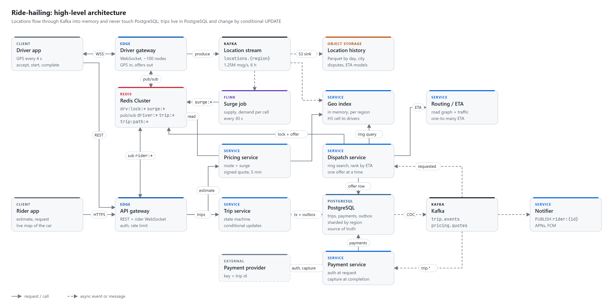
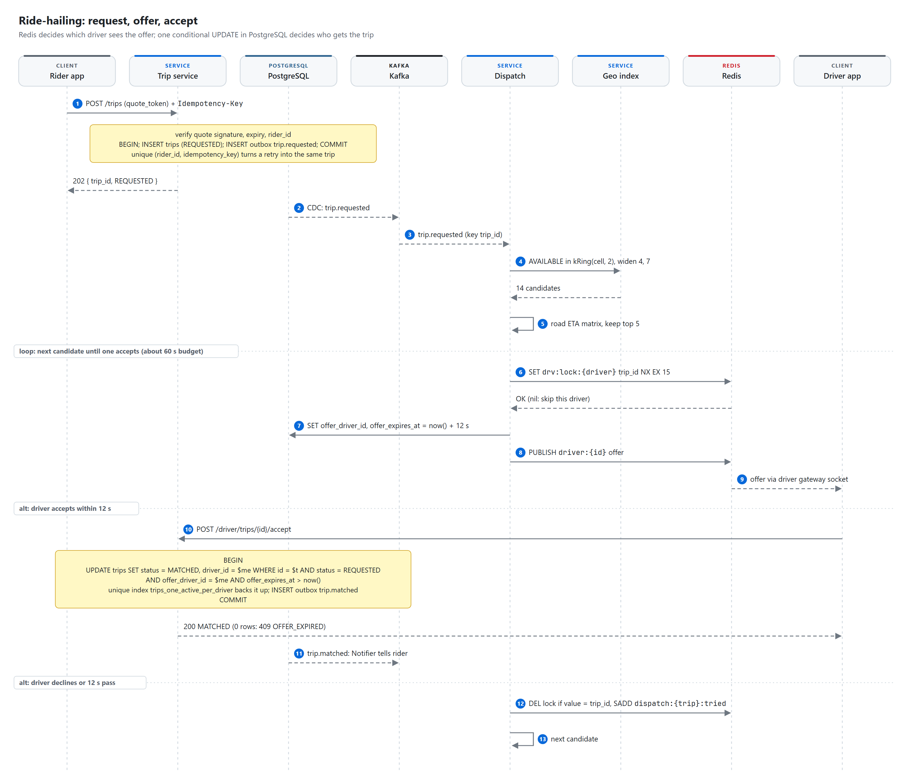
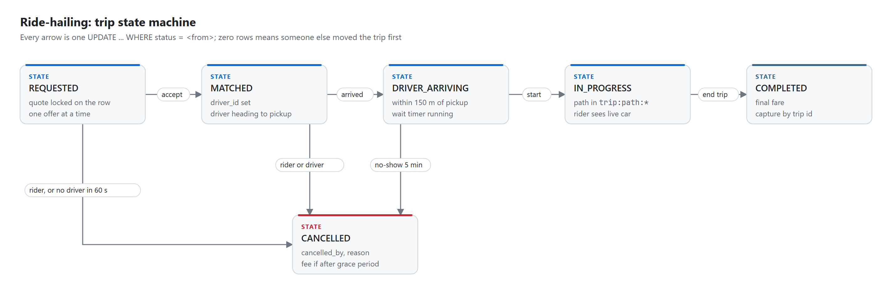

# Ride-hailing

> **Driver locations are a stream, not records: 1.25M GPS pings per second go over WebSocket into Kafka and
> into an in-memory H3 cell index per region, and none of them is written to PostgreSQL. Dispatch searches
> rings of cells around the pickup, ranks candidates by road ETA and offers the trip to one driver at a time
> under a 15 s Redis lock, while a conditional UPDATE plus a partial unique index in PostgreSQL makes it
> impossible for a driver to hold two trips. Surge is computed per cell on the stream every 30 s, the quote is
> a signed token valid for 5 minutes, and payment is an authorization at request and a capture at
> completion, both keyed by the trip id.**

| Category | Difficulty | Interview length | Core problems |
|---|---|---|---|
| Location-based | Hard | 45-60 min | high-rate location ingestion, geo index, dispatch without double assignment, surge, trip state |

**Contents:** [Requirements](#1-requirements) · [Capacity](#2-capacity-estimate) · [API](#3-api) ·
[Data model](#4-data-model) · [Architecture](#5-high-level-architecture) · [Flows](#6-request-flows) ·
[Deep dives](#7-deep-dives) · [Failures](#8-failure-cases) · [Trade-offs](#9-trade-offs) ·
[Follow-ups](#10-likely-follow-ups)

## 1. Requirements

**Functional**

- A rider enters pickup and dropoff and gets a fare estimate with a pickup ETA.
- A rider requests a ride at the quoted price and is matched to a nearby driver within a few seconds.
- A driver goes online, streams location, receives one offer at a time and accepts or declines it.
- Both sides see live progress: the car moving on the map, arrival, trip start, trip end.
- The rider is charged at the end of the trip; either side can cancel under clear rules.
- Prices rise in areas where demand outruns supply (surge).

**Non-functional**

- Match latency: first offer on a driver's screen p99 under 3 s after the request; rider matched p50 under 10 s.
- Location freshness: a driver's position in the index is at most ~5 s old (one 4 s ping plus pipeline lag).
- A driver is never assigned two active trips; a rider never gets two cars for one tap. These are hard rules.
- Trip state and payments are strongly consistent per trip. Locations and surge are allowed to be seconds stale.
- Availability: 99.99% for request and trip transitions within a region. Losing a region must not affect others.
- Location history kept for disputes and model training: about 13 months.

**Out of scope**

- Routing engine internals (road graph, traffic model), driver onboarding and documents, driver payouts and
  the ledger, shared rides (pool), food delivery, fraud scoring. They are mentioned where they touch the design.

**Scale** (estimates)

- 5M drivers online at peak, each sending a GPS ping every 4 s.
- 20M rides per day, about 5 fare estimates per completed request.
- Average trip 20 minutes, plus about 5 minutes driving to the pickup.
- About 20 regions, each a group of cities. Trips never span regions in the data model.

## 2. Capacity estimate

| Quantity | Arithmetic | Result | So what |
|---|---|---|---|
| Location pings | 5M drivers / 4 s | 1.25M/s at peak | Cannot be a database write. Stream it, keep the latest in memory |
| Ingress bandwidth | 1.25M/s x ~150 B (protobuf + framing + TLS) | ~190 MB/s, ~1.5 Gbps | Spread over the gateway fleet, trivial per node |
| Driver sockets | 5M / ~50k per node | ~100 gateway nodes (150 with headroom) | ~12k pings/s per node |
| Kafka location volume | 1.25M/s x 100 B, 6 h retention, RF 3 | 125 MB/s in, ~8 TB on disk | Separate cluster from trip events |
| Geo index memory | 5M drivers x ~150 B | ~750 MB in total | Fits in one process per region with room to spare |
| Ride requests | 20M / 86,400 s | ~230/s avg, ~700/s peak | Small for PostgreSQL even before sharding |
| Fare estimates | 100M / 86,400 s | ~1,150/s avg, ~3,500/s peak | Pricing is stateless, scale horizontally |
| Concurrent trips | 20M x 25 min / 1,440 min | ~350k avg, ~1M peak | ~20% of online drivers are busy at peak |
| On-trip pings | 1M trips / 4 s | 250k/s | Each one is a PUBLISH and an RPUSH in Redis: ~500k ops/s |
| Trip DB writes | 20M trips x ~15 row writes (trip, offers, transitions, outbox, payment) | ~3,500/s avg, ~10k/s peak | ~1k/s per regional shard; sharding is for blast radius and residency, not throughput |
| Hot trip storage | 20M/day x ~1.5 KB x 90 days | ~2.7 TB total | ~270 GB per region; older trips go to the warehouse |
| Location history | ~0.5M pings/s daily average x 86,400 x ~25 B in Parquet | ~1.1 TB/day, ~400 TB for 13 months | Object storage only, partitioned by day and city |
| Surge cells | ~200k active H3 res-7 cells / 30 s | ~7k Redis writes/s | Cheap |

## 3. API

Rider side, over the API gateway. Everything that changes state takes an idempotency key or a version.

```http
POST /v1/fare-estimates
{ "pickup": {"lat": 41.0431, "lng": 29.0094}, "dropoff": {"lat": 41.0082, "lng": 28.9784},
  "vehicle_type": "standard" }
-> 200 { "quote_token": "q1.eyJ...sig", "fare": {"amount_cents": 18400, "currency": "TRY"},
         "surge_multiplier": 1.3, "pickup_eta_s": 240, "expires_at": "2026-10-26T18:05:00Z" }

POST /v1/trips                         Idempotency-Key: 7c1e...  (uuid from the app)
{ "quote_token": "q1.eyJ...sig", "payment_method_id": "pm_829" }
-> 202 { "trip_id": "eu2-0192f7c4-...", "status": "REQUESTED", "version": 0 }
-> 409 { "error": "QUOTE_EXPIRED", "new_quote": { ... } }
-> 409 { "error": "ACTIVE_TRIP_EXISTS", "trip_id": "eu2-..." }

GET  /v1/trips/{trip_id}
-> 200 { "status": "MATCHED", "version": 1, "driver": {...}, "vehicle": {...},
         "pickup_eta_s": 180, "driver_location": {"lat": ..., "lng": ..., "ts": ...} }

POST /v1/trips/{trip_id}/cancel        { "version": 1 }
-> 200 { "status": "CANCELLED", "fee_cents": 0 }   |  409 { "error": "STATE_CHANGED", "status": "IN_PROGRESS" }
```

Driver side. Actions are REST; offers and location go over the driver socket.

```http
POST /v1/driver/trips/{trip_id}/accept      -> 200 MATCHED | 409 OFFER_EXPIRED | 409 TRIP_CANCELLED
POST /v1/driver/trips/{trip_id}/decline     -> 204
POST /v1/driver/trips/{trip_id}/arrived     -> 200 DRIVER_ARRIVING
POST /v1/driver/trips/{trip_id}/start       { "pin": "4821" }  -> 200 IN_PROGRESS
POST /v1/driver/trips/{trip_id}/complete    { "odometer_m": 8120 }  -> 200 COMPLETED { "fare_cents": 18400 }
```

Driver location stream over `wss://drivers.example/v1/stream`. The wire format is protobuf; JSON is shown for
reading. The driver id comes from the authenticated connection, never from the message.

```text
-> { "t": "loc", "seq": 18234, "ts": 1761470000123, "lat": 41.04312, "lng": 29.00941,
     "hdg": 87, "spd": 11.2, "acc": 6, "st": "AVAILABLE" }            every 4 s
<- { "t": "offer", "trip_id": "eu2-0192f7c4-...", "pickup": {...}, "pickup_eta_s": 180,
     "fare_cents": 18400, "expires_in_s": 12 }
<- { "t": "trip", "trip_id": "eu2-...", "status": "CANCELLED" }
```

Idempotency: `POST /trips` is idempotent through `UNIQUE (rider_id, idempotency_key)`; a retry returns the
same trip. Driver transitions are idempotent by state: if the conditional UPDATE changes zero rows and the row
already shows the requested state with this driver, the call returns 200 with the current trip. Cancel carries
the version the rider saw, so a cancel cannot land on a trip that has already started without the rider
knowing.

## 4. Data model

PostgreSQL, one cluster per region, is the source of truth for trips and payments. Locations are never in it.
Trip ids carry the region prefix (`eu2-` + UUIDv7), so every service routes a trip call without a lookup.

```sql
CREATE TABLE trips (
    id                 text        PRIMARY KEY,               -- 'eu2-' || uuidv7
    rider_id           bigint      NOT NULL,
    driver_id          bigint,
    status             text        NOT NULL CHECK (status IN
                         ('REQUESTED','MATCHED','DRIVER_ARRIVING','IN_PROGRESS','COMPLETED','CANCELLED')),
    version            integer     NOT NULL DEFAULT 0,
    idempotency_key    uuid        NOT NULL,
    vehicle_type       text        NOT NULL,
    pickup_lat         double precision NOT NULL,
    pickup_lng         double precision NOT NULL,
    pickup_cell        bigint      NOT NULL,                  -- H3 res 9
    dropoff_lat        double precision NOT NULL,
    dropoff_lng        double precision NOT NULL,
    quote_id           uuid        NOT NULL,
    quoted_fare_cents  integer     NOT NULL CHECK (quoted_fare_cents > 0),
    surge_multiplier   numeric(4,2) NOT NULL CHECK (surge_multiplier >= 1.00),
    currency           char(3)     NOT NULL,
    final_fare_cents   integer,
    offer_driver_id    bigint,                                -- driver currently holding the offer
    offer_expires_at   timestamptz,
    dispatch_attempts  smallint    NOT NULL DEFAULT 0,
    cancelled_by       text        CHECK (cancelled_by IN ('RIDER','DRIVER','SYSTEM')),
    cancel_reason      text,
    route_object_key   text,                                  -- S3 key of the GPS path, set at completion
    distance_m         integer,
    duration_s         integer,
    requested_at       timestamptz NOT NULL DEFAULT now(),
    matched_at         timestamptz,
    arrived_at         timestamptz,
    started_at         timestamptz,
    completed_at       timestamptz,
    cancelled_at       timestamptz,
    CONSTRAINT trips_rider_idem UNIQUE (rider_id, idempotency_key),
    CONSTRAINT trips_driver_when_assigned CHECK (
        status IN ('REQUESTED','CANCELLED') OR driver_id IS NOT NULL)
);

-- The two invariants that matter, enforced by the database, not by application code.
CREATE UNIQUE INDEX trips_one_active_per_driver ON trips (driver_id)
    WHERE status IN ('MATCHED','DRIVER_ARRIVING','IN_PROGRESS');
CREATE UNIQUE INDEX trips_one_active_per_rider ON trips (rider_id)
    WHERE status IN ('REQUESTED','MATCHED','DRIVER_ARRIVING','IN_PROGRESS');

CREATE INDEX trips_rider_history  ON trips (rider_id, requested_at DESC);
CREATE INDEX trips_driver_history ON trips (driver_id, requested_at DESC) WHERE driver_id IS NOT NULL;
CREATE INDEX trips_waiting        ON trips (requested_at) WHERE status = 'REQUESTED';  -- dispatch sweeper

CREATE TABLE outbox (
    id            bigserial   PRIMARY KEY,
    aggregate_id  text        NOT NULL,          -- trip id, becomes the Kafka key
    event_type    text        NOT NULL,          -- trip.requested, trip.matched, ...
    payload       jsonb       NOT NULL,
    created_at    timestamptz NOT NULL DEFAULT now()
);

CREATE TABLE payments (
    trip_id               text        PRIMARY KEY REFERENCES trips (id),
    rider_id              bigint      NOT NULL,
    payment_method_id     text        NOT NULL,
    currency              char(3)     NOT NULL,
    authorized_cents      integer,
    captured_cents        integer,
    status                text        NOT NULL CHECK (status IN ('AUTH_PENDING','AUTHORIZED','AUTH_FAILED',
                              'CAPTURE_PENDING','CAPTURED','CAPTURE_FAILED','VOIDED')),
    provider_auth_ref     text,
    provider_capture_ref  text,
    attempts              smallint    NOT NULL DEFAULT 0,
    updated_at            timestamptz NOT NULL DEFAULT now()
);
CREATE INDEX payments_stuck ON payments (updated_at)
    WHERE status IN ('AUTH_PENDING','CAPTURE_PENDING');

CREATE TABLE processed_webhooks (
    provider_event_id  text        PRIMARY KEY,
    received_at        timestamptz NOT NULL DEFAULT now()
);
```

One trap: `trips` is deliberately not range-partitioned by month. On a partitioned table a unique index must
include the partition key, which would break `trips_one_active_per_driver`. Instead a nightly job moves trips
older than 90 days to the warehouse and deletes them; the hot table stays around 180M rows per region.

**Redis keys** (Redis Cluster per region)

| Key | Value | TTL | Purpose |
|---|---|---|---|
| `drv:lock:{driver_id}` | trip_id | 15 s | At most one outstanding offer per driver |
| `drv:trip:{driver_id}` | trip_id | 12 h, deleted at end | Gateway knows the driver is on a trip after a reconnect |
| `dispatch:{trip_id}:tried` | set of driver ids | 120 s | Do not re-offer to a driver who declined this trip |
| `surge:{h3_res7}` | multiplier and computed_at | 120 s | Pricing reads the multiplier for the pickup cell |
| `trip:path:{trip_id}` | list of compact points (ts, lat, lng) | 6 h | Distance for the final fare, polyline for the receipt |
| channel `driver:{driver_id}` | pub/sub (sharded) | none | Offers and trip updates to the gateway node holding the socket |
| channel `trip:{trip_id}` | pub/sub (sharded) | none | Driver location to the rider's socket during the trip |
| channel `rider:{rider_id}` | pub/sub (sharded) | none | Trip status to the rider's socket |

What if Redis loses them:

- `drv:lock:*`: a driver could get a second offer while one is on screen. Annoying, not wrong: the second accept
  hits the partial unique index and gets 409. Correctness never depended on the lock.
- `drv:trip:*`: the gateway asks the Trip service for the driver's active trip (an index lookup on
  `trips_one_active_per_driver`) and re-caches it.
- `dispatch:*:tried`: a driver who declined might see the same trip once more. Harmless.
- `surge:*`: Pricing uses 1.0 until the next job tick, at most 30 s. Riders are never overcharged by a failure.
- `trip:path:*`: the Trip service rebuilds the path from the location archive in S3 by driver id and time
  window. The fare is finalized a few minutes later than usual, and the capture waits for it.
- Pub/sub is fire and forget. A lost offer times out after 12 s and dispatch moves on; apps also poll
  `GET /trips/{id}` every 5 s when the socket is down.

**Kafka topics**

| Topic | Key | Producer | Consumers |
|---|---|---|---|
| `locations.{region}` (location cluster) | driver_id | Driver gateway | Geo index replicas, Surge job, S3 sink connector |
| `trip.events` | trip_id | Trip service outbox via Debezium | Dispatch, Payment service, Notifier, Surge job (demand), analytics |
| `pricing.quotes` | rider_id | Pricing service | Surge job (demand), analytics, quote audit |
| `dispatch.offers` | trip_id | Dispatch | Acceptance-rate stats, analytics |
| `payment.events` | trip_id | Payment service outbox | Notifier (receipts), Trip service (block next ride on unpaid) |
| `surge.updates` | h3 cell | Surge job | Audit of every multiplier shown, analytics |

Location topics have 6 h retention and run on their own cluster, so a location spike cannot slow trip events.
`trip.events` keeps 7 days.

## 5. High-level architecture

<picture>
  <source media="(prefers-color-scheme: dark)" srcset="diagrams/architecture-dark.png">
  
</picture>

- **Driver gateway**: holds 5M WebSockets. Validates each ping (monotonic `seq`, plausible speed, accuracy),
  stamps server time, computes the H3 cell and region, produces to `locations.{region}`. For on-trip drivers it
  also does `PUBLISH trip:{id}` and `RPUSH trip:path:{id}`. Each node subscribes to `driver:{id}` for the
  drivers it holds, which is how offers reach the right socket without a connection registry.
- **Location stream**: the only place a raw ping goes, besides the archive. It decouples 1.25M writes per second
  from everything that reads them.
- **Geo index**: per-region, in-memory map from H3 cell to available drivers. Two or three replicas per region,
  each consuming the whole region topic on its own. It holds nothing that the last 30 s of the stream cannot
  rebuild.
- **Surge job** (Flink): windowed supply and demand per H3 res-7 cell, writes multipliers to Redis.
- **Routing / ETA**: road graph with live traffic; answers point-to-point routes for Pricing and one-to-many ETA
  matrices for Dispatch. Its internals are out of scope.
- **Pricing**: route + surge + rate card, returns a signed quote token. Also asks the geo index for nearby cars
  to show the pickup ETA.
- **Trip service**: owns the `trips` state machine. Every transition is a conditional UPDATE plus an outbox row
  in one transaction.
- **Dispatch**: consumes `trip.requested`, searches, ranks, locks, offers. It writes only the offer columns of
  `trips`, always with `WHERE status = 'REQUESTED'`.
- **Payment service**: authorization on `trip.requested`, capture on `trip.completed`, against the provider
  with our trip id as the idempotency key.
- **Notifier**: turns trip events into `PUBLISH rider:{id}` for open apps and APNs/FCM pushes for closed ones.

## 6. Request flows

<picture>
  <source media="(prefers-color-scheme: dark)" srcset="diagrams/dispatch-flow-dark.png">
  
</picture>

**Driver location update** (every 4 s per driver)

1. The app sends `loc` with `seq` and device time over the socket.
2. The gateway drops it if `seq` is not greater than the last one on this connection, or if the implied speed
   from the previous point is over 250 km/h (GPS jump). It stamps server time, computes the H3 res-9 cell.
3. The gateway produces to `locations.{region}` with key driver_id, `acks=1`, 5 ms linger. Losing a ping is
   fine; the next one is 4 s away.
4. If the driver has an active trip (`drv:trip:{id}`, cached on the connection), it also publishes the point to
   `trip:{trip_id}` and appends it to `trip:path:{trip_id}`.
5. Geo index replicas apply the ping: update the driver record, move the driver between cell sets if the cell
   changed, drop the driver from cell sets if the status is not AVAILABLE.

**Fare estimate**

1. Rider sends pickup, dropoff, vehicle type. Pricing gets the route (distance, duration) from Routing.
2. Pricing reads `surge:{res7 cell of pickup}` (missing key means 1.0) and the regional rate card.
3. Pricing asks the geo index for the nearest few available drivers to compute the pickup ETA shown in the app.
4. It returns a quote token: HMAC over `{quote_id, rider_id, pickup, dropoff, vehicle_type, fare_cents, surge,
   expires_at = now + 5 min, key_id}`. Nothing is stored; the quote event goes to `pricing.quotes`.

**Request, match, accept** (the diagram above)

1. `POST /trips` with the quote token and an `Idempotency-Key`. The Trip service verifies the signature, the
   expiry and that the token belongs to this rider.
2. One transaction: `INSERT trips (REQUESTED)` with the quoted price copied onto the row, plus an outbox row.
   The partial unique index rejects a second active trip for the rider. Returns 202.
3. Debezium publishes `trip.requested` (key trip_id). Dispatch and the Payment service both consume it.
4. Dispatch queries the geo index replica for the region: available drivers of the right vehicle type in
   `kRing(pickup_cell, 2)`, widening to 4, then 7, until it has at least 8 candidates.
5. Dispatch asks Routing for a one-to-many ETA matrix from the candidates to the pickup, ranks, keeps the top 5.
6. For the best candidate: `SET drv:lock:{driver} {trip_id} NX EX 15`. If it fails, someone else is offering
   to that driver; skip.
7. `UPDATE trips SET offer_driver_id = $d, offer_expires_at = now() + interval '12 s' WHERE id = $t AND status = 'REQUESTED'`.
   Zero rows means the rider cancelled; release the lock and stop.
8. `PUBLISH driver:{id}` with the offer. The gateway node holding that socket forwards it.
9. Driver accepts: the conditional UPDATE in the deep dive below moves the trip to MATCHED. Zero rows returns
   409. The outbox emits `trip.matched`; the Notifier tells the rider; the Trip service sets `drv:trip:{id}`.
10. Decline or 12 s timeout: compare-and-delete the lock, add the driver to `dispatch:{trip}:tried`, go to the
    next candidate. After the list is exhausted, widen the ring. After 60 s with no match, the trip is
    CANCELLED by SYSTEM with reason `NO_DRIVERS` and the rider is told.

**Trip and payment**

1. Payment service, on `trip.requested`: `INSERT payments (AUTH_PENDING) ON CONFLICT DO NOTHING`, then
   authorize the quoted fare plus 20% with idempotency key `auth-{trip_id}`. This runs in parallel with
   dispatch; it does not block matching.
2. Driver taps arrived (or is within 150 m of pickup): DRIVER_ARRIVING, wait timer starts.
3. Driver enters the rider's PIN: IN_PROGRESS. The rider watches the car through `trip:{trip_id}`.
4. Driver ends the trip: the Trip service reads `trip:path:{id}`, computes distance, writes the polyline to S3,
   sets `final_fare_cents` (the quote, unless the rules below apply) and COMPLETED, in one transaction with
   the outbox row.
5. Payment service, on `trip.completed`: capture with key `capture-{trip_id}`, mark CAPTURED, emit
   `payment.captured`; the Notifier sends the receipt.

## 7. Deep dives

### 7.1 Geo index and location updates

**The problem.** 1.25M updates per second, each obsolete 4 seconds later. The only query that matters is
"available drivers of type X near point P, nearest first", at ~700/s for dispatch and ~3,500/s for estimates.

**Why not PostgreSQL.** 1.25M row updates per second is a large sharded fleet producing WAL and dead tuples
for data nobody will read again. PostgreSQL stores facts; a ping is not a fact worth a transaction.

**Cells: H3 over geohash.** H3 resolution 9 cells are hexagons of about 0.1 km² (edge about 175 m, centre to
centre about 300 m). Every neighbour is the same distance away, and "ring k around this cell" is one call,
`1 + 3k(k+1)` cells: k=2 is 19 cells (~600 m), k=4 is 61, k=7 is 169 (~2 km). Geohash works too, and Redis
GEO uses it internally, but its cells are rectangles that stretch with latitude, the 8 neighbours sit at two
different distances, and a point near a cell edge needs neighbour handling anyway. H3 makes the ring search
and the surge cells the same concept at two resolutions.

**Index shape, per region, per replica.**

```text
drivers: map driver_id -> { lat, lng, cell, status, vehicle_type, heading, ts }
cells:   map cell      -> set of driver_id   (AVAILABLE drivers only)

apply(ping):
  if ping.ts <= drivers[id].ts: drop                      # out of order
  if cell changed or status changed: move between cell sets
  drivers[id] = ping
every 5 s: evict drivers with ts older than 30 s           # app killed, tunnel, phone died
query(cell, k, type): union cells[c] for c in kRing(cell, k), filter type, sort by straight-line distance
```

The largest region has a few hundred thousand drivers, ~75k pings per second: one process with a few consumer
threads handles it, and memory is under 100 MB. Restart: the replica seeks its consumer to the offset for
`now - 30 s` and replays; it reports ready once lag is under 1 s, usually within 10 to 20 s. No snapshot, no
persistence: **the index is a 30-second cache of the stream**.

**Why not Redis GEO.** It is the right answer for one city at a few thousand updates per second. At this scale:
each GEOADD is a network round trip on a sorted set, so 1.25M/s needs a large cluster just for writes;
`GEOSEARCH` returns busy drivers too, so you need a second lookup or a set per status; stale drivers need a
second sorted set by timestamp and a sweeper; and Redis would still not know road ETA. An in-process map
answers the ring query in microseconds and the only thing we give up is persistence, which the stream already
provides.

**Transport: WebSocket over UDP.** UDP saves bytes per ping, but we still need authentication, encryption
(DTLS), NAT keepalives on mobile networks and a downstream channel for offers. A WebSocket gives all of that on
one connection. A lost ping does not matter either way.

**Cold storage.** The S3 sink connector writes `locations.{region}` as Parquet partitioned by
`date/city/hour`, ~1.1 TB a day. Support reads it for disputes ("the driver took a detour"), and the ETA and
supply forecasting models train on it. It is never on a request path, except the rare fare rebuild when
`trip:path:*` was lost.

### 7.2 Matching without double assignment

**The problem.** Two riders' dispatch jobs both find the same nearest driver. Or a driver accepts at second
13 of a 12-second offer while dispatch has already moved on. The driver must end up with exactly one trip,
and the trip with exactly one driver.

**Three layers, each with one job.**

```text
-- 1. Redis: at most one offer on a driver's screen (UX and fairness, not correctness)
SET drv:lock:{driver_id} {trip_id} NX EX 15

-- release on decline or timeout, only if the lock is still ours
if redis.call('GET', KEYS[1]) == ARGV[1] then return redis.call('DEL', KEYS[1]) end
return 0
```

```sql
-- 2. Offer columns: only the driver currently offered can accept, only inside the window, on the DB clock
UPDATE trips
   SET offer_driver_id = $driver, offer_expires_at = now() + interval '12 seconds',
       dispatch_attempts = dispatch_attempts + 1, version = version + 1
 WHERE id = $trip AND status = 'REQUESTED';

-- accept, one transaction with the outbox insert
UPDATE trips
   SET status = 'MATCHED', driver_id = $driver, matched_at = now(),
       offer_driver_id = NULL, offer_expires_at = NULL, version = version + 1
 WHERE id = $trip AND status = 'REQUESTED'
   AND offer_driver_id = $driver AND offer_expires_at > now();
-- 0 rows: OFFER_EXPIRED or TRIP_CANCELLED (read the row to tell which)

-- 3. trips_one_active_per_driver: a unique violation here means the driver already has a trip -> 409
```

The Redis lock decides who sees an offer; PostgreSQL decides who gets the trip. If Redis fails over and loses a
lock, the worst case is two offers on one phone, and the second accept fails on the unique index. The lock TTL
(15 s) is longer than the offer window (12 s) so in the normal path the lock outlives the offer. After an
accept we do not delete the lock: it expires a few seconds later, by which time the driver's next ping has
reported `ON_TRIP` and the geo index has removed them from the available set.

The expiry check uses `now()` from the database for both writing and reading `offer_expires_at`, so clock skew
between dispatch nodes and the Trip service does not matter.

**One driver at a time, not broadcast.** Sending the trip to five drivers and taking the first accept is faster
when acceptance is low, but four drivers see an offer vanish, they learn to tap fast instead of read, and the
nearest driver loses to the fastest thumb. Sequential offers with a 12 s window cost on average about 1.5
offers per trip. When the top driver's acceptance rate is poor, dispatch shortens the window to 8 s.

**Ranking.** Road ETA from the routing matrix, not straight-line distance (a driver 300 m away across a river
can be 9 minutes out). Ties broken by heading toward the pickup, then by idle time so the same drivers do not
get every trip.

**Dispatch crash mid-loop.** The loop state lives in the dispatch process plus `dispatch:{trip}:tried`. A
sweeper every 2 s reads `trips_waiting`: trips still REQUESTED whose `offer_expires_at` passed more than 3 s ago,
or which have no offer 3 s after `requested_at`, and re-enqueues them to a live dispatch instance.

### 7.3 Surge pricing

**The problem.** In a cell where 40 people want rides and 5 drivers are free, a fixed price means most riders
wait 20 minutes and nobody new comes online. A higher price there reduces demand and pulls drivers in.

**Computation, on the stream.** A Flink job (Kafka Streams would also do; Flink earns its place with event-time
windows and keyed state) keyed by H3 res-7 cell, about 5 km²:

- Supply: distinct AVAILABLE drivers whose latest ping in the last 2 minutes falls in the cell.
- Demand: distinct riders who asked for an estimate (`pricing.quotes`) or requested (`trip.events`) in the cell
  in the last 2 minutes. Distinct, so one rider refreshing ten times counts once.
- Every 30 s: `ratio = demand / max(supply, 1)`, `raw = clamp(1 + a * (ratio - 1), 1.0, cap)`, where `a` and
  `cap` come from per-region config (some cities legally cap surge).
- Smoothing: average with the ring-1 neighbours so adjacent cells do not differ by 1.5x across one street, and
  limit the change per tick to +/-0.3 so the price does not flap.
- Write `surge:{cell}` with TTL 120 s and emit to `surge.updates` for audit.

**Reading it.** Pricing reads one Redis key per estimate. Every rider in the cell sees the same number for 30 s,
which is fairer and far cheaper than computing surge per request.

**Locking the price.** The multiplier and the fare are inside the signed quote token, valid 5 minutes. The rider
pays what they saw, even if surge jumps one tick later. The token needs no storage: verification is an HMAC
check, and a key id inside it allows key rotation. The fare changes after the trip only if the rider changed
the destination (new quote), or the actual distance or duration exceeded the quote's route by more than 25%
(detours, rider-requested stops). Both rules are visible to the rider before they request.

### 7.4 Trip state and payment

<picture>
  <source media="(prefers-color-scheme: dark)" srcset="diagrams/trip-states-dark.png">
  
</picture>

| From | To | Who | Guard |
|---|---|---|---|
| REQUESTED | MATCHED | driver | offer is theirs and not expired; driver has no active trip |
| REQUESTED | CANCELLED | rider, or SYSTEM after 60 s | none; free |
| MATCHED | DRIVER_ARRIVING | driver, or geofence at 150 m | none |
| MATCHED | CANCELLED | rider or driver | rider pays a fee after a 2 min grace period; driver cancels hurt their score |
| DRIVER_ARRIVING | IN_PROGRESS | driver | rider PIN matches |
| DRIVER_ARRIVING | CANCELLED | driver after 5 min wait, or rider | no-show fee to rider |
| IN_PROGRESS | COMPLETED | driver | none; there is no cancel once the rider is in the car |

Every transition has the same shape: `UPDATE trips SET status = $to, ..., version = version + 1 WHERE id = $t
AND status = $from` plus an outbox insert, in one transaction. Zero rows means another actor moved the trip
first: the rider cancelled at the same second the driver tapped arrived, and whoever committed first wins. The
loser reads the row and shows the real state. No locks are held across network calls.

**Payment.** Two provider calls, both keyed by our trip id:

1. **Authorize at request** (`auth-{trip_id}`), for the quote plus 20%. If it is declined before a match, the
   trip is cancelled with `PAYMENT_DECLINED` and the rider picks another card. If the decline arrives after a
   match (the auth runs in parallel with dispatch), the trip is cancelled by SYSTEM and the driver gets a small
   compensation. Rare, and much cheaper than blocking every match on a 1-2 s auth call.
2. **Capture at completion** (`capture-{trip_id}`), for the final fare. If the final fare is above the
   authorized amount, capture the authorized amount and charge the rest as a separate call keyed
   `extra-{trip_id}`.

A timeout leaves the row in `CAPTURE_PENDING`. The retry uses the same key, so the provider returns the first
result instead of charging twice. A reconciler scans `payments_stuck` every minute and asks the provider for
the status by our key. Webhooks are deduplicated through `processed_webhooks`. If a capture finally fails, the
rider has an unpaid balance and the Trip service rejects their next request until it is settled; the driver is paid
regardless, because that risk belongs to the platform.

**Sharding by region.** Each region has its own PostgreSQL cluster, Redis cluster, geo index, dispatch and
location topic. A trip belongs to the region of its pickup, for its whole life, even if it ends across a border.
Riders and drivers are global accounts in a separate user service; a driver who drives into another region
simply starts producing to that region's topic and the old region's index evicts them after 30 s.

## 8. Failure cases

| Failure | Effect | Recovery |
|---|---|---|
| Driver gateway node dies | ~50k drivers lose the socket; their offers in flight are lost | Apps reconnect with jittered backoff to other nodes; index entries survive 30 s; lost offers time out and dispatch moves on |
| Location Kafka cluster degraded | Index goes stale; drivers drop out after 30 s; fewer candidates, longer waits | Replicated brokers; consumers resume from committed offsets. Trips already in progress are unaffected, they do not read the index |
| Geo index replica crashes | Queries to it fail | Dispatch and Pricing use another replica; the restarted one replays 30 s of stream and rejoins |
| Redis primary fails over, locks lost | A driver may get two offers | Second accept fails on `trips_one_active_per_driver`; surge falls back to 1.0 for at most 30 s |
| Redis pub/sub message lost | Offer or status never reaches the app | Offer times out in 12 s; apps poll `GET /trips/{id}` when the socket is down |
| Dispatch instance crashes mid-loop | Trip stays REQUESTED with an expired offer | Sweeper re-enqueues REQUESTED trips with an expired or missing offer after 3 s |
| Regional PostgreSQL primary fails | 10-30 s with no new trips or transitions in that region | Synchronous standby promoted. Driver app queues transitions and retries them; they are idempotent by state |
| Driver loses signal mid-trip | Rider sees the car freeze | App buffers points with device timestamps and uploads them in a batch on reconnect; the path is filled in before the fare is final |
| Provider times out on capture | Payment stuck in `CAPTURE_PENDING` | Retry with the same `capture-{trip_id}` key; reconciler queries by key |
| Driver accepts at second 13 | Accept arrives after the offer moved on | Conditional UPDATE finds `offer_expires_at` passed: 409 `OFFER_EXPIRED` |
| Rider double-taps Request | Two POSTs | Same `Idempotency-Key`, same trip; a different key still hits `trips_one_active_per_rider` |
| GPS spoofing or jumps | Wrong positions, fake proximity | Gateway speed and accuracy filter; spoofing detection runs on the archive and flags accounts |
| Whole region down | No new trips in those cities | Other regions unaffected. A warm standby region with async replication can take over, accepting a few seconds of lost writes |

## 9. Trade-offs

| Decision | Chosen | Rejected | Why |
|---|---|---|---|
| Location storage | Kafka + in-memory index + S3 archive | PostgreSQL row per ping | 1.25M writes/s of data that is obsolete in 4 s; a stream is the right shape |
| Geo index | In-process map per region, rebuilt from the stream | Redis GEO | No status filter or staleness expiry in GEO, a network hop per write; we lose only persistence, which the stream gives back |
| Cell system | H3 res 9 for search, res 7 for surge | Geohash | Uniform neighbours and a one-call ring; geohash would work with more edge handling |
| Transport | WebSocket | UDP | Auth, TLS, NAT and a downstream channel for offers on one connection |
| Offer strategy | One driver at a time, 12 s window | Broadcast to N drivers | No race between drivers, offers mean something; costs some seconds when acceptance is low |
| Double-assignment guard | Conditional UPDATE + partial unique index | Redis lock alone | A Redis failover can drop a lock; the database cannot forget a constraint |
| Fare quote | HMAC-signed token, 5 min | Quote row in Redis or PostgreSQL | Nothing to store, nothing to lose, no lookup on the request path |
| Surge | Windowed stream job, every 30 s per cell | Compute per request | Same price for everyone in the cell, one key read per estimate |
| Push to apps | Redis sharded pub/sub, apps poll as fallback | Connection registry + RPC to gateway node | No registry to keep consistent; offers already tolerate loss through the timeout |
| Sharding | By region (pickup decides) | Hash of trip id | Every query is local to a city; small blast radius; data residency; costs special handling at borders and airports |
| Payment | Authorize at request, capture at end | Charge only at the end | Catches bad cards before a driver drives; auth runs in parallel so it does not slow matching |

## 10. Likely follow-ups

- **How would you match better than greedy nearest-first?** Batch it. Collect requests in a cell group for
  1-2 s and solve an assignment that minimizes total pickup ETA across all of them. Greedy gives the nearest
  driver to the first rider even when that driver is the only one who can reach the second rider quickly.
- **How do airports work?** Not by nearest driver. Drivers inside the airport geofence join a FIFO queue
  (a Redis sorted set by arrival time, rebuilt from pings if lost), and dispatch for airport pickups pops from it.
- **Riders see cars on the map before requesting. Isn't that a lot of geo queries?** Pricing serves them from
  the same index, but the result per res-8 cell is cached for 2 s and positions are coarsened. Thousands of
  riders looking at the same block share one query.
- **How do you build the ETA?** A routing engine on the road graph with live segment speeds derived from the
  location stream itself, then an ML correction trained on the archived actual pickup times.
- **What if the driver app sends a fake location?** Speed and accuracy checks at the gateway, mock-location
  flags from the OS, and offline detection on the archive (impossible paths, clusters of drivers at the same
  coordinates). Flagged accounts are suspended, not filtered silently.
- **Why not let Dispatch read the latest location from Redis instead of a custom index?** That moves the 1.25M
  writes per second into Redis and still leaves the ring query and the status filter to us. The custom part is
  a hash map of sets.
- **What about a trip that starts in one region and ends in another?** It belongs to the pickup region for its
  whole life. The driver's pings move to the other region's topic, but the rider's tracking goes through
  `trip:{id}` in the trip's region, which the gateway resolves from the trip id prefix.
- **How would you add shared rides?** A trip becomes a set of legs on one vehicle and matching must check that
  adding a rider does not delay the others past a limit. The single-active-trip index becomes a capacity check
  on the vehicle. It is a different dispatch problem and I would design it separately.

## Phrases worth using

- "A location is a stream, not a record: the next ping is four seconds away, so we never write it per update."
- "The geo index is a 30-second cache of the stream; losing it costs one replay."
- "Redis decides who sees the offer; PostgreSQL decides who gets the trip."
- "Every transition is a conditional UPDATE: zero rows means someone else got there first."
- "The quote is a signed fact, not a row."
