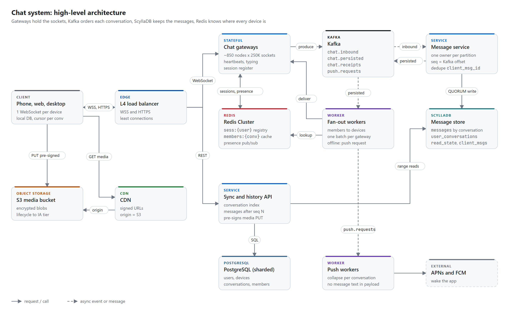
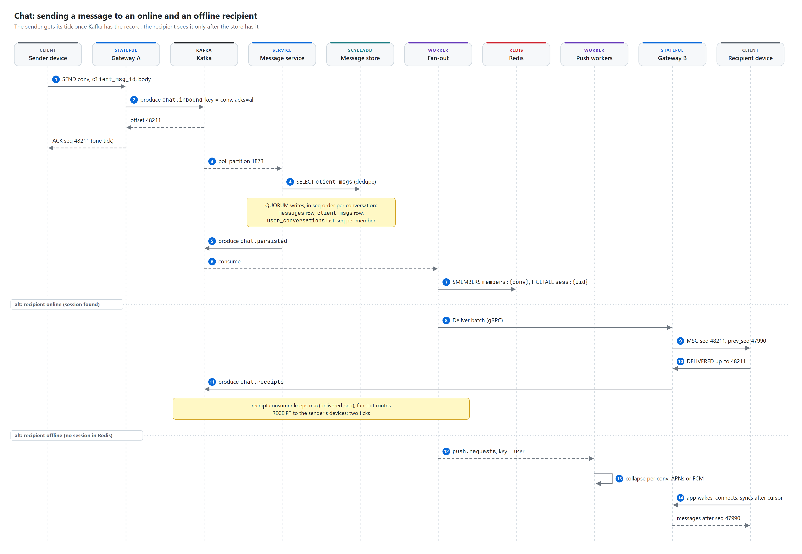
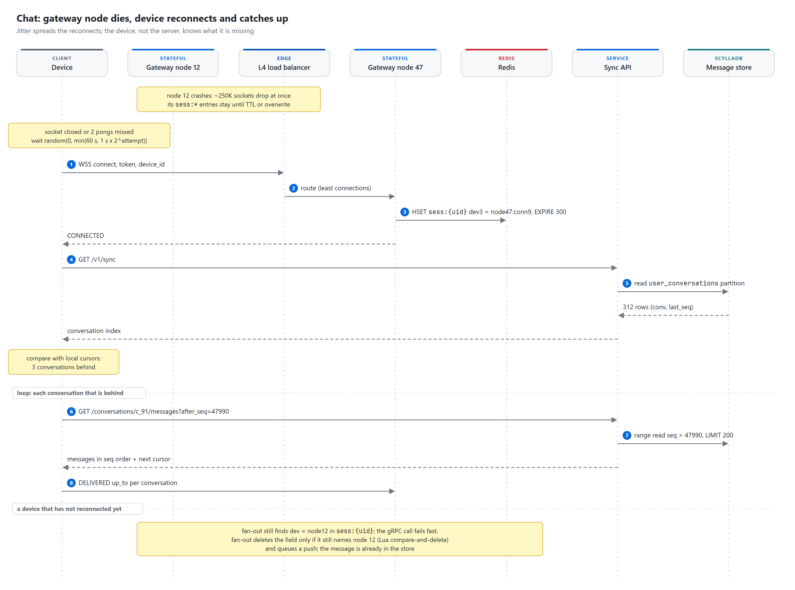

# Chat system

> **Every device holds one WebSocket to a stateful gateway, and a Redis session registry maps each
> user's devices to the gateway node that holds them. A send goes into Kafka keyed by conversation id, so
> one Message service instance owns each conversation, and the Kafka offset of the record becomes the
> message's sequence number: ordering, durability and the sender's first tick all come from one
> replicated append.** Messages are stored once per conversation in ScyllaDB, fan-out workers push them to
> whichever devices are online, push notifications wake the rest, and every device catches up on its own
> with "give me everything after seq N", so a dropped socket or a dead gateway delays a message but never
> loses it.

| Category | Difficulty | Interview length | Core problems |
|---|---|---|---|
| Messaging and real-time | Hard | 45 to 60 min | stateful connections, per-conversation ordering, multi-device delivery, group fan-out, presence |

**Contents:** [Requirements](#1-requirements) · [Capacity](#2-capacity-estimate) · [API](#3-api) ·
[Data model](#4-data-model) · [Architecture](#5-high-level-architecture) · [Flows](#6-request-flows) ·
[Deep dives](#7-deep-dives) · [Failures](#8-failure-cases) · [Trade-offs](#9-trade-offs) ·
[Follow-ups](#10-likely-follow-ups)

## 1. Requirements

**Functional**

- Send text and media in 1:1 chats and in groups of up to 500 members.
- Use several devices per user (phone, desktop, web); all of them see the same history.
- Receive messages in real time when online, and through a push notification plus catch-up when offline.
- See delivery and read receipts (one tick: server has it, two: delivered, blue: read).
- See whether a contact is online, or when they were last seen; see "typing...".

**Non-functional**

- p99 under 500 ms from send to the recipient's screen when both are online.
- No lost messages: once the sender sees one tick, the message survives any single machine or zone loss.
- Messages in a conversation appear in the same order on every device. No global order across chats.
- 99.99% availability for send and receive. Presence and typing may degrade first.
- A device that was offline for a week catches up in a few seconds, without the server tracking it.

**Out of scope**

- End-to-end encryption internals (Signal protocol, key exchange). We treat the body as an opaque blob,
  which is exactly what E2E would require. Section 10 says what changes if it is on.
- Voice and video calls, stories, broadcast channels with 100K+ members, server-side search, bots.
- Contact discovery and abuse detection beyond send rate limits.

**Scale**

- 500M DAU, 2B registered users, ~40 messages sent per user per day.
- 70% of messages are 1:1, 30% go to groups (average 15 other members, maximum 500).
- 1.4 connected devices per online user on average.
- Average message: ~300 bytes on the wire and at rest (body, ids, envelope). 5% carry media, ~300 KB each.

## 2. Capacity estimate

All numbers are estimates, rounded on purpose.

| Quantity | Arithmetic | Result | So what |
|---|---|---|---|
| Messages per day | 500M x 40 | 20B/day | |
| Send rate | 20B / 86,400 s | ~230K/s avg, ~700K/s peak (3x) | Size Kafka and the store for 1M/s (holiday midnight) |
| Recipients per message | 0.7 x 1 + 0.3 x 15 | ~5.2 users | Fan-out, not ingest, is the bulk of the work |
| Device deliveries | 700K x 5.2 x 1.4 (+ sender's other devices) | ~5.4M frames/s peak | Batch per gateway node, never one RPC per frame |
| Concurrent sockets | 150M online at peak x 1.4 devices | ~210M WebSockets | |
| Gateway nodes | 210M / 250K per node | ~850 nodes | 250K is a choice, not a limit; see 7.5 |
| Memory per gateway | 250K x ~10 KB (TLS state, buffers, session) | ~2.5 GB | Small boxes; CPU (TLS, JSON) is the real limit |
| Heartbeats | 210M / 45 s | ~4.7M/s fleet, ~5.5K/s per node | Cheap, handled in the gateway, never touches Redis |
| Kafka ingest | 700K x 300 B, x2 topics, x3 replicas | ~1.3 GB/s disk writes | A few dozen brokers, 4,096 partitions on `chat.inbound` |
| Message storage | 20B x 300 B | ~6 TB/day raw, ~18 TB/day with RF 3 | E2E ciphertext does not compress |
| Hot tier (90 days) | 18 TB x 90 | ~1.6 PB | ~450 ScyllaDB nodes at ~3.7 TB used each; older buckets go to S3 |
| Store writes | 700K messages + 700K x 6.2 index rows, x3 | ~15M replica writes/s | ~34K/node on 450 nodes: storage-bound, not write-bound |
| Media | 20B x 5% x 300 KB | ~300 TB/day, ~110 PB/year | S3 with lifecycle rules, CDN for reads |
| PostgreSQL | 2B users x 1 KB + ~120B memberships x 60 B | ~2 TB + ~7 TB (+ indexes) | Sharded, 64 shards by id |
| Redis | 150M `sess` hashes x 150 B + caches | ~100 GB, ~4M ops/s peak | ~60 primaries with replicas |

## 3. API

**WebSocket** (`wss://chat.example.com/v1/ws`, bearer token, `X-Device-Id`). JSON shown for reading;
the wire uses a compact binary encoding.

```text
-> {"t":"send","conv":"c_91","client_msg_id":"7f3c...e1","kind":"text","body":"<opaque base64>"}
<- {"t":"ack","client_msg_id":"7f3c...e1","seq":48211}                     one tick
<- {"t":"nack","client_msg_id":"7f3c...e1","code":"not_a_member"}

<- {"t":"msg","conv":"c_91","seq":48211,"prev_seq":47990,"sender":"u_7","sender_device":2,
    "client_msg_id":"7f3c...e1","kind":"text","body":"...","sent_at":1761480000123}
-> {"t":"delivered","conv":"c_91","up_to":48211}                            watermark, not per message
-> {"t":"read","conv":"c_91","up_to":48211}
<- {"t":"receipt","conv":"c_91","user":"u_8","delivered_up_to":48211,"read_up_to":48100}

-> {"t":"presence_sub","users":["u_8"]}                                      only for chats on screen
<- {"t":"presence","user":"u_8","state":"online"}  |  {"state":"offline","last_seen":1761479000}
-> {"t":"typing","conv":"c_91"}                                              ephemeral, never stored
-> {"t":"ping"}   <- {"t":"pong"}                                            every 45 s
```

`send` is idempotent on `(conv, client_msg_id)`. The client generates the id (UUIDv7), stores the message
locally as pending, and resends with the same id after any timeout or reconnect until it gets an `ack`.

**REST** (stateless, behind the same load balancer):

```http
GET  /v1/sync?page_token=...
-> 200 {"conversations":[{"conv":"c_91","last_seq":48211,"large":false}, ...],"next_page_token":null}

GET  /v1/conversations/c_91/messages?after_seq=47990&limit=200     catch-up, oldest first
GET  /v1/conversations/c_91/messages?before_seq=47990&limit=50     scroll back, newest first
-> 200 {"messages":[...],"next_cursor":48211,"has_more":false}

PUT  /v1/direct/u_8                       -> 200 {"conv":"c_91"}   idempotent: one DM per user pair
POST /v1/conversations                    Idempotency-Key: <uuid>
{"kind":"group","title":"Climbing","members":["u_8","u_9"]}
-> 201 {"conv":"c_120"}
POST /v1/conversations/c_120/members      {"user":"u_10"}  -> 204 | 409 group_full

POST /v1/media/uploads                    {"mime":"image/jpeg","bytes":284113,"sha256":"..."}
-> 201 {"media_id":"m_5d1","upload":{"url":"https://...s3...","fields":{...}},"expires_in":900}
GET  /v1/media/m_5d1                      -> 302 Location: <signed CDN URL, 5 min>
```

The upload is a pre-signed S3 POST policy with a `content-length-range` condition, so the client cannot
upload more than it declared. Membership changes are written to PostgreSQL and then produced to
`chat.inbound` as system messages, so they get a seq like any other message (see 7.4).

## 4. Data model

### PostgreSQL: users, conversations, memberships

Low write rate, relational, needs uniqueness constraints. Sharded 64 ways: `users` and `devices` by
`user_id`, `conversations` and `conversation_members` by `conversation_id` (members live with their
conversation). No foreign keys cross shards.

```sql
CREATE TABLE users (
    user_id           bigint PRIMARY KEY,
    phone_e164        text NOT NULL UNIQUE,
    display_name      text NOT NULL,
    last_seen_privacy smallint NOT NULL DEFAULT 0 CHECK (last_seen_privacy IN (0, 1, 2)), -- all, contacts, nobody
    created_at        timestamptz NOT NULL DEFAULT now()
);

CREATE TABLE devices (
    user_id        bigint   NOT NULL REFERENCES users (user_id),
    device_id      smallint NOT NULL,
    platform       text     NOT NULL CHECK (platform IN ('ios', 'android', 'web', 'desktop')),
    push_token     text,
    identity_key   bytea,                      -- public key, used if E2E is on
    last_active_at timestamptz,
    PRIMARY KEY (user_id, device_id)
);

CREATE TABLE conversations (
    conversation_id bigint PRIMARY KEY,
    kind            text   NOT NULL CHECK (kind IN ('direct', 'group')),
    title           text,
    created_by      bigint NOT NULL,
    member_count    int    NOT NULL DEFAULT 0 CHECK (member_count BETWEEN 0 AND 500),
    created_at      timestamptz NOT NULL DEFAULT now()
);

CREATE TABLE direct_pairs (                    -- makes "open a DM" idempotent
    user_low        bigint NOT NULL,
    user_high       bigint NOT NULL,
    conversation_id bigint NOT NULL UNIQUE,
    PRIMARY KEY (user_low, user_high),
    CHECK (user_low < user_high)
);

CREATE TABLE conversation_members (
    conversation_id bigint NOT NULL REFERENCES conversations (conversation_id),
    user_id         bigint NOT NULL,
    role            text   NOT NULL DEFAULT 'member' CHECK (role IN ('owner', 'admin', 'member')),
    joined_seq      bigint,                    -- set when the member_added system message gets its seq
    muted_until     timestamptz,
    PRIMARY KEY (conversation_id, user_id)
);
```

Adding a member is one transaction: `UPDATE conversations SET member_count = member_count + 1 WHERE
conversation_id = $1 AND member_count < 500`, and if one row changed, `INSERT INTO conversation_members`.
Zero rows means `409 group_full`. The `CHECK` is the backstop.

### ScyllaDB: messages and everything derived per message

The message table is append-only, written at up to 1M rows/s, always read as "one conversation, a range
of seq". That is the exact shape of a wide-column store: the partition key picks the conversation, the
clustering key keeps rows sorted by seq on disk, and writes are sequential appends to a commit log and
memtable with no read-before-write. PostgreSQL would need hundreds of shards plus B-tree maintenance on
every insert for the same load. ScyllaDB over Cassandra for the lower tail latency (no JVM GC pauses) on
the same data model; either works.

```sql
-- seq = (generation << 48) | Kafka offset; bucket = seq >> 28 (about 8 weeks of a partition's offsets)
CREATE TABLE messages (
    conversation_id bigint,
    bucket          int,
    seq             bigint,
    sender_id       bigint,
    sender_device   smallint,
    client_msg_id   uuid,
    kind            tinyint,       -- 0 text, 1 media, 2 system (member_added, ...)
    body            blob,          -- opaque; ciphertext when E2E is on
    media_id        text,
    sent_at         timestamp,
    PRIMARY KEY ((conversation_id, bucket), seq)
) WITH CLUSTERING ORDER BY (seq ASC)
  AND compaction = {'class': 'TimeWindowCompactionStrategy', 'compaction_window_unit': 'DAYS',
                    'compaction_window_size': 7};

CREATE TABLE client_msgs (           -- dedupe for retried sends
    conversation_id bigint,
    client_msg_id   uuid,
    seq             bigint,
    PRIMARY KEY ((conversation_id, client_msg_id))
) WITH default_time_to_live = 604800;                       -- 7 days

CREATE TABLE conversation_heads (    -- one row per conversation, rewritten per message
    conversation_id bigint PRIMARY KEY,
    last_seq        bigint,
    last_at         timestamp
);

CREATE TABLE user_conversations (    -- the per-user sync index
    user_id         bigint,
    conversation_id bigint,
    last_seq        bigint,          -- not maintained for groups over 100 members (large = true)
    large           boolean,
    PRIMARY KEY (user_id, conversation_id)
);

CREATE TABLE read_state (            -- receipts as watermarks
    conversation_id bigint,
    user_id         bigint,
    delivered_seq   bigint,
    read_seq        bigint,
    PRIMARY KEY (conversation_id, user_id)
);
```

The bucket caps a busy 500-member group's partition at ~170 MB (10K messages a day x 8 weeks x 300 B)
instead of letting it grow forever. A reader computes the first bucket from the cursor (`after_seq >> 28`) and
walks forward to the bucket of `conversation_heads.last_seq`; a quiet DM that slept for a year costs about
seven empty single-partition probes. All writes and reads use `LOCAL_QUORUM` with RF 3, so a read always
sees a write that was acknowledged.

### Redis: where devices are, and short-lived state

| Key | Value | TTL | Purpose |
|---|---|---|---|
| `sess:{user_id}` | hash `device_id -> node_id:conn_id` | 300 s, refreshed every 120 s per node | Session registry: which gateway holds each device. Online = hash not empty |
| `lastseen:{user_id}` | unix seconds | 30 days | "Last seen" for users with no session |
| `members:{conversation_id}` | set of user ids | 1 h, deleted on membership change | Send-time membership check, fan-out member list |
| `pres:{user_id}` | sharded pub/sub channel (not a key) | none | Presence and typing events to gateways that subscribed |
| `rl:send:{user_id}` | counter | 60 s | Send rate limit, 120 messages a minute |
| `push:collapse:{user_id}:{conv}` | `1` | 10 s | At most one push per conversation per 10 s |

**If Redis loses the keys:** nothing durable lives here. Lost `sess:*` entries make online users look
offline: fan-out sends a push instead of a socket frame, so the message still arrives, just slower.
Gateways re-register every session they hold when they see a failover (one pipelined `HSET` per socket,
~250K commands, about a second per node), and the 120 s refresh repairs anything missed. Lost `members:*`
is a cache miss that falls back to PostgreSQL. Lost `lastseen:*` shows "last seen recently". Lost
rate-limit and collapse counters allow a short burst of extra sends or pushes. Dedupe deliberately does not
live in Redis, because losing it would create visible duplicate messages.

### Kafka topics

| Topic | Key | Producer | Consumers |
|---|---|---|---|
| `chat.inbound` | conversation_id | Gateways (sends), Sync API (system messages) | Message service: dedupe, seq, write |
| `chat.persisted` | conversation_id | Message service (messages and receipt events) | Fan-out workers; metadata-only analytics |
| `chat.receipts` | conversation_id | Gateways (`delivered`, `read` frames) | Message service: max() into `read_state` |
| `push.requests` | user_id | Fan-out workers | Push workers (APNs, FCM) |

`chat.inbound` has 4,096 partitions, RF 3, `min.insync.replicas = 2`, 7-day retention (a replay buffer if
the store is down). The partition count never changes: a conversation must stay on one partition, or the
offsets that order it stop being comparable (7.1 covers the escape hatch). `chat.receipts` uses the same
key and partition count, so the same Message service instance owns a conversation's messages and receipts.

## 5. High-level architecture

<picture>
  <source media="(prefers-color-scheme: dark)" srcset="diagrams/architecture-dark.png">
  
</picture>

- **L4 load balancer**: passes TCP through (or terminates TLS) and balances on least connections, since
  sockets live for hours and round robin would leave new nodes empty.
- **Chat gateways**: hold the sockets and nothing else of value. They authenticate, register the device in
  `sess:{user}`, answer pings, produce sends to Kafka, and push frames they receive from fan-out workers.
  They do no database work, so a node is cheap to lose.
- **Message service**: the single writer per conversation. It owns a set of `chat.inbound` partitions and
  processes each conversation strictly in offset order: membership check, dedupe, write, publish.
- **Fan-out workers**: turn "message seq S in conversation C" into frames for devices. They resolve
  members, look up sessions, batch frames per gateway node, and send push requests for users with no
  session.
- **Sync and history API**: stateless reads from ScyllaDB (sync index, ranges after a seq) plus the REST
  writes for conversations, members and media. Catch-up traffic never touches the gateways' CPU.

## 6. Request flows

### 6.1 Send to an online and an offline recipient

<picture>
  <source media="(prefers-color-scheme: dark)" srcset="diagrams/send-message-dark.png">
  
</picture>

1. Device A sends `send` with a fresh `client_msg_id`. Gateway A checks the rate limit and that A is in
   `members:{conv}` (a fast pre-check; the Message service makes the binding check).
2. Gateway A produces to `chat.inbound` with key = conversation id, `acks=all`. Kafka returns offset 48211.
3. Gateway A replies `ack seq 48211`. One tick: the message is now on two or more brokers.
4. The Message service instance that owns the partition reads the record. It checks `client_msgs`; this is
   a new id.
5. It writes the `messages` row, the `client_msgs` row, `conversation_heads`, and one `user_conversations`
   row per member (skipped for groups over 100), all at `LOCAL_QUORUM`, then produces to `chat.persisted`.
6. A fan-out worker reads the event, gets the member list and each member's `sess:{uid}` in one pipeline.
7. Online recipient: one gRPC batch per gateway node. Gateway B writes the `msg` frame with `prev_seq`.
   Device B stores it, acks `delivered up_to 48211`, and the receipt reaches A as the second tick.
8. Offline recipient (no session): fan-out produces to `push.requests`. A push worker collapses per
   conversation and calls APNs or FCM. The app wakes, connects and runs the catch-up in 6.2.

The sender's own other devices are members too, so they receive the message the same way.

### 6.2 Reconnect and catch up

<picture>
  <source media="(prefers-color-scheme: dark)" srcset="diagrams/reconnect-sync-dark.png">
  
</picture>

1. The socket closes (or two pongs are missed). The device waits `random(0, min(60 s, 1 s x 2^attempt))`.
2. It reconnects; the new gateway overwrites `sess:{uid}[device] = node47:conn9`.
3. `GET /v1/sync` returns the user's `user_conversations` partition: a few hundred `(conv, last_seq)` rows,
   one partition read, ~10 KB. For `large` groups the API reads `conversation_heads` instead.
4. The device compares each `last_seq` with its local cursor and, for each conversation that is behind,
   pages `messages?after_seq=<cursor>` until `has_more` is false.
5. It sends `delivered up_to` per conversation, which produces the sender-side receipts.

### 6.3 Media

1. `POST /v1/media/uploads` returns a pre-signed S3 POST valid for 15 minutes, with a size condition.
2. The client uploads the (client-encrypted, if E2E) file straight to S3. The API is not in the byte path.
3. The client sends a normal `send` with `kind = media`, `media_id`, and a ~2 KB blurred thumbnail inline,
   so the chat renders before the download.
4. Recipients call `GET /v1/media/{id}`, get a 302 to a short-lived signed CDN URL, and the CDN pulls from
   S3 once per edge. S3 lifecycle moves objects older than 30 days to an infrequent-access tier.

## 7. Deep dives

### 7.1 Send path and ordering

**Problem.** Two members of a group send at the same moment through different gateways. Every device must
show them in the same order, the store must never hold two messages under one seq, and a device that read
"up to N" must never later find a message below N.

**Options.**

| Option | Problem |
|---|---|
| Snowflake id assigned by the gateway | Clock skew between gateways orders messages by machine, not by arrival. Worse, a message with a smaller id can commit after a reader moved its cursor past it, and is then skipped |
| Per-conversation counter (`INCR` in Redis or a counter row) | Contiguous and nice for unread counts, but two writers after a failover or a Redis loss can hand out the same number, and one message overwrites the other. Fixing that needs a lightweight transaction (Paxos) per message, ~4 round trips |
| Kafka offset of the record in the conversation's partition | Assigned once by the partition leader, monotonic, durable before the ack. Not contiguous per conversation |

**Choice: seq = Kafka offset** (with a generation prefix). The conversation id is the key, so the
conversation always lands on the same partition, and the leader assigns offsets in arrival order. The
offset is a property of the record, not of whoever processes it: if a Message service instance stalls,
loses its partition, and wakes up as a zombie, it rewrites the same rows under the same keys. That is a
harmless duplicate write, not a lost message. And the gateway learns the offset from the produce response,
so the sender's `ack` carries the final seq with no second round trip.

The one rule the Message service must follow: **writes for the same conversation happen in seq order,
one at a time.** If 48211 and 48212 were written in parallel and 48212 landed first, a reader could see
48212, advance its cursor, and never fetch 48211. Different conversations in the same partition run in
parallel.

```python
for batch in consumer.poll():                         # one partition, records in offset order
    for conv, records in group_by_conversation(batch):     # run these groups in parallel
        for rec in records:                                # strictly in order within a conversation
            seq = (GENERATION << 48) | rec.offset
            if not members.is_member_at(conv, rec.sender):    # membership as of this seq
                nack(rec, "not_a_member"); continue
            if client_msgs.get(conv, rec.client_msg_id):      # retry of a stored message
                continue
            store.write_quorum(message_row(conv, seq, rec), client_msg_row(conv, rec, seq),
                               head_row(conv, seq), index_rows(conv, seq))
            persisted.produce(key=conv, value=event(conv, seq, prev_seq=heads[conv]))
            heads[conv] = seq
    consumer.commit(batch.last_offset + 1)            # only after every write above succeeded
```

**Duplicates.** A client that never got its `ack` resends with the same `client_msg_id`, which creates a
second Kafka record at a new offset. The Message service finds the first one in `client_msgs` and drops
the second. The client may have been acked with the dropped offset, but it keys its own outgoing messages
by `client_msg_id`, so when the stored copy arrives through sync it just corrects the seq locally. Clients
also dedupe display by `client_msg_id` as a last line of defence.

**Gap detection.** Seqs are not contiguous, so a device cannot spot a gap by counting. Every pushed message
carries `prev_seq`, the previous message in that conversation. If `prev_seq` is not the device's last seq,
it fetches `after_seq = <its last seq>` before showing the new one.

**Repartitioning.** If 4,096 partitions ever run out, we create `chat.inbound.v2` with more partitions,
bump `GENERATION` (the top 16 bits of seq), drain v1, then switch producers. Every v2 seq is larger than
every v1 seq, so cursors stay valid.

**Latency budget (online to online, p99).** Uplink 80 ms, produce with `acks=all` 15 ms, consumer poll 20
ms, dedupe read + quorum writes 25 ms, produce + consume `chat.persisted` 30 ms, Redis pipeline 5 ms, gRPC
to gateway 10 ms, downlink 80 ms: about 265 ms, with margin for GC pauses and retries under 500 ms.

**Cost.** Unread counts cannot be `last_seq - read_seq`; the client counts unread messages locally, and the
push badge shows unread conversations. The partition count is frozen. Two Kafka hops add ~30 ms.

### 7.2 Delivery to multi-device and offline users

The unit of delivery is the device, the unit of receipts is the user, and the unit of storage is the
conversation.

- **Online devices** get a frame from fan-out. Each `sess:{uid}` field is one device, so a user on phone
  and laptop gets two frames, possibly through two gateway nodes.
- **Offline devices** get nothing pushed through the socket path and nothing queued for them. One push per
  user (not per device) goes to APNs/FCM, collapsed per conversation and rate limited to one per 10 s.
  The payload carries the conversation id and sender name, never the body.
- **Every device catches up the same way**: sync index, then ranges after its own cursor (6.2). There is
  no per-device inbox to fill, drain or lose.

A per-device offline queue (store-and-forward, delete on ack) multiplies writes by the device count and
makes a new device a history copy job. Pulling after a cursor makes both the same code as "offline".

**Receipts** are watermarks per user per conversation: `delivered_seq` and `read_seq` in `read_state`.
"Delivered" means any of the user's devices acked; "read" means any device showed it. Devices send
watermarks, not per-message acks, and gateways coalesce them per conversation per second, which cuts
receipt traffic by an order of magnitude. Because `chat.receipts` is keyed by conversation, one consumer
applies `max(current, new)` in order, so a stale watermark from a phone that was offline cannot move the
read state backwards. Receipt events go back out through `chat.persisted` to the other members for 1:1
chats and groups up to 50; bigger groups fetch "read by 37 of 499" on demand.

### 7.3 Presence at scale

The naive design broadcasts every online/offline change to every contact. With 500M users, ~30 foreground
and background switches a day each, two events per switch and ~100 contacts, that is ~3 trillion events a
day, around 35M/s, for a dot most people never look at.

What we do instead:

1. **Online is derived, not stored.** A user is online if `sess:{uid}` has a field. No extra writes.
2. **Subscribe only to what is on screen.** When a chat opens, the client sends `presence_sub` for the peer
   (or up to 20 members of a small group). The gateway reads the current state once and does `SSUBSCRIBE
   pres:{uid}` on Redis sharded pub/sub. It unsubscribes when the chat closes.
3. **Publish only real changes, debounced.** A gateway publishes `online` when a user's first device
   connects and `offline` 10 s after the last one disconnects, so app switching does not flap. It writes
   `lastseen:{uid}` at the same moment.
4. **Typing** uses the same channels with a 5 s client-side expiry, never stored. Disabled in groups over
   50 members.
5. **Privacy** (`last_seen_privacy`) is checked at subscribe time, so a hidden user never has a channel
   anyone can read.

At ~20% of online users with a chat open, that is ~30M subscriptions and a change rate in the tens of
thousands per second. A gateway node crash leaves its users "online" for up to the 300 s registry TTL;
for a presence dot that is acceptable, and the stale fan-out case is handled in 7.5.

### 7.4 Group fan-out

A message to a 500-member group is one stored row, 500 member lookups, ~280 online devices and up to 500
index writes. Ingest is cheap; fan-out is where the cost is.

- **One stored copy.** Messages are stored per conversation, never per recipient. Fan-out moves pointers
  and frames, not message copies.
- **Member list stays local.** `chat.persisted` is keyed by conversation, so the same fan-out worker sees
  every message of a given group. It caches the member list in process, backed by `members:{conv}` in
  Redis and PostgreSQL on a miss.
- **Membership changes are messages.** `member_added` and `member_removed` go through `chat.inbound` and
  get a seq. Everything before that seq goes to the old member list, everything after to the new one, on
  every worker, because they all process the conversation in order. `joined_seq` also stops a new member
  from reading history from before they joined.
- **Batch per gateway node.** The worker groups frames by `node_id` and sends one gRPC call per node,
  coalescing across messages for up to 10 ms. A 500-member group spread over ~250 nodes is ~250 calls, not
  500.
- **Write-time index only for small groups.** `user_conversations.last_seq` is updated per member for 1:1
  and groups up to 100 (one write per member, ~6.2 rows per message on average). Above 100 members we stop:
  the member's row says `large = true`, and sync reads the single `conversation_heads` row instead. This is
  the news-feed push/pull split applied to chat.
- **Damping in big groups.** No typing indicators above 50 members, no pushed read receipts above 50, and
  pushes for groups default to collapsed and mutable.

### 7.5 Gateway fleet: connection placement, node death, reconnect storms

A gateway could hold 1M sockets. We stop at 250K because the real limit is the blast radius: when a node
dies, all of its users reconnect at once, and 250K TLS handshakes plus 250K sync calls is a load the rest of
the fleet absorbs without noticing.

- **Session registration** writes `sess:{uid}[device] = node_id:conn_id`. `conn_id` is unique per process
  start, so a restarted node with the same name rejects frames meant for old connections and reports them
  gone.
- **Deregistration is compare-and-delete.** If a device reconnects to node 47 before node 12 notices the
  old socket closed, node 12 must not delete the new entry:

```lua
-- KEYS[1] = sess:{uid}, ARGV[1] = device_id, ARGV[2] = node_id:conn_id this node registered
if redis.call('HGET', KEYS[1], ARGV[1]) == ARGV[2] then
  return redis.call('HDEL', KEYS[1], ARGV[1])
end
return 0
```

- **Dead node.** Fan-out calls to node 12 fail fast (connection refused, 200 ms timeout). The worker runs
  the same compare-and-delete for that entry and queues a push. Nothing is lost because the message is
  already stored; the device reads it on reconnect.
- **Jittered backoff.** Full jitter, `random(0, min(60 s, 1 s x 2^attempt))`, spreads 250K reconnects over
  tens of seconds instead of one spike. Without jitter, every client retries on the same schedule and each
  wave knocks the next node over.
- **Admission control.** The load balancer caps new connections per second per node and answers excess
  with a close code that carries a retry-after. TLS session resumption skips the expensive key exchange on
  reconnect. The sync API has its own concurrency limit and returns `429` with `Retry-After`.
- **Draining for deploys.** A node marked draining stops accepting sockets and closes its existing ones in
  batches over 10 minutes with a "reconnect" frame. Deploying 850 nodes in waves of 5% keeps the reconnect
  rate flat.

## 8. Failure cases

| Failure | Effect | Recovery |
|---|---|---|
| Gateway node crash | ~250K sockets drop; unacked sends are in doubt | Clients reconnect with jitter and resend unacked messages with the same `client_msg_id`; dedupe drops repeats |
| Produce to Kafka times out | Gateway does not know if the record landed | No `ack` to the client; the client resends; a second record is deduped by the Message service |
| Message service instance dies | Its partitions stop for the rebalance (~10 s with cooperative rebalancing) | New owner resumes from the committed offset; re-processed records rewrite identical rows |
| Zombie owner after rebalance | Two instances write the same conversation briefly | Same offset, same key, same row: idempotent by construction |
| Two ScyllaDB replicas of a range down | `LOCAL_QUORUM` writes fail | Message service stops committing and retries; Kafka (7-day retention) buffers; senders still get one tick, recipients wait |
| Kafka broker loss | Partition leaders move, seconds of produce errors | RF 3, `min.insync.replicas = 2`; producers retry; clients see a slow `ack` at worst |
| Redis primary failover | `sess:*` writes lost since last replication | Users look offline briefly, so they get pushes; gateways re-register all sessions on failover |
| Fan-out lag | Online users get messages late | Alert on consumer lag; scale workers up to the partition count; sync still works, so devices that reconnect catch up |
| APNs or FCM throttling | Offline users are not woken | `push.requests` backs up and retries with backoff; collapse keeps one push per conversation; messages wait safely in the store |
| Region-wide connection loss | Tens of millions of reconnects | Jitter, LB connection rate caps with retry-after, TLS resumption, sync API `429`s |
| Sender removed from group mid-flight | Send was produced but must not be stored | Message service checks membership as of that seq, drops it and sends `nack not_a_member` |

## 9. Trade-offs

| Decision | Chosen | Rejected | Why |
|---|---|---|---|
| Message order key | Kafka offset per conversation partition | Snowflake ids, per-conversation counter | Offset is assigned once by the broker and is the same for any reprocessing; no locks, no clocks |
| Message store | ScyllaDB, partition per (conversation, bucket) | PostgreSQL, DynamoDB | 1M appends/s and range reads by conversation is the wide-column sweet spot; Scylla for tail latency |
| When the sender gets one tick | After Kafka `acks=all` | After the store write | Kafka is replicated and durable; acking there saves ~50 ms and makes the seq known at once |
| Offline delivery | Device pulls after its own cursor | Per-device server queue | One code path for offline, multi-device and new device; no per-device server state |
| Sync index | Per-member rows up to 100 members, heads row above | Per-member always, or pull always | Bounds write amplification for big groups, keeps sync to one partition read for most users |
| Receipts | Watermarks per user per conversation | Per-message receipt rows | One row per member instead of one per message per member; order-safe with max() |
| Presence | Subscribe to chats on screen, sharded pub/sub | Broadcast to all contacts | ~35M/s of events reduced to a few tens of thousands per second |
| Gateway to device delivery | Fan-out calls gateway nodes by gRPC | Per-gateway Kafka topic, plain Redis pub/sub | Direct calls are fast and tell us at once when a node is dead; pub/sub drops silently |
| History retention | 90 days in ScyllaDB, older buckets archived to S3 | Everything in ScyllaDB | ~1.6 PB hot instead of ~6.6 PB a year growing forever; old history is read rarely |

## 10. Likely follow-ups

- **What changes with end-to-end encryption?** The server already treats the body as opaque. With E2E the
  sender encrypts once per recipient device (pairwise sessions), or once per group with a sender key that
  is distributed pairwise. Push payloads cannot show text, server-side search is gone, and a new device
  gets history from another device of the same user, not from the server.
- **Why not deliver through Redis pub/sub and skip Kafka?** Pub/sub is at-most-once. If the subscriber is
  gone, the message is gone. Kafka gives us durability before the ack, ordering per conversation and a
  replay buffer.
- **How do you know messages are not being lost?** Per partition, compare the offsets consumed with the rows
  written; alert on any difference. On clients, count `prev_seq` mismatches that a sync did not fill.
- **How do edits and deletes work?** As new messages of kind `edit` or `delete` that reference the target
  seq. Order is preserved, and every device applies them in seq order.
- **Multi-region?** Each conversation has a home region where its partition lives. A user connects to the
  nearest region; that gateway produces to the conversation's home region. Cross-region sends pay one extra
  hop (~80 ms), which still fits the 500 ms budget.
- **What if one group is extremely busy?** 50 messages a second in one conversation is trivial for one
  partition. The limit is fan-out frames, which the 500-member cap bounds.
- **How does a brand new device get history?** Sync index first, then `before_seq` paging backwards per
  conversation as the user scrolls, starting with the most recent chats.

## Phrases worth using

- "The offset is the sequence number: one replicated append gives me order, durability and the ack."
- "Store once per conversation, deliver per device, receipt per user."
- "The device is its own cursor; the server never tracks what a device has seen."
- "Gateways hold sockets, not state. Losing one costs a reconnect, not a message."
- "Presence is subscribed, not broadcast."
