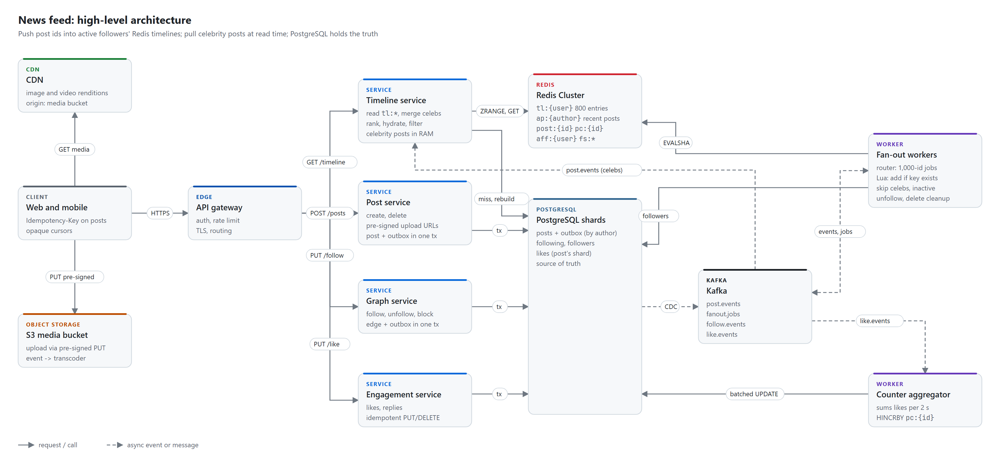
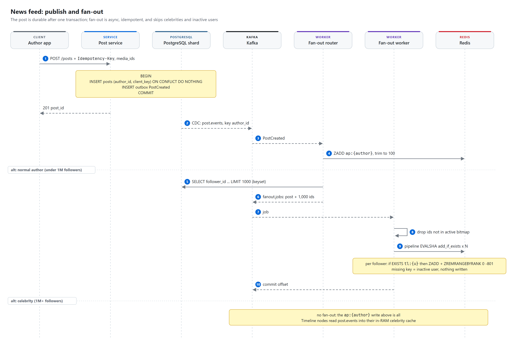
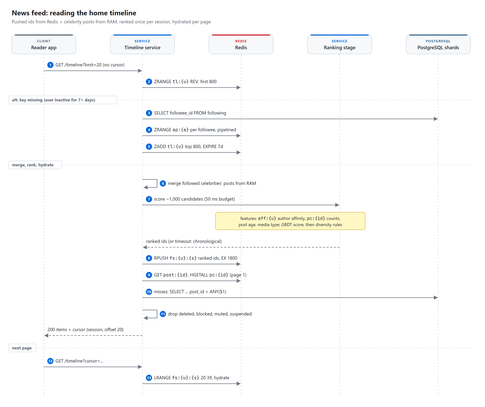

# News feed

> **When a normal author posts, workers push the post id into a capped Redis timeline (800 entries) for
> each follower who was active in the last week. Accounts with more than a million followers are not
> pushed: their recent posts sit in memory on every Timeline node and are merged in when a timeline is
> read. PostgreSQL, sharded by author, holds posts, the follow graph and likes, and is the source of
> truth. Every Redis structure can be rebuilt from it, so a lost key costs one slower read, never lost
> data.**

| Category | Difficulty | Interview length | Core problems |
|---|---|---|---|
| Social and feeds | Hard | 45-60 min | fan-out, celebrity problem, cache sizing, ranking |

**Contents:** [Requirements](#1-requirements) · [Capacity](#2-capacity-estimate) · [API](#3-api) ·
[Data model](#4-data-model) · [Architecture](#5-high-level-architecture) · [Flows](#6-request-flows) ·
[Deep dives](#7-deep-dives) · [Failures](#8-failure-cases) · [Trade-offs](#9-trade-offs) ·
[Follow-ups](#10-likely-follow-ups)

## 1. Requirements

**Functional**

- Publish a post with text and up to four images or one video.
- Read a home timeline of posts from accounts you follow, newest first or ranked, with infinite scroll.
- Follow, unfollow, block and mute accounts.
- Like and unlike a post, and see like and reply counts.
- Delete a post; it disappears from every timeline it reached.

**Non-functional**

- Home timeline: p99 under 200 ms server side for the first page, under 100 ms for later pages.
- Publish: p99 under 300 ms (media upload excluded). A normal author's post reaches followers'
  timelines within 5 s at p99. A celebrity post is visible as soon as it is committed, because it is
  read at request time.
- Availability: 99.99% for reading, 99.95% for writing. Reading degrades (staler, chronological, fewer
  items) before it fails.
- Consistency: a post, a follow and a like are durable once acknowledged. Timelines are eventually
  consistent within seconds. Authors always see their own post at once (read-your-writes).
- Deletes and blocks: the content stops rendering within seconds, even if ids are still cached.
- Counters may lag by a few seconds; they must never drift permanently.

**Out of scope**

- Ads, search, direct messages, push notifications, comment threads, moderation models, and the
  multi-region story (one follow-up at the end).

**Scale (estimates)**

- 300M DAU, ~600M MAU, ~1.5B registered accounts.
- 500M posts/day, ~20% with media.
- Average user follows ~200 accounts. The follower count has a long tail: ~50K accounts have more than
  1M followers, the largest have 50M+.
- Each DAU loads ~20 timeline pages a day. Read:write at the request level is ~12:1, but every post
  turns into ~100 timeline writes, so the system is write-heavy underneath.

## 2. Capacity estimate

| Quantity | Arithmetic | Result | So what |
|---|---|---|---|
| Post writes | 500M / 86,400 s | ~5.8K/s avg, ~17K/s peak (3x) | ~130/s per PostgreSQL shard at peak; posts are not the hard part |
| Timeline reads | 300M x 20 / 86,400 s | ~70K/s avg, ~200K/s peak | the read must be one Redis call plus hydration |
| Fan-out per post | ~200 followers x 50% active in 7 days | ~100 timeline writes | inactive users are skipped |
| Fan-out writes (hybrid) | 500M x 100 / 86,400 s | ~580K/s avg, ~1.7M/s peak | ~20K Lua calls/s per Redis primary across ~90 primaries |
| If celebrities were pushed too | 50K accounts x 5 posts/day x 1.5M active followers | +375B writes/day (7.5x everything else) | celebrities are pulled, not pushed |
| Pure fan-out on read | 200K reads/s x 200 followees | 40M author lookups/s | rejected, see 7.1 |
| One timeline entry | 16 B member + 8 B score + listpack overhead | ~28 B | ids only, never post bodies |
| One timeline | 800 x 28 B | ~22 KB | |
| Timeline cache | ~400M users active in 7 days x 22 KB | ~9 TB | ~90 primaries of 100 GB, plus one replica each |
| Celebrity recent posts | 50K accounts x 100 posts x 24 B | ~120 MB | fits in RAM on every Timeline node |
| Post rows | 500M x ~600 B (row + indexes) | ~300 GB/day, ~110 TB/year | sharded PostgreSQL, 128 primaries to start |
| Post cache (48 h) | ~1B posts x ~700 B | ~700 GB | almost every timeline item is recent |
| Hydration | 200K pages/s x 20 posts | 4M post reads/s | node-local LRU in front of Redis for viral posts |
| Media | 100M media posts x ~500 KB renditions | ~50 TB/day into S3 | CDN carries the egress, never our servers |
| Likes | ~5B/day / 86,400 s | ~58K/s avg, ~175K/s peak | row per like, counts batched |
| Follow graph | ~100B edges x 2 copies x ~40 B | ~8 TB | two adjacency tables, no graph database |

The line that drives the design is the fan-out row. Normal authors cost 50B small writes a day, which
a Redis cluster absorbs. Pushing celebrities would add 375B more, concentrated in bursts of tens of
millions per post. That is the whole case for the hybrid.

## 3. API

```http
POST /v1/media/uploads
{ "kind": "image", "content_type": "image/jpeg", "bytes": 2483112 }
-> 201 { "media_id": "m_7f3a...", "upload_url": "https://media-bucket.s3...&X-Amz-Signature=...",
         "expires_in": 900 }

PUT <upload_url>            (client to S3 directly, body = file bytes)

POST /v1/posts              Idempotency-Key: 6c1e0c1a-...
{ "body": "Ship it.", "media_ids": ["m_7f3a..."], "visibility": "public" }
-> 201 { "post_id": "7364459832168493057", "created_at": "2026-10-26T09:14:03.211Z" }
-> 409 { "error": "media_not_ready", "media_ids": ["m_7f3a..."] }

DELETE /v1/posts/{post_id}
-> 204

GET /v1/timeline?limit=20&mode=ranked            (mode=latest for strict chronological)
-> 200 { "items": [ { "post": {...}, "author": {...}, "counts": { "likes": 1204, "replies": 31 },
                      "viewer_liked": false } ],
         "next_cursor": "eyJzIjoiYTFiMiIsIm8iOjIwfQ", "new_since_session": 0 }

GET /v1/timeline?limit=20&cursor=eyJzIjoiYTFiMiIsIm8iOjIwfQ

PUT    /v1/users/{user_id}/follow   -> 204
DELETE /v1/users/{user_id}/follow   -> 204
PUT    /v1/posts/{post_id}/like     -> 204
DELETE /v1/posts/{post_id}/like     -> 204
```

- `POST /posts` is idempotent through `UNIQUE (author_id, client_key)`: a retry with the same key
  returns the original post instead of creating a second one.
- Follow and like use `PUT`/`DELETE` on a resource, so they are naturally idempotent. A double tap
  is one row, not two.
- The cursor is opaque. In `latest` mode it encodes `(created_at_ms, post_id)` of the last item; in
  `ranked` mode it encodes `(session_id, offset)`. Clients never see offsets into a list that moves.
- `POST /posts` rejects media that the transcoder has not marked `READY`, so a post never fans out
  with a broken image.

## 4. Data model

PostgreSQL is the source of truth. Posts live on the shard of their author. The post id carries the
shard, so a lookup by id needs no directory:

```text
post_id (64 bits) = 41 bits ms since custom epoch | 13 bits logical shard | 10 bits sequence
logical shard     = hash(author_id) % 8192        (8,192 logical shards on 128 physical primaries)
```

This is the scheme Instagram described for its sharded PostgreSQL. Ids sort by time, a client can
derive the shard from the id, and moving a logical shard to a new host is a copy plus a routing change.

```sql
-- Sharded by author (logical shard in post_id)
CREATE TABLE posts (
    post_id      bigint      PRIMARY KEY,           -- generated in-shard from a sequence
    author_id    bigint      NOT NULL,
    client_key   uuid        NOT NULL,              -- Idempotency-Key from the client
    body         text        NOT NULL CHECK (char_length(body) <= 2000),
    media        jsonb       NOT NULL DEFAULT '[]', -- [{media_id, kind, w, h, renditions}]
    visibility   smallint    NOT NULL DEFAULT 0,    -- 0 public, 1 followers only
    like_count   bigint      NOT NULL DEFAULT 0 CHECK (like_count >= 0),
    reply_count  bigint      NOT NULL DEFAULT 0 CHECK (reply_count >= 0),
    created_at   timestamptz NOT NULL DEFAULT now(),
    deleted_at   timestamptz,                       -- tombstone, row kept for 30 days
    UNIQUE (author_id, client_key)
);
CREATE INDEX posts_author_recent ON posts (author_id, created_at DESC)
    WHERE deleted_at IS NULL;

CREATE TABLE outbox (                               -- read by Debezium, pruned after 24 h
    id           bigserial   PRIMARY KEY,
    kafka_key    bigint      NOT NULL,              -- author_id for post.events
    event_type   text        NOT NULL,              -- PostCreated, PostDeleted
    payload      jsonb       NOT NULL,
    created_at   timestamptz NOT NULL DEFAULT now()
);

-- The graph, stored twice: once on the follower's shard, once on the followee's shard
CREATE TABLE following (                            -- sharded by follower_id: "who do I follow"
    follower_id  bigint      NOT NULL,
    followee_id  bigint      NOT NULL,
    created_at   timestamptz NOT NULL DEFAULT now(),
    PRIMARY KEY (follower_id, followee_id)
);

CREATE TABLE followers (                            -- sharded by followee_id: "who follows me"
    followee_id  bigint      NOT NULL,
    follower_id  bigint      NOT NULL,
    created_at   timestamptz NOT NULL,
    PRIMARY KEY (followee_id, follower_id)          -- keyset pages for fan-out, index-only scan
);

CREATE TABLE user_stats (                           -- sharded by user_id
    user_id         bigint      PRIMARY KEY,
    follower_count  bigint      NOT NULL DEFAULT 0,
    following_count bigint      NOT NULL DEFAULT 0,
    is_celebrity    boolean     NOT NULL DEFAULT false, -- in at 1M followers, out at 800K
    state           smallint    NOT NULL DEFAULT 0,     -- 0 active, 1 private, 2 suspended, 3 deleted
    last_active_at  timestamptz NOT NULL DEFAULT now()
);

CREATE TABLE blocks (                               -- sharded by blocker_id; mutes look the same
    blocker_id   bigint      NOT NULL,
    blocked_id   bigint      NOT NULL,
    created_at   timestamptz NOT NULL DEFAULT now(),
    PRIMARY KEY (blocker_id, blocked_id)
);

-- Routed by the logical shard inside post_id, so a like sits next to its post
CREATE TABLE likes (
    post_id      bigint      NOT NULL,
    user_id      bigint      NOT NULL,
    created_at   timestamptz NOT NULL DEFAULT now(),
    PRIMARY KEY (post_id, user_id)                  -- one like per user per post
);
-- A reverse copy, user_likes (user_id, post_id), on the viewer's shard answers "did I like these 20?"
```

Graph edges are written on the follower's shard in one transaction with an outbox row. A consumer of
`follow.events` writes the reverse edge in `followers` and adjusts `user_stats`. The reverse table is
eventually consistent by a second or two, which only delays the first fan-out to a new follower.

**Redis keys**

| Key | Value | TTL | Purpose |
|---|---|---|---|
| `tl:{user_id}` | ZSET, member = 16 bytes (post_id, author_id), score = created_at ms; at most 800 | 7 days, refreshed on read only | home timeline candidates for normal authors |
| `ap:{author_id}` | ZSET of the author's last 100 post ids by time | 30 days | timeline rebuild, celebrity source, profile page |
| `post:{post_id}` | serialized post: body, media, author, visibility, deleted flag | 48 h | hydration |
| `pc:{post_id}` | HASH `likes`, `replies`, `reposts` | 48 h | displayed counts, ranking features |
| `aff:{user_id}` | HASH author_id -> affinity score, top 500 authors | 2 days, rebuilt nightly | ranking feature |
| `fs:{user_id}:{session}` | LIST of ranked post ids for one feed session | 30 min | stable pagination in ranked mode |
| `hide:{user_id}` | SET of blocked and muted author ids | 1 day | read-time filter |

`tl:*` keys are listpack-encoded ZSETs (`zset-max-listpack-entries 1024`), which keeps an 800-entry
timeline at ~22 KB instead of ~60 KB as a skiplist. The score is the timestamp, not the post id,
because a 64-bit id does not fit exactly in a double. `maxmemory-policy volatile-lru` is the safety
net; an evicted key is a rebuild, not an error.

What if Redis loses keys:

- `tl:*`: the next read finds no key and rebuilds it (deep dive 7.2). Losing a whole shard is a burst
  of rebuilds, throttled, with a degraded feed served meanwhile.
- `ap:*`: rebuilt from `posts_author_recent` on the author's shard, one index range scan.
- `post:*` and `pc:*`: read-through from PostgreSQL. Counts come from `posts.like_count`, which the
  aggregator updates from the same windows it writes to Redis, so nothing is lost.
- `aff:*`: ranking falls back to recency-only scores until the nightly job runs again.
- `fs:*`: the user's next page starts a new session at the top. Annoying, harmless.
- `hide:*`: reloaded from `blocks` on the viewer's shard. Until then the read path checks the table.

**Kafka topics** (partitioned by entity id)

| Topic | Key | Producer | Consumers |
|---|---|---|---|
| `post.events` | author_id | Debezium on `outbox` (Post service) | fan-out router, Timeline nodes (celebrity cache), search indexer |
| `fanout.jobs` | post_id + batch number | fan-out router | fan-out workers |
| `follow.events` | follower_id | Debezium on `outbox` (Graph service) | reverse-edge writer, timeline backfill and cleanup, affinity job |
| `like.events` | post_id | Debezium on `outbox` (Engagement service) | counter aggregator, `user_likes` writer, affinity job |
| `media.events` | media_id | transcoder | Post service (marks media `READY`) |

Keying `post.events` by author keeps create and delete of one post in order. `fanout.jobs` is keyed by
post plus batch so the hundreds of batches of a big author spread over all partitions instead of one.

## 5. High-level architecture

<picture>
  <source media="(prefers-color-scheme: dark)" srcset="diagrams/architecture-dark.png">
  
</picture>

- **Timeline service** owns the read path: read `tl:{u}`, merge celebrity posts, rank, hydrate,
  filter. It keeps the recent posts of all ~50K celebrities in process memory, fed by `post.events`.
- **Post service** writes the post and an outbox row in one transaction, issues pre-signed upload
  URLs, and handles deletes. It never talks to Kafka directly; the outbox plus CDC means no event is
  lost and no event exists for a rolled-back post.
- **Graph service** owns follows, blocks and mutes. Same outbox pattern.
- **Engagement service** owns likes and replies. It writes rows, not counters.
- **Fan-out workers** are two roles in one deployment. The router reads `post.events`, decides push or
  pull, pages through `followers` and emits jobs of 1,000 ids. Workers apply jobs to Redis. They also
  handle cleanup jobs for unfollows, blocks and deletes.
- **Counter aggregator** sums `like.events` per post over 2 s windows and applies one `HINCRBY` and one
  `UPDATE` per post per window.
- **S3 and the CDN** carry all media bytes. Our services only sign URLs and store media ids.

## 6. Request flows

### 6.1 Upload media and publish

1. Client calls `POST /media/uploads`. Post service creates a `media_id`, returns a pre-signed S3 PUT
   URL valid for 15 minutes, scoped to one key and one content length.
2. Client uploads the file straight to S3. The S3 event triggers the transcoder, which writes
   renditions (thumbnail, 640, 1080, HLS for video) and publishes `media.events` `READY`.
3. Client calls `POST /posts` with `Idempotency-Key` and the media ids. Post service checks media
   state, then in one transaction inserts the post (`ON CONFLICT (author_id, client_key) DO NOTHING`,
   returning the existing row on a retry) and the `PostCreated` outbox row.
4. Response `201` with the post id. The client inserts the post at the top of the author's own feed
   locally; the Timeline service also merges `ap:{self}` on read, so a refresh shows it too.

### 6.2 Fan-out

<picture>
  <source media="(prefers-color-scheme: dark)" srcset="diagrams/publish-fanout-dark.png">
  
</picture>

1. Debezium reads the outbox row from the WAL and publishes `PostCreated` to `post.events`.
2. The router writes `ap:{author}` (ZADD, trim to 100). Every author gets this, celebrity or not.
3. If the author is a celebrity, stop. Timeline nodes consume the same event into their memory.
4. Otherwise the router pages `followers` by keyset (`WHERE followee_id = $1 AND follower_id > $2
   ORDER BY follower_id LIMIT 1000`) and emits one `fanout.jobs` message per page.
5. A worker drops ids that are not in its in-memory active-user bitmap (1.5B bits = ~190 MB, refreshed
   every 5 minutes), then pipelines one `EVALSHA` per remaining follower: add if the timeline exists,
   trim to 800.
6. The worker commits its offset after the pipeline returns. A crash replays the job; `ZADD` with the
   same member and score is a no-op, so replays never duplicate entries.

### 6.3 Read the home timeline

<picture>
  <source media="(prefers-color-scheme: dark)" srcset="diagrams/read-timeline-dark.png">
  
</picture>

1. `ZRANGE tl:{u} +inf -inf BYSCORE REV LIMIT 0 800`, then `EXPIRE tl:{u} 7d`. Only reads refresh the
   TTL; fan-out never does, so an account nobody opens expires even if its followees post all day.
2. Missing key: rebuild (7.2), then continue.
3. Merge in posts from the celebrities this user follows, taken from process memory. The list of
   followed celebrities comes from `following` joined with the in-memory celebrity set, cached per user.
4. Rank (7.4), or sort by time in `latest` mode. Store the ordered ids in `fs:{u}:{s}` for 30 minutes.
5. Hydrate the first 20: node-local LRU, then pipelined `GET post:{id}` and `HGETALL pc:{id}` grouped by Redis shard, then PostgreSQL for misses, grouped
   by shard and sent in parallel.
6. Drop tombstoned posts, authors in `hide:{u}`, and authors whose state is suspended or deleted. Pull
   a few extra ids to refill the page if anything was dropped.
7. Return the page and a cursor. Later pages slice `fs:{u}:{s}` and hydrate; no re-ranking, so items
   never jump between pages.

Latency budget at p99: Redis read 3 ms, merge 1 ms, ranking 50 ms (hard timeout), hydration 15 ms with
misses, filtering 1 ms. ~70 ms plus network, well inside 200 ms.

### 6.4 Follow and unfollow

1. `PUT /users/{id}/follow`: insert into `following` and the outbox in one transaction.
2. `follow.events` consumers write the `followers` edge, bump `user_stats`, and backfill: copy the
   followee's last 20 posts from `ap:{followee}` into `tl:{follower}` so the new follow shows up at once.
3. Unfollow: delete the edge, then a cleanup job scans `tl:{follower}` (800 members, each carries its
   author id) and `ZREM`s that author's entries. 800 members is a single-digit-millisecond scan.

### 6.5 Like

1. `PUT /posts/{id}/like`: `INSERT INTO likes ... ON CONFLICT DO NOTHING` plus an outbox row, but only
   if a row was inserted. A second tap writes nothing and emits nothing.
2. The aggregator consumes `like.events` by post id, sums `+1`/`-1` over 2 s, then runs
   `HINCRBY pc:{id} likes <delta>` and `UPDATE posts SET like_count = like_count + $delta`.
3. A viral post with 50K likes per second becomes one Redis call and one row update every 2 s.

### 6.6 Delete a post

1. Set `deleted_at`, write a `PostDeleted` outbox row, and overwrite `post:{id}` with a tombstone in
   the same request. From this moment hydration drops the post everywhere.
2. The router sends cleanup jobs to the same followers (`ZREM` from their timelines) and removes it
   from `ap:{author}`. Timeline nodes evict it from the celebrity cache.
3. The cleanup is tidiness, not correctness. Hydration is the guarantee.

## 7. Deep dives

### 7.1 Fan-out strategy

**Fan-out on write (push).** Do the work when a post is created: write its id into every follower's
timeline. Reads become one Redis call. The cost scales with followers per post: ~100 active followers
on average is ~580K writes/s, which ~90 Redis primaries absorb at ~20K Lua calls/s each at peak. The
problem is the tail. A 50M-follower account has ~25M active followers; one post is 25M writes and
~700 MB of timeline memory. A fan-out fleet sized for ~2M writes/s spends 12 s on that single post,
and a few celebrities posting during a live event stall everyone else's posts behind them.

**Fan-out on read (pull).** Store nothing per reader. At read time, fetch recent posts from each of
~200 followees and merge. Writes are free; reads cost 200K x 200 = 40M author lookups/s at peak. The
worse problem is tail latency: if 1% of lookups are slower than 50 ms, a request that waits for 200 of
them hits at least one slow call with probability `1 - 0.99^200 = 87%`. The p99 target is gone.

**Hybrid (chosen).** Push for every author under the threshold, pull for the ~50K above it.
Reads get one Redis call plus a merge of ~20 celebrity lists, which is fast because those lists are
already in process memory. Writes skip exactly the authors that would have dominated them.

What the hybrid costs:

- Two code paths, and the read path must merge and de-duplicate (a post can be in both places when an
  author crosses the threshold; merge by post id).
- The threshold needs hysteresis (in at 1M, out at 800K) so an account at 999,950 followers does not
  flip every hour.
- A user who follows 2,000 celebrities makes a slow merge. Cap the pull side at the 300 celebrities
  with the highest affinity for that user; nobody reads 2,000 celebrity feeds anyway.

Two refinements that pay off:

- **Skip inactive followers** on the write side. Half the follower lists are people who have not opened
  the app in a week. Not writing for them halves the write load and is the reason the cache is ~9 TB
  instead of ~33 TB.
- **Split big fan-outs** into 1,000-id jobs keyed by post and batch, so a 900K-follower author fans out
  across every partition in parallel and finishes in about a second.

### 7.2 Timeline cache sizing and rebuild

Why 800 entries: a user scrolls ~20 pages of 20 items at most in a session, and ranking wants a pool a
few times bigger than what is shown. 800 covers several days for a typical user. Older items come from
a slower path (rebuild-style query) that almost nobody triggers.

Why ids, not posts: one viral post sits in millions of timelines. Copying its body would multiply
memory by ~25 and turn every edit or delete into a fan-out. Ids keep timelines small; hydration reads
each post once from the shared post cache.

The add-if-exists script is the activity gate. A missing key means "this user is not active", so
fan-out writes nothing:

```lua
-- KEYS[1] = tl:{follower}   ARGV[1] = 16-byte member (post_id, author_id)   ARGV[2] = created_at ms
if redis.call('EXISTS', KEYS[1]) == 1 then
  redis.call('ZADD', KEYS[1], ARGV[2], ARGV[1])
  redis.call('ZREMRANGEBYRANK', KEYS[1], 0, -801)
  return 1
end
return 0
```

**Rebuild on login.** When a read finds no key:

1. Read the user's followees from `following` (one query on the viewer's shard, ~200 rows).
2. Drop celebrities; they come from memory anyway.
3. Pipeline `ZRANGE ap:{a} 0 49 REV` for the remaining followees, grouped by Redis shard. A missing
   `ap:` key falls back to `posts_author_recent` on the author's shard.
4. K-way merge by timestamp, take 800, write `tl:{u}` with one `ZADD` and set the 7-day TTL.

This takes 30-60 ms, mostly Redis round trips. Returning users are ~15M a day (~175/s), so it is cheap
in steady state. The danger is a storm: losing a Redis shard (~1% of users) or a mass return after an
outage. Each Timeline node gets a rebuild token bucket. Over budget, the node serves a degraded first
page (merge of `ap:` for the user's top 50 followees by affinity, not stored) and rebuilds in the
background.

Sizing knobs if ~9 TB is too much: cap at 500 entries (-38%), shorten the activity window to 3 days,
or drop the author id from the member (8-byte members) and filter unfollows at read time instead.

### 7.3 The celebrity problem

Three different things go wrong with very large accounts, and the design answers each:

- **Write amplification.** 25M timeline writes per post. Answer: never push them.
- **Hot keys on read.** If celebrity posts were read from `ap:{celeb}` in Redis, a 50M-follower account
  would see ~1M reads/s on one key, on one shard. Answer: every Timeline node holds all celebrity recent
  posts in memory (~120 MB), filled from `post.events`. A node reads its own RAM; Redis never sees it.
- **Hot posts in hydration.** A celebrity post appears in tens of millions of pages. `post:{id}` and
  `pc:{id}` for it become hot keys. Answer: a node-local LRU with a 2 s TTL in front of Redis for posts
  from the celebrity set. 2 s staleness on a like count is invisible.

Crossing the threshold: when an author passes 1M followers the flag flips in `user_stats` and the
router reloads its celebrity set (every minute). Posts already pushed stay in timelines and age out;
new posts are pulled. The merge de-duplicates by post id, so a post that ended up in both is shown
once. Dropping below 800K flips back to push; the next posts fan out normally.

A middle case: an account with 2M followers of whom only 5% are active. Its active fan-out is 100K,
which is cheap. A smarter threshold uses active followers, not total followers. Start with the simple
rule; switch when the numbers show it.

### 7.4 Ranking pipeline

**Version 1: chronological.** Sort candidates by timestamp. It is predictable, needs no features, and
is the fallback for every ranking failure. Ship this first and keep `mode=latest` forever.

**Version 2: scored**, run once per feed session (first page or pull-to-refresh), ~50K/s at peak:

1. **Candidates.** Up to 800 from `tl:{u}`, up to 300 from followed celebrities, last 72 h only.
2. **Filter.** Drop seen-recently (a small per-session bloom filter), blocked, muted, deleted.
3. **Features.** Per candidate: author affinity from `aff:{u}`, like and reply counts from `pc:{id}`,
   age, media type, the author's recent engagement rate. Counts come mostly from the node-local cache;
   popular posts appear in many feeds, so hit rates are high.
4. **Score.** A gradient-boosted tree model predicts the probability of engagement. ~1,000 candidates
   score in ~10 ms on CPU. Hard timeout 50 ms, then fall back to chronological.
5. **Rerank.** At most two posts in a row from the same author, a freshness boost for the last hour,
   own posts pinned near the top after posting.
6. **Store** the ordered ids in `fs:{u}:{s}`. Later pages slice this list.

The affinity table is a nightly batch job over engagement events (likes, replies, profile visits,
dwell time) that writes `aff:{u}` for the top 500 authors per user. Online events adjust nothing in
real time in this version; a streaming update is a later improvement.

New posts during a session do not reshuffle what the user is reading. The client shows "N new posts";
tapping it starts a new session.

Model changes ship behind an experiment flag per user bucket, judged on long-term metrics (sessions per
day, 7-day retention), not just clicks on the next page.

### 7.5 Deletes, blocks and privacy changes

The rule: **timelines may hold stale ids; hydration decides what renders.** Every read already loads
the post and the author, so the checks cost nothing extra.

| Change | Synchronous step | Async cleanup | Read-time guard |
|---|---|---|---|
| Post deleted | `deleted_at` set, `post:{id}` tombstoned | `ZREM` from followers' timelines, `ap:` and RAM | tombstone dropped at hydration |
| Unfollow | edge deleted | `ZREM` author's entries from `tl:{u}` | none needed after cleanup; until then a few old posts may show |
| Block | edge and both follows deleted, `hide:{u}` updated | same as unfollow, both directions | `hide:{u}` filter, immediate |
| Account set to private | `user_stats.state` updated | none: only followers had the posts | non-followers never had them in their timelines |
| Account suspended or deleted | `state` updated, author cache invalidated | posts tombstoned in batches | author state checked at hydration |

One race is worth naming: a delete can reach a worker before the last fan-out batch of the same post,
and the late batch re-adds the id. It does no harm, because the tombstone filter drops it at read time.

## 8. Failure cases

| Failure | Effect | Recovery |
|---|---|---|
| Fan-out worker crashes mid-job | some followers miss the post briefly | Kafka redelivers the job; `ZADD` is idempotent, no duplicates |
| Fan-out lag (viral hour, deploy) | posts reach timelines late; authors still see their own | lag alert at 5 s, autoscale workers on consumer lag; publishing is unaffected |
| Redis timeline shard lost | ~1% of users have no `tl:` key | rebuild on read, token-bucket throttled; degraded feed from `ap:` meanwhile |
| Whole Redis cluster down | no pushed timelines | read path serves the celebrity merge plus `ap:` for top followees; slow but not blank |
| PostgreSQL shard primary down | authors on that shard cannot post; cached reads fine | Patroni failover ~30 s; clients retry with the same Idempotency-Key |
| Debezium stopped | posts saved but not fanned out | it resumes from its WAL position; alert on oldest outbox row age |
| Ranking stage slow or down | ranked mode cannot meet budget | 50 ms timeout, return chronological order |
| Celebrity cache on a node is cold (restart) | celebrity posts missing from feeds on that node | node warms from `ap:{celeb}` for the celebrity set before taking traffic |
| Delete races fan-out | deleted id re-added to some timelines | tombstone filter at hydration |
| Counter aggregator lag | like counts stale | counts catch up from Kafka; PostgreSQL rows are the truth |
| Transcoder fails | media never `READY` | post creation returns 409; client retries the upload |
| Pre-signed URL leaked | someone uploads to that one key | URL is single-key, size-bound and expires in 15 minutes; unreferenced media is deleted after 24 h |

## 9. Trade-offs

| Decision | Chosen | Rejected | Why |
|---|---|---|---|
| Fan-out | hybrid: push normal, pull celebrities | pure push; pure pull | push breaks on 50M followers, pull breaks p99 (7.1) |
| Timeline content | post ids + author id | full post copies | ~25x less memory; deletes and edits stay one write |
| Timeline scope | users active in last 7 days | everyone | ~9 TB instead of ~33 TB; rebuild is cheap |
| Timeline encoding | listpack ZSET, score = timestamp | LIST; skiplist ZSET | ZSET gives score-range cursors; listpack keeps it ~22 KB |
| Post store | PostgreSQL sharded by author | Cassandra | per-shard write load is tiny, outbox in the same tx, unique keys for idempotency. Cassandra wins once storage growth makes resharding the main cost; the access pattern (by author, by id) moves over unchanged |
| Shard routing | logical shard bits in post_id | directory lookup | no extra hop, ids stay time-sortable |
| Graph store | two adjacency tables in PostgreSQL | graph database | we only ever need one hop in each direction |
| Celebrity posts on read | in process memory on Timeline nodes | Redis `ap:` key | 120 MB fits everywhere, removes the hottest keys |
| Counters | Redis + 2 s batched UPDATE | UPDATE per like | one row per window instead of 50K/s on one row |
| Pagination | opaque cursor (time or session offset) | offset | the list changes under the reader |
| Ranking | score a cached candidate pool once per session | rank the whole graph per request | bounded cost, stable pages |

## 10. Likely follow-ups

- **Why not push to everyone and just buy more Redis?** Memory is the smaller problem. The real
  problem is time: one 50M-follower post is 25M writes that block the queue for everyone behind it.
- **How does the author see their own post instantly if fan-out is async?** The client inserts it
  locally, and the Timeline service merges `ap:{self}` on every read.
- **How do reposts work?** A repost is a post with a `repost_of` id. It fans out like any post; the
  ranker de-duplicates so the original and three reposts of it show once, with "reposted by" names.
- **What about edits?** Timelines hold ids, so an edit is one update to the post row and one cache
  delete. Nothing fans out.
- **How would you show "N new posts" without polling hard?** The client polls a cheap endpoint every
  60 s that compares the top score in `tl:{u}` and the celebrity set against the session start time.
  A long-lived connection is not worth it for a count.
- **A user follows 5,000 accounts. Does anything break?** Fan-out does not care. Rebuild reads 5,000
  `ap:` keys, which is slow, so rebuild caps at the top 1,000 followees by affinity.
- **How do you go multi-region?** Each region keeps its own Redis timelines and Timeline nodes, built
  from a replicated `post.events` stream. PostgreSQL shards have a home region per user; writes go
  there. Timelines in other regions lag by the replication delay, which a feed tolerates.
- **How do you delete an account for GDPR?** Tombstone the user, hide at read time immediately, then a
  batch job deletes posts, likes and edges shard by shard and removes media from S3. Caches expire on
  their own within 48 h.
- **What if ranking makes the feed worse?** `mode=latest` always exists, every model ships behind an
  experiment, and the fallback path is the same chronological code that runs on every timeout.

## Phrases worth using

- "Timelines are a cache of ids. The truth is posts plus the graph, and I can rebuild any timeline from
  those."
- "Push for the many, pull for the few. The threshold is about fan-out time, not fame."
- "A missing timeline key means inactive: fan-out skips it, and login rebuilds it."
- "Stale ids are fine because hydration decides what renders."
- "Counters are a stream, not a row: sum in a window, write once."
